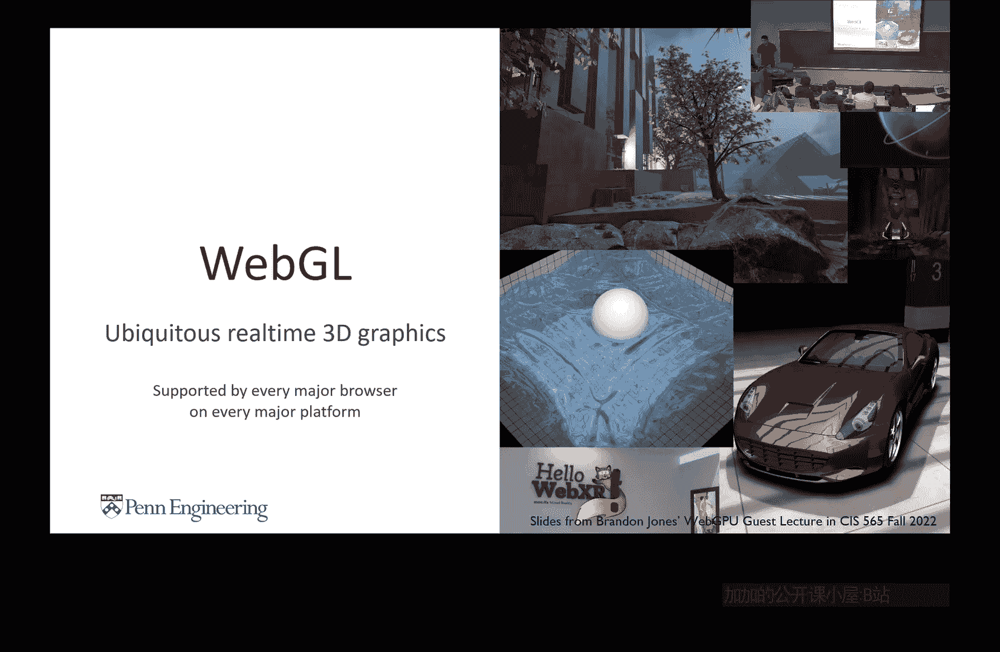
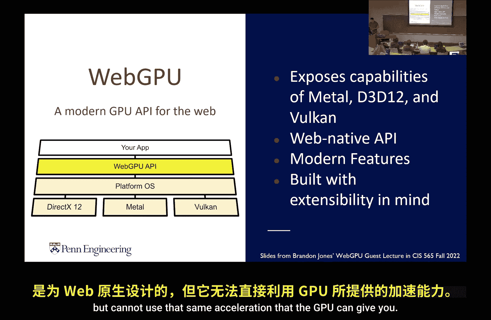
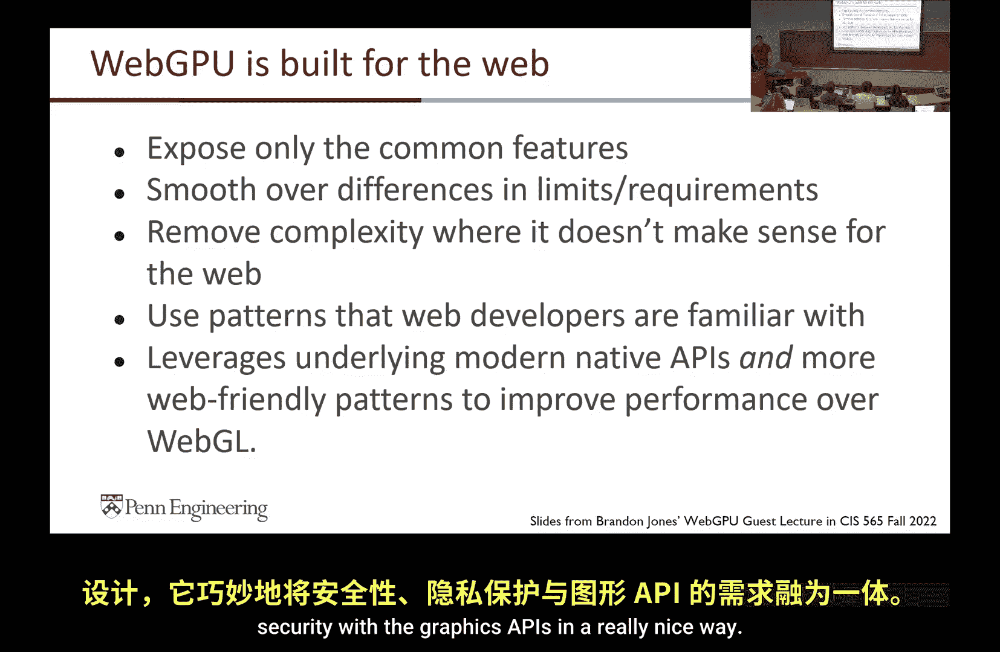
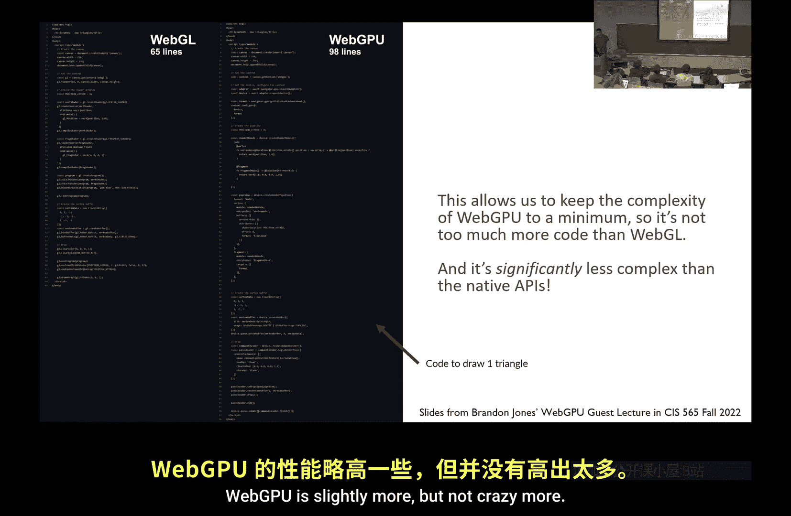
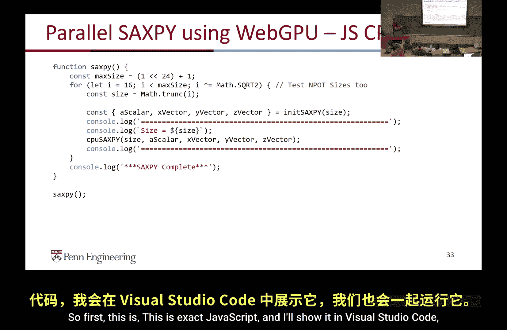

# 宾夕法尼亚大学【中英⚡GPU编程｜CIS5650 2024 GPU Programming】 p14 P14 2024-10-09 - Lecture 7 Introduction to WebGPU -BV1JeMnzFEWv_p14-

。All right， let's get started。All of you or most of all of you， I suppose， will would have。

Done some of form of graphics API。Open G， welcome， web GL， etc。嗯。The key thing。

 and now you've learned Quda， right？The key difference between those APIs and Kuda is that。

Kuda is computed first。Right you can start main， you can launch a kernel， you can exit。

 you don't have to do anything extra， whereas in the graphics API， even if you wanted to do GP GPU。

 general purpose， GPU compute， you have to launch a frame buffer。

 you have to use the raization pipeline， you have to use the shaders。

So that's a big difference in a way。Where GPU， I think kind of bridges that where it can be both depending on how you want to use it project4。

 you'll be using a lot of the graphic side of it。But you can also use the compute for those of you especially interested in things like client side machine learning inference using GPUs and don't want to rely on Kuda and the user having an Nvidia GPU web GPU can be a fantastic option because it gives you that so what well do today。

I will kind of revisit。😊，The first two lectures。That we had in Kuda。

But we look at it from a web GPU admin。Right。So。So let's do that。

 let's see how an API like web GPU which evolved from graphics APIs can really be used for compute as well。

All right。

So I have a few slides here that are kind of borrowed from Brandon slides from two years ago。

 but also from Kai's slide on Monday。I can kind of skip that。

 but let me know if you guys have any questions from Kai's guest lecture and I'll be happy to cover。

 but otherwise you we can breeze through them and I can get into the meat of the lecture and actually doing things hands on to show you guys how things evolve。

Okay， so WebGL real time graphics， we saw this， the history， if anybody has a question。

 please raise your hand。

The evolution of graphicfis， how webGL came up to be how WebGL is not sufficient this is kind of a new slide I think this may not have been there so this is kind of how web GPU sits within the stack where you have your app then you have web GP API you have the OS and then you have multiple backends for web GPU so this is where you can have web GPU as a platform agnostic API that's web native first but cannot use that same acceleration that the GPU can give you。

U。Lots of new features， again， Kai discussed this last week。S you the demos as well。

 and we also discussed why not have welcome， we saw this base code。Always fun to see that。

I think this we saw as well， and then the fact that web GPU is built for the web it blends that those requirements of safety。

 privacy security with the graphics APIs in a really nice way。

All right， there's again， a comparison of WebGL and WebGp。

 web GPP is slightly more but not crazy more， so that's always a good thing。

All right， so this is where I get started， right？So， kuda is。

You know the GP GPU platform dedicated for Nvidia。Nobody else has it。

 it's an open awesome API platform architecture because it's really all three。

But it's exclusive to Edward that is their mo sure the federal government now is trying to you know claim monopoly and stuff I don't know how far that's going to go but what they've done is awesome and they should be。

Aed for that success。But it's also limiting， it creates a closed environment where not everybody can access it。

 you don't have NVDdia GPUs on your phone， how do you take advantage of that level of compute or devices that don't have NVIDdia GPUs and can't have NviDdia GPUs really。

So that's where web GPU can come in as that graphics plus compute for the web that can be really flexible。

 WebGL isn't that flexible in terms of compute but web GPU can be and eventually once it gains more adoption。

 itll also be across all platforms and browsers。嗯。Okay， here's a comparison of KUDa and web GPU。

 I won't read it out， I think you get most of it but take the time to read it on your own as well。

All right， so at the heart of the lecture， we want to take。

SX PY and matrixtri multiply and port them to Web GPpU and see what concepts map。In the slides。

 I really have SAXPY， I may make another set of slides that will cover MAM。

 but it's essentially the same concepts。For the class well do SAXPY and depending on when you guys have to leave for the Pixar event we will try to cover some matrix multiply hands hands on and I'll try to show you some quirks of webG that you'd be like oh my god why is it this way？

All right， so let's get it。So recapping SAXPY， its an element wise operation that does z equals a times x a is a scalar。

 a times x plus y， right very common operation， but it provides us a simple way。To be like， okay。

 our kuda curl， you can pretty much imagine what the ka kernel is in your head。

 I don't even need to tell you。But taking that simplicity and how does it port to the web GPU。

 what's the overhead there， that's what we can see。All right， so here's the KudDa program， right？

So on the CPU side， you're going to create some size， you're going to create the memory。

 you're going to create the GPU memory using Qaalec， then you're going to do Q DMM copy。

You're going to run the kernel。And then you're going to copy the memory back to do whatever you want to next。

 including just check the results。Right， so it's。Iitialize。Alloccate memory， initialize the memory。

 copy the memory。Run the compute and then result right So that's kind of the flow we have in mind。

I can skip that。And then the kernel of course， is a simple one dimensional  equals block IDX times block10 dot x plus thread IDX。

 and then you do element for operations while checking the bounds。Any questions before I move on？

Everybody， like this should be something you could do in your sleep now I think。Yeah。Okay。All right。

 so we want to take this。And map it to web GPU now again。

 for those of you who've done any of the graphics APIs。Doing something like this。

 which is probably maybe maybe at best 60 lines of code。😊，Depending on how you write it。嗯。

Converting that to an open GL or VGL would really blow up the size， even though it's something very。

 very simple that you want to do。So let's see how the GPU helps us with that。All right。So。

 we want to follow a very similar flow to Kura even forward GPbu。

 this is kind of the skeleton we will have。😊，We'll set up the HTML page as the wrappper。

You could potentially like paste the code in your browser console and it will still work。

 but we'll set up the HTML page just so that it's convenient。嗯。

We'll set up the CPU code because it's the first time we are doing webTP。

 we want to check our results。Then something you don't do in Qa is。😮，Initialize。

 initialize the device and stuff that you have to do with web GPU as you do with generally other graphics APIs。

Then similar to KudDa， you're going to copy the memory to the GPU。

 you'll set up the compute shader pipeline， which is kind of like setting up the kernel。

 you'll execute the shader pipeline， copy the result back and make sure that it's actually correct。

So some of these like four and 5 are completely reorderable， that's totally fine。

 we will just do it in the order because again we are coming from Qud and learning web GP so I try to want to mirror that as much as possible。

Okay。好的。Hopefully。All of you can read exactly what's going on here， there's HTML page。

Has the title has some CSS and then in the body view this is the main line the script module web GPXpyY。

js that's what we want to focus on the other two are just elements for beautification of the page。

Any questions on this？O。Then。We want to do the CPU part， okay？

So first this is exact JavaScript and I'll show it in visual Studio code and we'll run it together as well。

