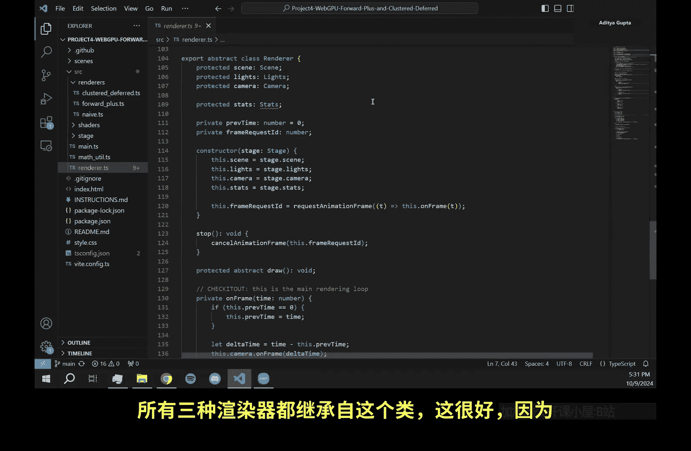

# 宾夕法尼亚大学【中英⚡GPU编程｜CIS5650 2024 GPU Programming】 p15 P15 2024-10-09 - Recitation-Project4 -BV1JeMnzFEWv_p15-

So recommend not recommend as much as it more or less required。

 I mean no JS you need for the project because as user setting it up on a local web server。

 this is all done for you so all you have to do really is download the project be like NPpM install NPpM run dev and you'll automatically have it in your browser and whenever you make a change to your files and you save them it will refresh the page automatically Next recommend browser is Google Chrome because it supports all the Web GPU extensions and whatnot that you need andvi GPU is not required for this it also has built in debugging and profiling tools and you can use extensions for more further debugging such as this one called webgPU dev tools which is kind of like render doc or webGU sort of so feel free to look around try this extension try anything else you might find and if you find something useful post on Ed to everybody else can C2。

And then for this one we recommend using visual Studio code， not visual Studio。

 it's easy to configure like alternate syntax highlighting for example。

 because it's like it says JavaScript but the project is in PpeScrri。

 but either way you can do a lot of nice syntax highlighting with VS code and you can also set up winters to catch errors and I don't know I mentioned it here or in the instructions for the project。

 but there's like a nice plugin you can download ticket syntax highlighting for WGSL。

So that's the tools that use for the project。Pally。

 I feel like I've done the basic JavaScriptscript tutorial like four times over the course of my degree this university。

But if you haven't done it， it's relatively straightforward。

 the part one of the project which makes you just go through and like fill in a couple of blanks should hopefully get you a bit more used to the environment。

With that said， part one， after that naiveix naive render is the forward plus and plus or deferred renderer。

So for forward what you do is often you can draw the seam once for each light and composite them onto a brain bufferer and the Nive code that we provide what it does is it checks every light for every fragment so you know if you have like one cu it for every single pixel in that cubit will check against every single light and you can imagine that it gets really slow especially once you have multiple like layers of things and you're checking the lights for fragments behind that are going to get overwritten eventually anyway so you're wasting a lot of work for no reason。

Forward plus optimizes checking each light by only checking the lights in the cluster that the current fragment is in。

 so we only check lights that actually affect this fragment plus or minus a little bit of wiggle root。

Right so for the naive render the project does not work when you clone it immediately and that's because we've left a couple parts for you to fill in the blanks like I said to kind of get used to how the project is laid out what you have to do is create and write to the GPU camera buffer which includes the view projection matrix you need to bind it to the pipeline and then update the shaders to actually make use of it so you know when you start off you'll hit just a black screen but once you've completed the first minor part you should get these you know fancy colorful lights it will be slow that is to be expected because the next thing you're going to do is make it a lot faster。

Any questions so far？同机换啊。The cluster themselves， they are portions of 3D space that correspond with tiles on the 2D screen。

 it involves the perspective transform， they are not bounding boxes， this is important。

 they are bounding thrust stems。Wwhich look like this and they are not aligned with the scene they are aligned with the camera so when you rotate the camera。

 the bounding thrusts will also move in world space so keep this in mind I will say though that when you check for intersections with the f it's often easier to calculate the access aligned bounding box of the thrust in view space otherwise you have to do a bunch of complicated stuff to figure out whether it even intersects or not。

 but the actual shape of the cluster is this bounding thrust here， not like a box or anything other。

Right so when you actually calculate the clusters what can do is that you have you have one compute shader that calculates the bounds of the clusters so for each one you calculate it in screen space the 2D and then you calculate the starting depth and the ending depth for this one I think I already got a question earlier that was like how do we find the max depth for that you can like try to programmatically find it from the like scene depth buffer or something but that's a lot of effort so if you want you can just hardcode it or like calculate some value based on how large the senior loading is but hard codinging is probably the easiest solution for that one。

Then you have to convert these into use space coordinates。

 which will involve adding another buffer to your camera uniforms and using that matrix for this calculation and finally store the computed bounding box of your cluster。

Then you have to have a separate task to assign lights to clusters。For this one。

 what you'll do is that。You want to keep track of how many lights are actually in this cluster up to a certain maximum。

 which you can hard code for each light you simply just check whether it intersects with the cluster's bounding box and if it does add it to the cluster and if you hit the maximum then you stop there and finally make sure you store the number of lights that are in this cluster。

This is all stuff that is also written in the shaders themselves and my comments。

 so you'll see the same comments there as well。And this is like a nice representation of what the bounding clusters actually look like in the scene。

 so you can see there's like multiple depths that bound them as well as like the 2D view from the camera to form 3D bounding thrusts for the clusters。

あ。Yeah。So you can see that like different lights with different rai will have willll be placing the different clusters depending on like where they are in the scene and how big the clusters are。

Questions on that。Yeah。But。This image， I don't remember exactly。

 but I believe it's that like that the red you know sphere wire sphere is the radius of the light in world space and then the red dots are the clusters which that light affects。

All right， moving on oh there's more yeah okay， then so that's forward plus which is still nice。

 but you still suffer from the problem of overdraw。

 which is you are drawing fragments behind that are going to get overwritten anyways later so you're wasting a lot of work for nothing。

What you can do to remedy this is use deferred shading。

 which is you draw each object in the scenem two Jeeep buffers， which include like the albedo。

 the normal， the position， stuff like that。What this means is that the initial rendering pass is really simple because all you have to do is output to a texture and later on you read from those textures to then do the final rendering。

And this means that for each there's only one fragment for each pixel as opposed to potentially multiple if you have a scene with a lot of depth。

Right， the light plus string can be pretty much exactly the same as forward plus and the way the base code is set up you can use the same exact compute shaders so once done if for the forward plus there's no need to really go and update and like I said it mitigates issue with overdraw so you have your albedo buffer your depth buffer from which you can reconstruct the row position and your surface normals and with just those three textures you can basically render the entire scene。

Right， so with that， this is more for reference for later。

 I'll just go show you in the base code itself how this is all laid out。We pull this up， oops。Okay。

 and let me make sure the screen share is correct also。That should be it。Yeah呀。嗯。Yeah okay。All right。

 so。In the base code， mainly you're going to want to look at just the source folder here。

 everything else is like boilerplate stuff or like no JS or like the web server package that we're using or whatever。

Oh， I should turn that off one second。Ho it's going。I'll just mut the volume give me one。Okay。え。

Of would be anyways， so source。This is the main entry point。

 this is where like it'll get called from your index at HTML or whatever。

You probably will not need to mess with anything in here I mean all it's really doing is like setting up web GPU loading the scene。

 adding the lights in the camera and the reason that lights and camera are two separate classes here is that it's a lot easier to reuse them between multiple vendors because like the camera logic is exactly the same for all the vendors it doesn't change at all。

It'll add like GUi for the drawing the number of lights so if you want to add more options to your GUI this is the place to do so right here it sets's up a stage and there's like a little switch statement here which switches between the three renders so you know naive is almost fully implemented you just have to add the last little bit forward plus and clustered are pretty much empty so that's up to you to figure out。

And then the renders themselves are stored under this renderers tab here。

 or I guess the base class is under the source folder， Oh it doesn't like called the。Okay。

 ignore the errors， it should work fine if you do it on yours， probably。

 although they'll detect this outwards。toOkay， so this is the base render class down here。There。

And all three of the renders extend this class， which is nice because like it has all the common stuff that you would need。

 like the scene， the lights， the camera。

