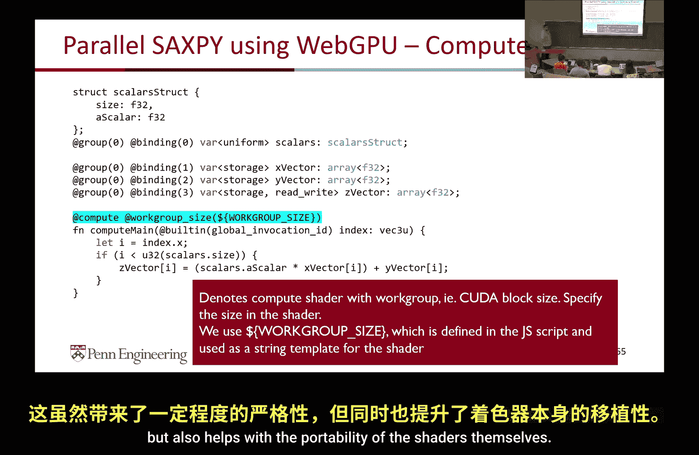

# 宾夕法尼亚大学【中英⚡GPU编程｜CIS5650 2024 GPU Programming】 p16 P16 2024-10-14 - Lecture 8 WebGPU, Advance Topics in CUDA Pt1 -BV1JeMnzFEWv_p16-

Right。Okay。啊。O。Spark from the top。

Okay。So， let's。So I'm going to kind of start with。Restar with the Web GPU SXPY function。

And now that you have a little bit more hands on， feel free to stop me again and ask any questions。

So here before this， we did the CPU SAXPY。We did in GPU here that I won't really go through I think all of you know that by now so now what we have to do is we have to take our inputs X and y cop them onto the GPU copies the。

The uniforms and then do the say XpyY， okay， using a compute trader。

So these two again I'll go slightly faster than I did on Wednesday。

 these two are examples of how you can allocate memory and then copy that memory to the GPU。

 so this is essentially if you compare to Kuda Kuda Maluk and KaM copy operations on the CPU for these buffers。

The the one thing to remember here and we will see this repeatedly is these flags like usage which really define what are the controls around that memory in KudDa we have cont for example。

 here you're going to define whether it's read write map to CPU map or whether it's map for reading or writing and so on so there's a bunch of flags that youll have to take care of。

The next。あな。So un map so mapping is and you have this in other graphics APIs as well。

 where if you want to copy memory from CPU to GP or the other way around， you have，In Kuda。

 KudaM copypy， very simply API VI just does the thing it says。In most graphics APIs。

It needs to re map。 So what you're doing is you're taking。

Memory from CPU and GPU and mapping them to each other， and then you do the copy。

So once you do the copy， you have to do the unmpped to release whatever memory that youve mapped。

 otherwise you will have a member read later。Or potentially Ill be unable to use it。原本了。Coside。是。

In this case yes， because we are copying from CPU to GPU。

 so it's going to take the host memory and create a map of that on the GPU and when you do this line here it will essentially copy that to the GPU。

Yeah。Right， so if you remember in Kuda I showed one slide many weeks ago that had the pin memory side of it。

 so you're taking host memory， putting it into pin memory and pin memory to the GPU。

That's kind of like this where youre mapping the range， you're saying， okay。

 this can be copied to the GPU and then you're actually copying it there。Other questions on this？

Okay。All right， so I've run through that for。The thing to note on the Z side is again。

 the flags here。And you have to pay particular attention to the direction flags。

For Z remember that we are not copying any memory from host to device right all the memory is going to be written on the device itself。

 what we need to do is copy the memory from device to host to actually do the error checking you know is our computation correct。

So that's why the flag is copy source， we are copying the source of the buffer from the GPU to the CPU so you have to think of it from the GPU's perspective about which flag you want to be using。

 so that's why copy source。嗯。So and then we look at uniforms as Joanna mentioned earlier these need to be4 byte aligned in my case I haven't found that to be necessary for less than four bytes。

 so I've just done two and。笨是。I guess if you're using a flow 32 array。

 it's already 4 by line no matter how many you use。So here， again。

 if you think of SAXPY on a coa kernel。What are your arguments with the colonel？It's X， Y， and z。

 and then what else？What are the two other arguments you need to pass？

Number numberumber of values and。The scale of value so you need to pass the a value and the length so that's why we have these two floats here and again compared to Kuda you can pass these y value in web GPU and other graphics APIs you need to create a buffer for them to put them onto the GPU。

Uniforms here are very similar to constant memory where they read only by all threads and write only from the CPU。

 so that's why we use the copy to destination flag because we are copying from host to the GPU remember its from the GPU's perspective and then the uniform is saying this is for as uniform buffers。

Create the value， and then we actually copy the values to the uniform buffer on the GPU。

Any questions on this？So again， think of all of these write buffer， create buffer asakuuda and copy。

For buffers think of uniforms as pass by value generally， it's not a universal road。

 but anytime you think oh how am I going to do this with Ka that you would map it to something like this on web GPU？

Other questions on this？Okay。All right so I've covered that so at this point weve kind of set up our arguments or our memories on the GPU now we are basically ready to call the shader。

So this is what our compute trade is going to look like。And there's a few differences。First。

 we set up astruct that takes on our uniform values。

 you could potentially have multiplestructs for each uniform value。However。

 that practice invent CPUU is， is。Discouraged thank you if you're passing multiple uniforms to multiple shaders and stuff then sure you can have multiplestructs。

 but in this case I just have one compute shader I have two values I'm just going to make them onestruct。

😊，This groups and bindings we will come back to in a little bit。

 but essentially what they what they are there for is。

Again in your kuda kernel you pass let's say length a X y z right there's a certain order to it and then you have to use that same order on the CPU as well if you use a different order on the CPU you' arere going to mess things up。

RightSo that's basically what's going on here， just defining the order of the parameters going into the compute shader and we'll look at how the CPU side of it uses it in a little bit。

Okay。Then you have what types of arrays they are and what kind of usage you have again this is very similar to the usage patterns you have in kernels Matt。

So， the first two。Be why that you coming up like。I believe default is read only。

 so that's why readr is defined for Z vector。Yeah， other questions？minute， this might be silly。So。

 the the。Like is there a high screen or could we do like write for me is there a reason read the I don't think that is a right only in yeah okay。

I think the answer is just that like there are optimizations for reading papers since they're notating right。

Yeah。Other questions？Okay， so that's the pipe。Then one of the major differences between KUuda and Web GPU is that。

In Web GPU。The block size isn't defined on the CPU side。The block size。

 that is a number of threads in a block is not defined on the CPU。

 it's defined inside the kernel itself， inside the shader。Okay， so this。

TheLine here is what the work anytime you see workgroup think blocks in terms of kuda。So work group。

 you have to tell what dimensions and size that shader is going to follow and all invocations of that shader will have to use the same sizes。

So that that brings some level of。Strictness to it。

 but also helps with the portability of the shaders themselves。

Okay。