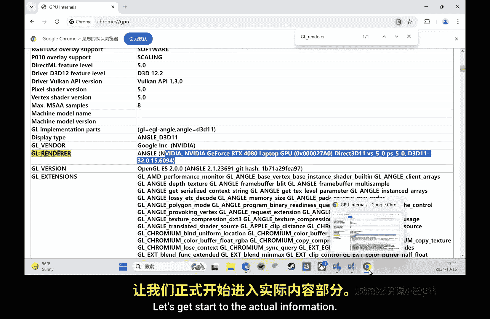
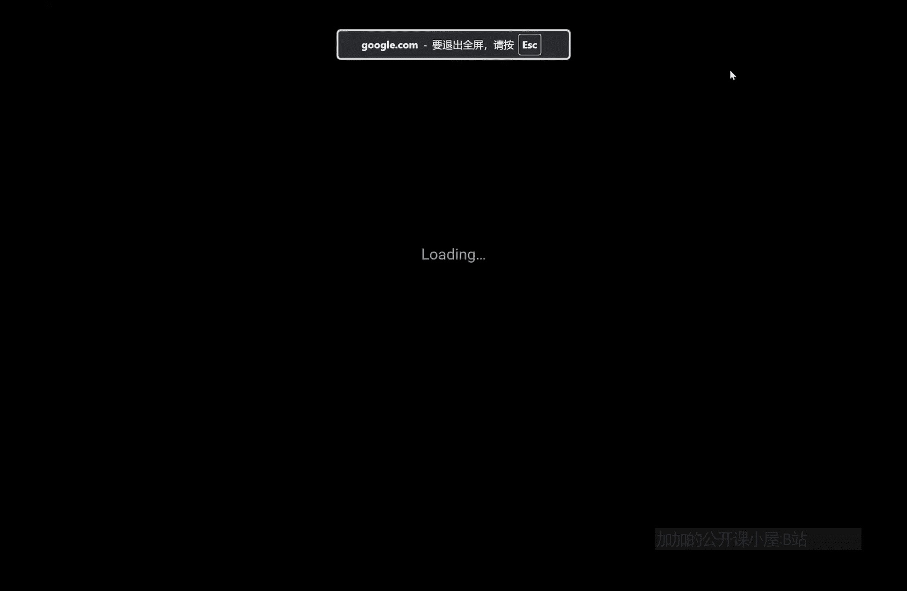
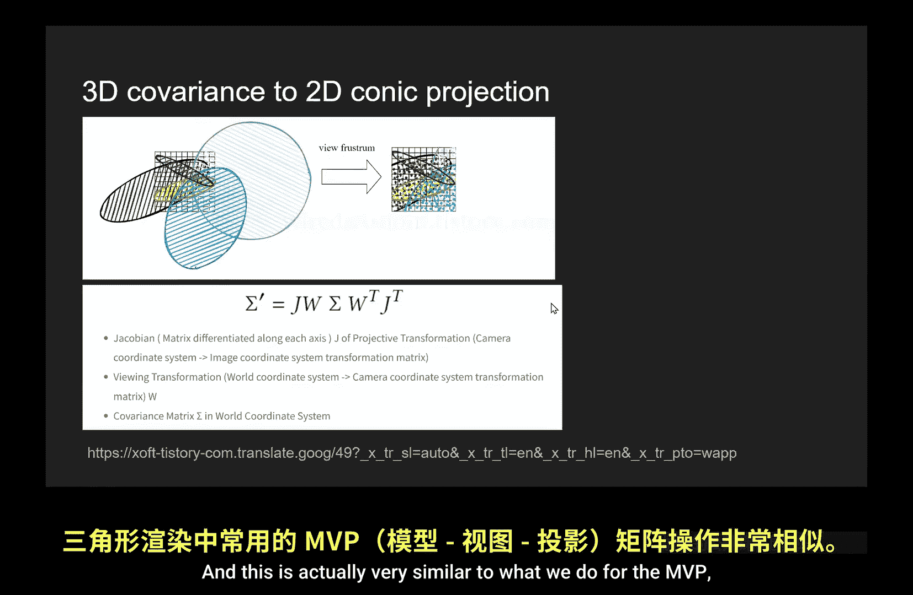

# 宾夕法尼亚大学【中英⚡GPU编程｜CIS5650 2024 GPU Programming】 p17 P17 2024-10-16 - Recitation-Project5, Vulkan Lab I -BV1JeMnzFEWv_p17-

系咪你要开你一。He was like。要啊。我理解没有。まいた。Guess we will start right now。 Okay， let's get started。 And today。

 we have like three acceptance。 The first section is。あ。

If you go viewer and the next session will be introduction to open the lab part one and the last section would be like welcome grass。

系い。Yeah，Okay， I will represent represent the Gaussian spoting Web GPU project for project 5 and because this one will intensively use the GPU。

 But the Chrome or default is the integrated graphic car。 if you have one for power safe。 So you。

 you should change to your， if you have a nicer one。

 You should definitely check on your Chrome GPU and check the G render。

 whether you showing the GPU you want to use for Chrome。And。

Let's get start to the actual information。

Yeah。How many of you guys have heard like a3D cartoon sping already。Okay， many of。Yeah。

 the Gaussian sp which is very different from what we do for geographic rendering instead we not rendering triangle。

 we render render a points cloud and you see splas it' like a Gaussian distribution around that point and you have like some color variations and different sense to represent each point and and then you blend all the color together those you form the thing and。

The basic idea is from some statistic things called cautionus distribution from stats and if you guys have learned some basic statistic and the caution distribution is just a uniform distribution all from the center and you can see the 1D 2D and the 3D the 3D is what we will do for our project and it basically has like a。

Distribution and showing likesopher。 It's not always be uniform like this after you applied the rotation and scalingling and different things and。

The， the main importance is the covariance we we will need to use for our。

Project and mean is just the position of the point。 The covari you have learned before in that。

 it just means。How many variation you have for your all data sets from the center。

 the whole data variation and respect to the center point or the mean and in our 3D thing it's just the center point and the outside data data cloud like the things just showing here like how variation the color is respect to the center。

Yes。And also we can transform the covariance just like here you see the rotation matrix and the scalingling matrix。

 like we usually do on work graphic pipeline。Yes。This is more a visual representation of some standard Gausian distribution after we transform the covariance and this is what it looks like。

And in the。In actual paper for 3D Gausian spting， they trained actual scene from different cameras angles and they sampled the points and then they do the Gaussian feeding for the point cloud。

 But in our project， we don't do any training。 We only focus on the rendering part。

 So we have the pretrained scene with the cameras file and the the Po file which it's just the supply file。

 and。And this is what we do for the viewing stage and the Gaussian spot our protected from the 3D point to the 2D spots is from like a 3D and then you will protect our view angles like we do for a triangle2 and。

Then we will render the small 2D quads from viewpoint each each frame pass and then we blend all theus Gausians but the point of color color we blend all them together and different from the original paper they because they are using and they do a towel base rendering and here we just do a we utilize the standardized the restaurant。

A restization pipeline in WebGP and we blend all the spts together instead of what they do is the forward words after they store the spt they add together all the color from to bad until they reach some satisfieding opacity but here we just render all the things from back to front and just like we do for semi transparent texture so see similar pose like that I will talk about more details later。

And Gaussian R。In our pipeline， we first we need to preprocess all the data。

 the first part is loading the 3D Go data which were already provided in pipeline and then after you have those data you need to preprocess those data into 2D screen like I just talked before。

 the first thing you will need to do is calling the sps in the view for some。Ting。

 I think you guys already do the project for it's very similar。

 you just need to of the get rid of the spot you cannot see and also you will do similar things for the open grass the calling test and。

Then we compute the 3D Gauss variances covariance using the data you have input from your file because the file will provide you the rotation and the scaling matrix and just like I talked before there is like a matrix multiplication you can cover from that like you transform the uniform one into the slide you want。

And then you come then the next thing you do is project the 3D covarient into the 2D equations。

 And in the in this one， you will also need to retrieveve the maximum radius and also the max qua size for your next rendering task because when you render。

 you render the Gaussian like a quad interview the view direction and。Based on that。

 you do like something similar to procedural texture to reconstruct the color。

Then you you evaluate thepherical harmonic to get the color from the slide and this part we already provided almost for you the calculation part。

 and you can also see the detailed mathematic proof I provided in the instruction in the ra and except you need to read the value by yourself and there is a function there you should implement and。

Then you store the flat data into later rendering restization pipeline and then。Also。

 because you need to sort the split in in the depths because we want to render from back to front。

 like what you do for transparent texture and。So we also provide the red resource already for you。

 So， but you still need to update the key size for the red resource and also the indexes because you。

Call out呃 calling some搞呃。Some Gaussian data already。

 So there is only part of the data you only need to render。 and also the depths。

This is the value you need to sort。And this is an overview of the sort， and。

There's a lot of interface you need to understand in this file and it's called general info and dispatch and for dispatch you need because we use indirect dispatch So all the dispatch count you need to update in preprocess step and and also the ping pong buffer will just they use a ping pong buffer to switch be but we already updated for you。

 So you only need to use the ping pong0。And for the rendering because we render each spread just like a bonding quail instance and for here you also use indirect drawing because the instance account you don't really know beforehand。

 this is some information you need from the preproces step and also from that you use the information you just got from the preproces。

 the maximum radius and the quail size and then in the fragmentment shadeator。

 you calculate the color， the opacity color。Oacity amount from the con equation。

 I will talk a little bit later on， and。Then you render the。Final probe into the screen。

 like what we do for transparent texture。And this is the CD covariant to the2 projection。

 and this is actually very similar to what we do for the MVP。

 the view projection matrix we usually do for。

