# 宾夕法尼亚大学【中英⚡GPU编程｜CIS5650 2024 GPU Programming】 p18 P18 2024-10-21 - Recitation-Vulkan Lab II -BV1JeMnzFEWv_p18-

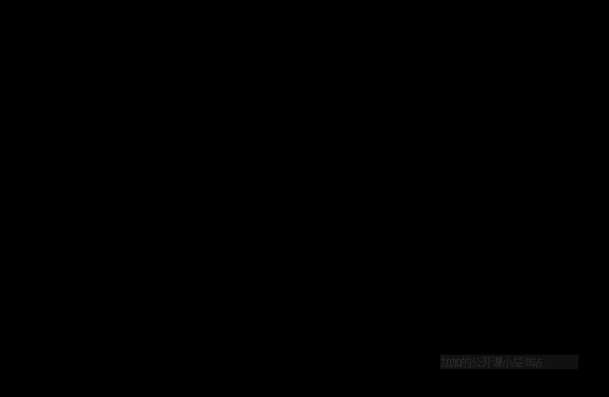

Yeah。Alright， let's go。Go back to Vcan。 And today we're going to mainly talk about command recording and also synchronization inside Vcan。

And those are like a pretty important part for Vcan because it's a like pretty asynchronous API。

 so you need to basically manually handle every synchronization for yourself and we start with the command buffer。

And for the command buffer to be useful by the GPU。

 like we need to actually submit the command buffer to one Q of the GPU。

 and it can record the sequence of sequence of commands。

 which can be like submitted to like any queue for execution。 But remember。

 the order of your recording It not the actual order of the execution。

 Your like the the finishing order of the execution can be like a pre arbitrarybit。

 So if you want to ensure some order between your like a different commands。

 you need to insert insert some like barriers instead。Com buffer our recording stage。

And the command buffer is allocated and free from a V K command pool。

 which can cannot be corrected directly。The command buffer can only be allocated from the pool。

 it can be directly created。And we can。Record all of our commands。Like whatever it is。

 whether it is like a draw commands where some pipeline barrier between the V begin command buffer and also the V and command buffer。

 the command buffer， the concept of command buffer is pretty much similar to the concept of command recorder encoder inside the web GPP。

And here our command is being recorded at this like a code section， which is a。呃And。InIn between of。

 in between this。Command buffer， we can。We can actually look at the code of it。Oh嗯。Okay啊。Okay。哦。Yeah。

 like here we're building the command buffer for the graphics pipeline and we're basically just drawing like a full screen triangle。

 but there are some there are some like resource ownership transfer， which will talk about it later。

 those ownership transfers done by the pipeline barrier。And we basically begin the winter pass。

Said the viewport and said the scisessor of the screen。

 And then we find the descriptor set we created before， which is just one descriptor set。

 which is this graphics dot discscriptor set。 and we。By our pipeline。

And then we can do the actual draw command。 And this draw command actually just draw like a full screen triangle。

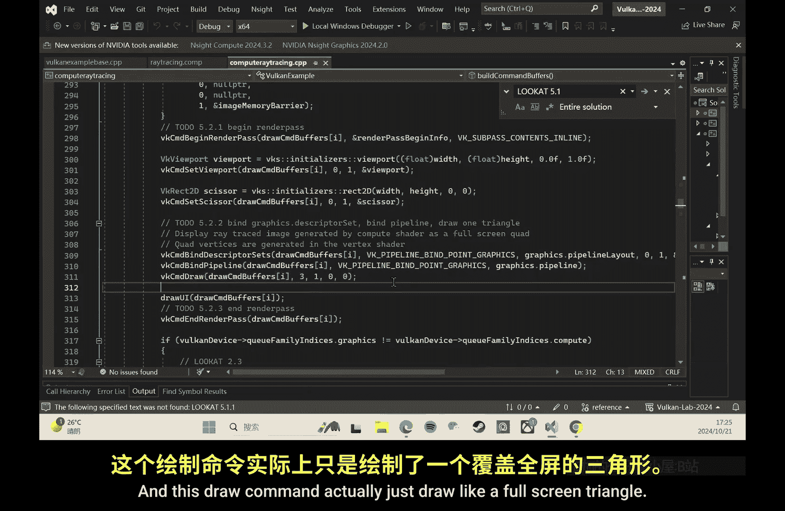

Which can fully cover the screen， and we can use this as a full screen pass。 And this is actually a。

Yeah， this is somewhere we allocate the command buffer。

 But I don't think this is like too important for us to use because like， you can just allocate some。

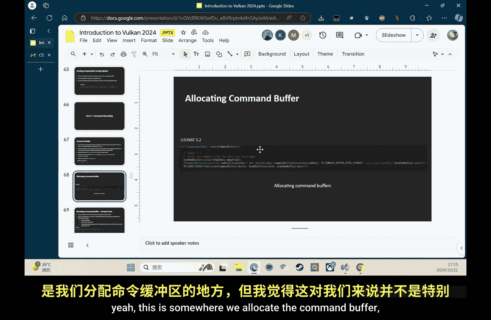

Of the command bufferer from the pool， if you need it。And the actual meat of the command buffer is。

 the all of the commands you are recording。 like in our example。

 we are doing compute retracing inside the compute shaders。 So we need to first。

Do the BK command dispatch inside the command buffer recording stage， which is a pre。

 which is a bit easier than the。

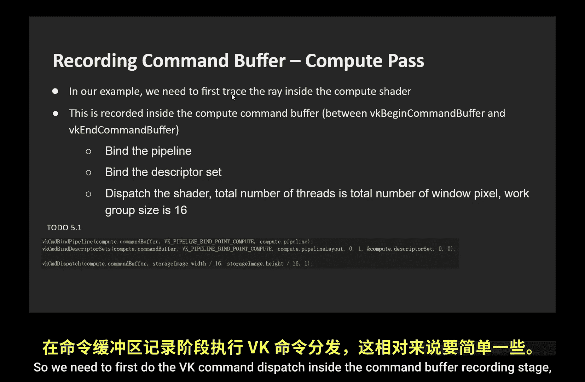

I would also always argue that compute pipeline is a bit easier than graphics pipeline。

 If you can go to the to do 5。1， which is a。

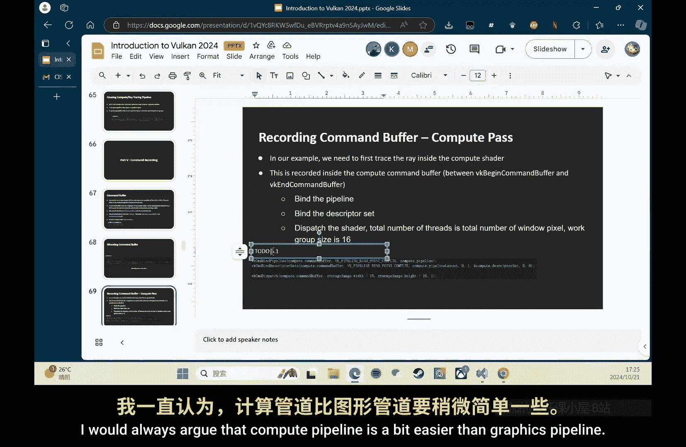

Basically， three lines of code， which first bind the compute pipeline and bind the distributor set。

 and you can interchange those two lines It wouldn't change like anything like。

And then you can do the actual dispatch， which is a。Here。

 the number 16 is our size of the work group。 Our work group size on the X direction is 16 and also on the Y direction is also 16。

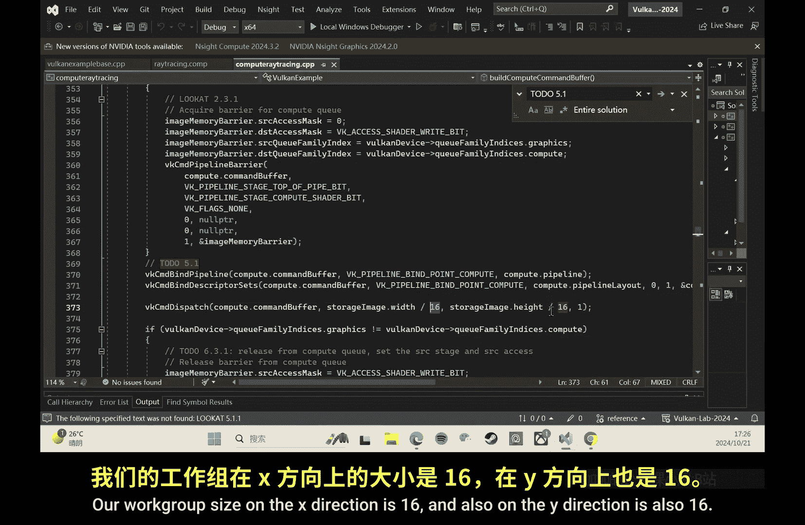

And so far are any questions for this？Like， this is a to do。 you can。

Pretty much a few in the blanks in your code section。It's pretty straightforward， I think。Okay。

 let's continue。And another。AndAnother code I've touched before。

 which is the another to do inside our graphics pipeline， inside graphics pipeline。

 before you draw anything and before you bind pipeline， ban this group set。

 you always need to start a。

You always need to begin new like render path。Where you can use like multiple sub pass within a render pass。

 So you start with the VK command begin render pass。

 And this is the render pass that we have created before。 If you look at the V。

 If look at this render pass begin info， you can see the。

We have a like a a handle to the render past that we created before。And this。Yeah。

 and this beginning for also contains about like a。Several different things。

 like such as the area and the areas offset and also the extent of the。 and also the。

This is where you specify the clear values for the whatever attachments we are trying to write to。

 Here is only the color and depth stencil。 and I've mentioned before that this one is pretty much optional for our。

Per purposetus but。We are using it because it shares like some common base code for other examples inside this base code。

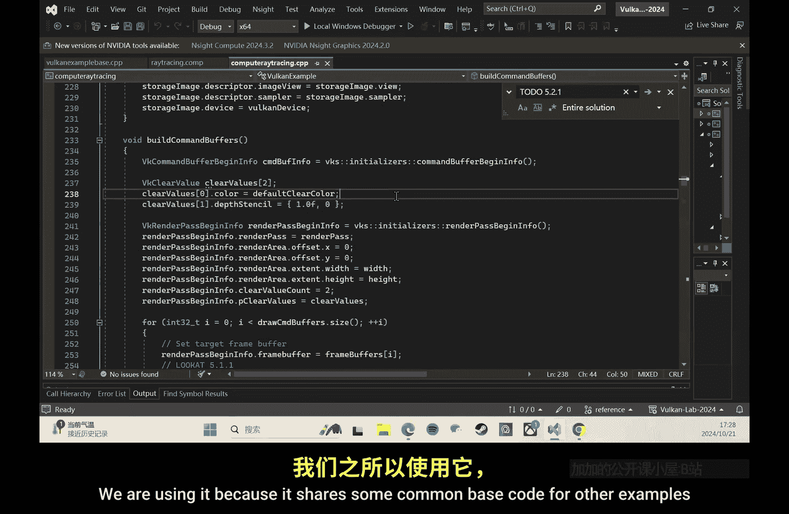

Yeah， and you can like specify the clear values inside the when past begin info and。

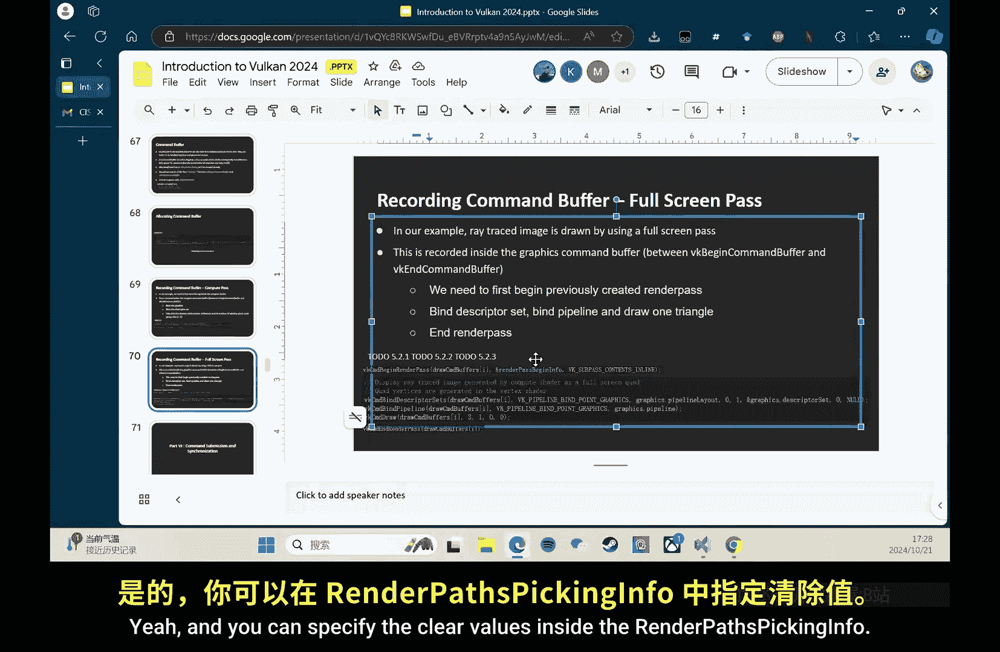

Another thing， Another thing are just pretty much the same as the computers。

 You buy the discpancies and you bind the pipeline， and you can actually draw something like here。

 the B K command draw。 if you can， I'm sorry。

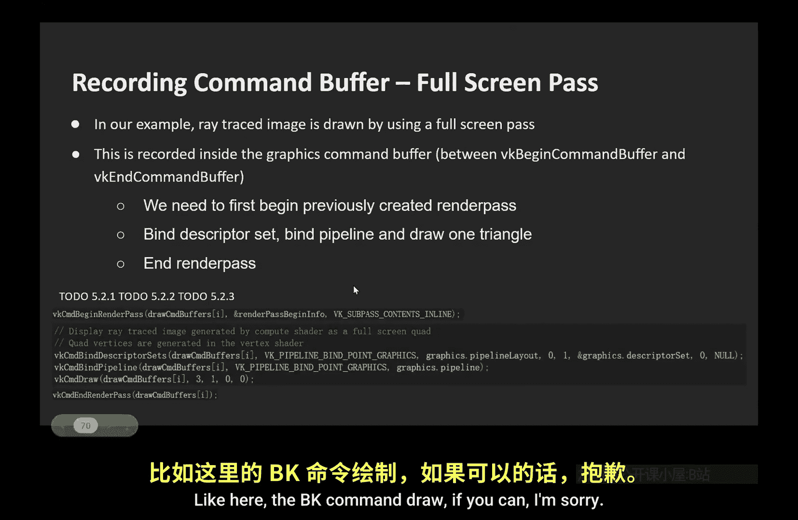

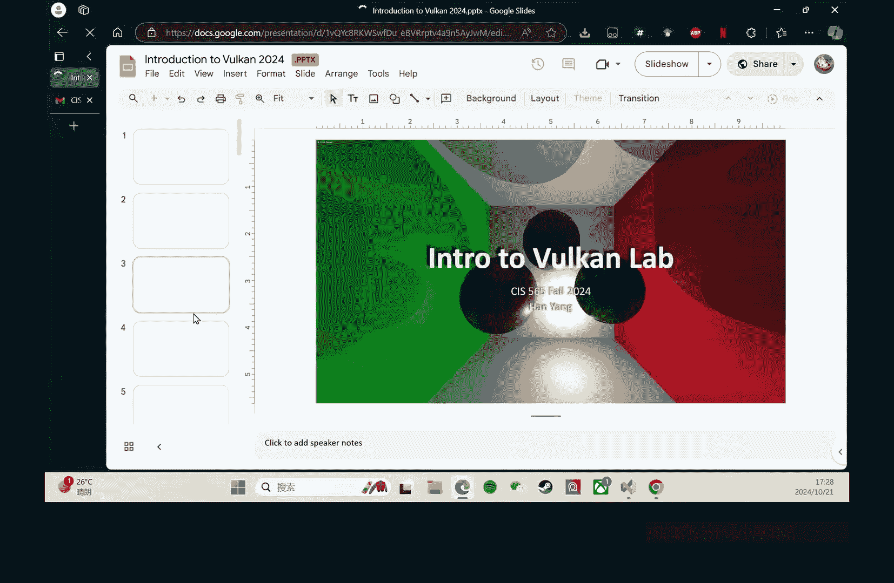

You can see the。A function signature by going to the。We can command draw。 You can see the。

 the first one is the command buffer， and the second one is vertex count。

 which means how many vertex you want to draw and。Soir one is instanceense con。

And the first vertex and first index is just some offset into the vertex and index buffer。

And here we set them all to0。

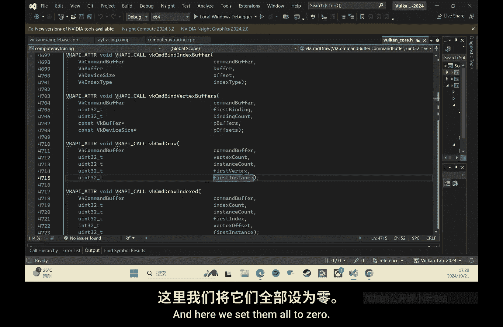

And after we have finished all of the drawings， including joining the UI。

 and we can actually end the render pass， which。We keep command and bring advice。And yeah。

Any questions for this。Winter past and also the draw lines。No， okay， let's continue。And yeah。

 the part 6 is the heart。 I think this is the heart of our broken language。呃。

Talk something about like synchronization inside Vcan。

 Like before we have introduced the concept of a queue。

Which means like each command buffer we have recorded， can be submitted to a single queue。

 And then these queuees can ask execute asynchronously and also。Like。I mean， I mean。

 like for each command buffer。Their execution， the commands within them can be askedd。

 like inronously。 and also the commands on different like queues that can also run concurrently。

 so we。Need to synchronize within like a queue and also between queues。And also。

 CPU and GPU works concurrently， We may need to wait for GPU work to finish sometime on CPU。

And so we need like different kinds of synchronization primitives。Theres。

Different ways to synchronize a V program， like between different。Objects like CPU or GPU。

 you want to use a fence or you want to synchronize between queue operations between different queues。

 you can use a sum of4 or you can use like a VK event to synchronize very versatilely within a single queue and at last which is I think it is very useful is the pipeline barrier。

 you can do a lot of things with like pipeline barrier。

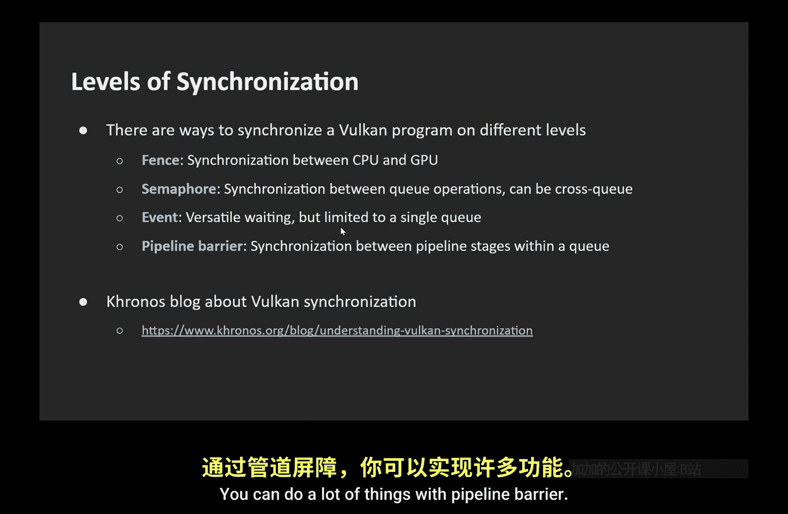

But this pipeline barrier is。