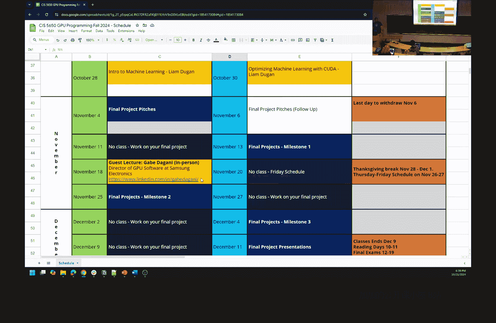
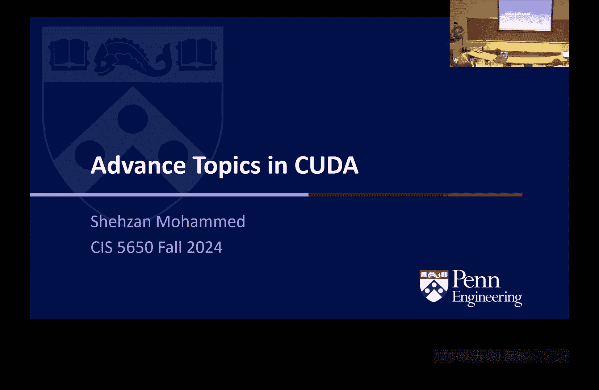
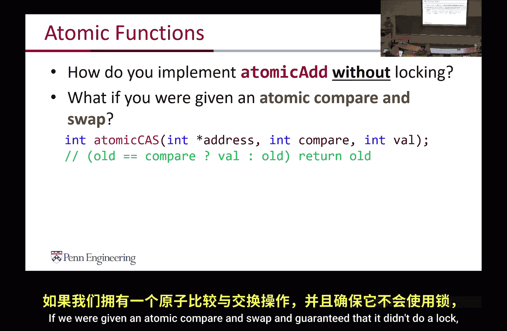

# 宾夕法尼亚大学【中英⚡GPU编程｜CIS5650 2024 GPU Programming】 p19 P19 2024-10-21 - Lecture 9 Advance Topics in CUDA Pt2 -BV1JeMnzFEWv_p19-

Yeah。Before we jump in。Before we jump into the slides and I just wanted to go over the schedule a little bit。

 so of course we are here October 21st， almost in November， can you believe it？

So today I will cover a small part of advanced sca， I don't think it should take us too long。

 but Wednesday is essentially where we kick off final project season。So， you know。

 start thinking about them， please ask those of you。

 your friends who who haven't attended class today， please ask them to make it on Wednesday because。

Like if you think all of the effort you've put into the class。The final project is 40% of your grain。

Suggestion in putting that into perspective， please ask all your friends to come and attend on Wednesday。

Next week we'll have two back toback lectures from Liam。

 Liam is a PhD student here at Penn who's done fantastic and this would be his fourth consecutive twopart guest lecture on machine learning and KudDa and it inspires a lot of final projects for those of you who are interested in dabbling into machine learning as part of final projects again these are going to be some two fantastic guest lectures。

To attend。And then。ForFor the way we do final projects we'll do a page so that you present your ideas and stuff more details to follow on that on Wednesday。

 but during the final projects on November 18th we'll have our final G structure。

 Gabe Deganni who's GPU software director at Samsung advanced Research Center in Texas and we had Ha and a few other。

Previous students TA or not TA in turn with Gabe he's fantastic brings a lot of good knowledge from the industry into the classroom he'll be coming on November 18th and then it's like a home stretch to final projects once we start final projects we don't do any lectures we want to give you the time to focus on your projects itself。

The other thing I'll add， I've added percentage grades for projects four and five。

 so you can see that here， any questions。

Oh， all right。Let's dive in then。Okay。

So today we are going to cover a few more topics， so last class we covered streams and other things today we will cover a few more topics。

 atomic functions， what functions two very powerful ones， dynamic parallelism。

 which is an interesting concept if applied correctly in an independent threadchedul in cooperative groups kind of。

In a way through everything I've taught to you so far about threadscheduling out of the door。

 but again it's these advanced concepts so you may not apply them all the time。

 so let's cover them as they come。All right。So first of atomic functions。

Just like in every parallel programming paradigm， there are going to be times where you need to do atomic operations where you lock something and make sure that nothing is either reading or writing from that as you're operating on that memory。

RightSo if you take an example like this and put it in a device kernel。

 what do you think happens here？What do you think the value of this might be？Yeah， Nick。

Anything between one and8， Yeah， anything between one and 8。 your spot on there。 It depends on how。嗯。

How exact the timing of updating that variable is going to be if all threads。

at the very same clock cycle， try to update it， they will read zero and they will add it to one and then all of them have a race conflict to write to one。

If all of them do it one after the other， then they will do it to eight。😊，Basically。

The line of code you've written is undefined and the result is undefined right you haven't described what your intent is there very clearly to the program。

😊，So， this is not clear now if you intend for that each thread adds increments the value of count。

Then in that case， that's why you need to use atomics。So this is an example of atomic a。

 which is a bit in function in Kuda。Which essentially takes this variable and for each thread。

Adds one， which is an increment to count。 And this is done by an atomic way。 Now。

 what do you think happens。嗯。When you use a line like this in a couda kernel。

Like what's the implications of it？Yep， like any thread that wants to act dogg now has to wait for that one day。

So it could kind of exactly， it's not just eight threads。

 but depending on how many threads you have in the block。

 it will entirely become serial so you can see how much it could impact performance if you use it in the wrong ways。

Okay。So。Diving a little bit into atomics。I want to like while this is a built in function in Ka。

 I think it's interesting to explore。How you would implement something like this。

 because there are a bunch of built in functions in Qa。

But they're not everything you may want a different type of atomic function。

 there's a different type of atomic operation that you may want to do so in that spirit。

Let's look at how we would implement an atomic ad。If we were given an atomic。

Competent in operation like this， so if this function wasn't written。

 how would we implement it and it looks something like this。Where。

We would create our own new function called device and。

And then atomic add and we would take a pointer to the address and the value to increment it by generally clear on the function definition。

 but let me know if you have。If you have a question。We would。The return value here is the old value。

 so we want to store the new value in address and return the old value okay。

So we will create a variable for the old value call old and then we will have some form of a lock here。

😊，We are making up that word， there's different ways of doing it。

 but let's say theres a lock API and it locks the address。If that block is successful。

 it will go in and implement， execute these two instructions where it throws the value of address into old。

😊，And then increments the value of address by value。

And then returns the old value right if it's not successful。😊。

It will it's kind of like a do while loop then。So， as long as lock is false。

 it will iterate until lock is true。😮，Once lock is through， it' will execute and then return。

Does that make sense？Any questions on this？Okay， so you can use this as something you you can use。

InWith different atomic functions to build more complex atomics that you may want to write in your ka kernels。

So ultimately， you're minimizing where actually lock happens。Okay， so like we said before。😊。

In a function like this where you're doing this kind of a Dubai loop to get the lock。

It becomes completely serialized， you may have all the threads。

 each thread tries to acquire the lock， but only one thread can get a lock at any given time once a thread gets a lock。

 it executes。Once done or otherwise all the threads will loop around it。Okay， again。

 remember for this code， if you were to implement something like this。😊，嗯。

The threads still have to execute even if they are not doing anything threads in a warp execute together right so that is still going to happen that's why this diagram kind of has the arrow down from unlock back not just from lock backup okay this thread has to execute in lockstep with the warp。

嗯。Okay。Don okay。So。There might be a different way of doing this。Which is to not use。Locks。

And that's done using something like this here。We call this function our atomic compare and swap。

Which is also built in Kudaf Atomic。If we were given an atomic compare swapb and guaranteed that it didn't do a lock。

How would we then implement an atomic？