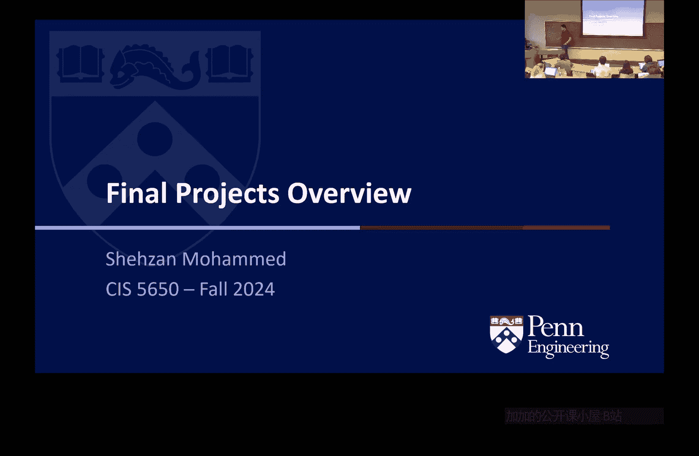
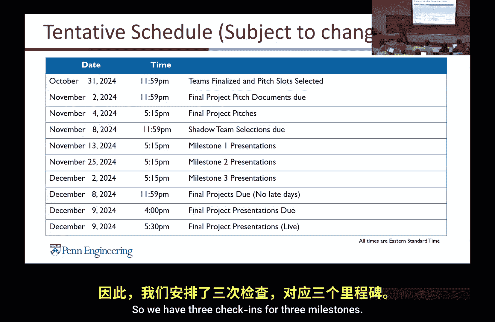

# 宾夕法尼亚大学【中英⚡GPU编程｜CIS5650 2024 GPU Programming】 p20 P20 2024-10-23 - Final Projects Overview -BV1JeMnzFEWv_p20-

这和我不。はい。Okay。So， so there。Teaching， not going to be educating you on anything， but。

I'm going to facilitate your education by offering you the incredible opportunity to do five to six weeks depending on how you counter a final project in the class of your choice and this is。

I'm pretty sure this is。At least 98% true。The final project of this class。Becomes the first line。

 first project you list on your resume。Every 98% of the students who graduated this class would have done that。

So that's how impactful。This opportunity is all of you。

So what I'm going to do here is tell you that you can do almost anything。

And I'm essentially giving you the asterisks of what you can't do in a way。

And putting some bounds on that。Okay， so so let's get started。

 please feel free to ask any questions while we are doing this again if you want。

I find the opportunity to be really exciting that you get to work on this incredible project of your choice。

But there's of course a grade attached to it as well so if that's a motivating factor in that you have questions about how your grades are done please feel free to ask as well Sp of grading I've been meaning to tell you for a couple of weeks we are behind on grading because all the Ts whenre taking on projects four and five getting that base code set up but we have a plan to essentially ship。

😊，All the grades by November 15th， starting with this week by the end of this week。

 I think you should start seeing projects one and two grades going out。

You'll get them in your email and by number 15 we should be caught up to all the projects up to five so we may need to tell you that glad I did okay。

So please feel free to ask any questions about final projects。

Yeah I'm really going to be telling you about the logistics of how we'll go about it。嗯。

Next we click every tag click。So the final projects in this class are large GPU programming projects。

 GPU programming being an important part of it of your choice。You can focus on graphics， compute， AI。

 anything you want as long as the GPU is the core part of the project itself。

Expect to do two to three times more work。Then whatever you thought the hardest project of this class would be and that's one message really saying two to three times more work per day。

 it's a six week project。Compared to all the standard projects that were about two weeks right so naturally there's more work to be done and。

In those weeks， you'll likely put anywhere between 10 to 20 hours per week。

 depending on your level of interest， what are the classes you're taking and stuff。

So the ingredients of a good project。That has a lot of impact has drive success for you， right。

 it's success for you， not for me。Is。Your level of interest in that project。

The GPU programming aspect， because that's going to make it unique compared to all the other projects that happen。

In engineering， not just CIS， but engineering as a whole。And then。

The thing that I love to emphasize is the。Newness or the recency and the applicability of your work into the industry。

RightSo it's important that you pick a topic。That has。

Some interest or some discussion happening in the industry that can create some connection that you when you go interview。

 you can proudly claim that worked on this， that you have deep expertise in that topic that you worked on。

So file projects in another sense are a combination of more than one of these factors right they don't have to be all of them。

 they can be just one of them， they have to be some form of combination of them so it is。

Fulfilling a need in the community， okay what that need is is up to you。

 but there needs to be some interest in whatever topic you pick。exploringpling a new API。

 Web GPU is a fantastic example from previous years where Web GPU was new non standardized。

 even now I would say it's finally new and you could create a really impact project。

Reproducing recent research and recent being no less than three years old。Is a great way。

Novel extension to existing work， you know something like those of you interested in graphics would have seen Rester and Re respond off like 500 new papers from Rester things like that are always approachable so you can you can do that or if you want to do something completely original you may be in a PhD program you may be working with a professor on some research you want to take that and move it to the GPU yeah that's certainly an option so some combination of these things makes for a good project。

Any questions so far on this？No， okay。So continuing on the guidelines。

 final projects are team projects okay and given the size of the class， 41 students this year。

We have to。To manage all of the projects， we have to kind of say teams of three are more important than teams of two。

And four and one are very much discouraged， but we may create exceptions for that。

 but there has to be proportion amount of work。嗯。So。

The general guidelines is that all the team members will receive the same grade unless there is a clear pattern where one student isn't contributing and you guys bring it to our attention early。

Not at the last minute， you bring it to our attention early。

 then we can do something to help you all that all of you， but you know。

 in general we will give the same grade。Teams of four will be considered。

 but the level of effort and the work you do has to be proportion to that。

Teams of one are very strongly discouraged， especially this year because of the size of the class。

 unless you have a strong and compelling reason why another student can't contribute。嗯。

That would likely not get approved。Okay， so so we want you to work in teams。

 we want you to bring the best of you know， both our multiple worlds or multiple students experiences into into your projects。

嗯。Let me pause and take any questions。有。Yeah， so I'll have a slide coming up on that here。

Any other questions on this？Okay。All right。Projects use GiHub you know I think all of you are used to it by now use GiHub programming language graphics APIs。

 all of that is completely up to you we've had students develop on Android on metal on Mac OS on web GPU which is much more broad so it's really up to you I don't limit that if you as long as you're following the guidelines I've laid out。

Pretty much everything else is up to you。嗯。You can use existing code and third party libraries。

 same policy as weve had for all of the standard project supplies here where the library should be helping you。

But not necessarily doing the work for you right so GLM is a great example GLM helps you do the math but isn't actually replicating the entire project for you。

嗯。All right， here's the schedule to I answer Michael's question by October 31st。

 which is a week from now， eight days from now， we would want to have the teams finalized。

And the slots selected， and I'll talk a little bit about the slots。嗯。On November 2nd。

 you will have your pitch documents due so that we can read it in advance and prepare for the pitches。

 you'll all have to pitch your projects and again I'll talk about that process in a bit。

Ner4 we'll do the pitch， most likely in this classroom， but I'll。Post more updates on that tune。嗯。

The other thing we do is we have a concept called shadow teams， which are。

Tams that you'll bounce ideas of， more detail coming， so you want to select that after your pitch。

 basically find teams that have some commonality that you can share and practice with。Now。

 it's always dangerous to give a final project that's six weeks long and never check in。

 So we have three check ins for three milestones。 milestone one is midweek of。

