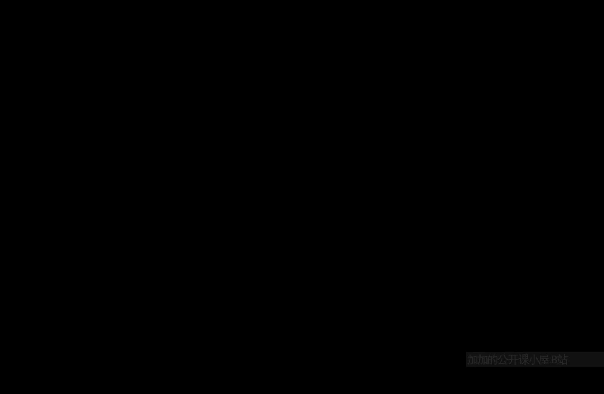
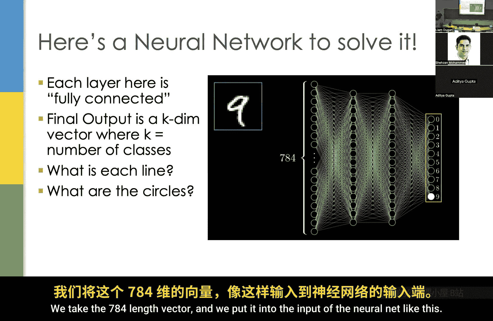
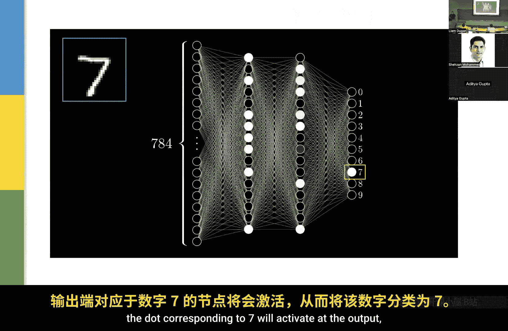
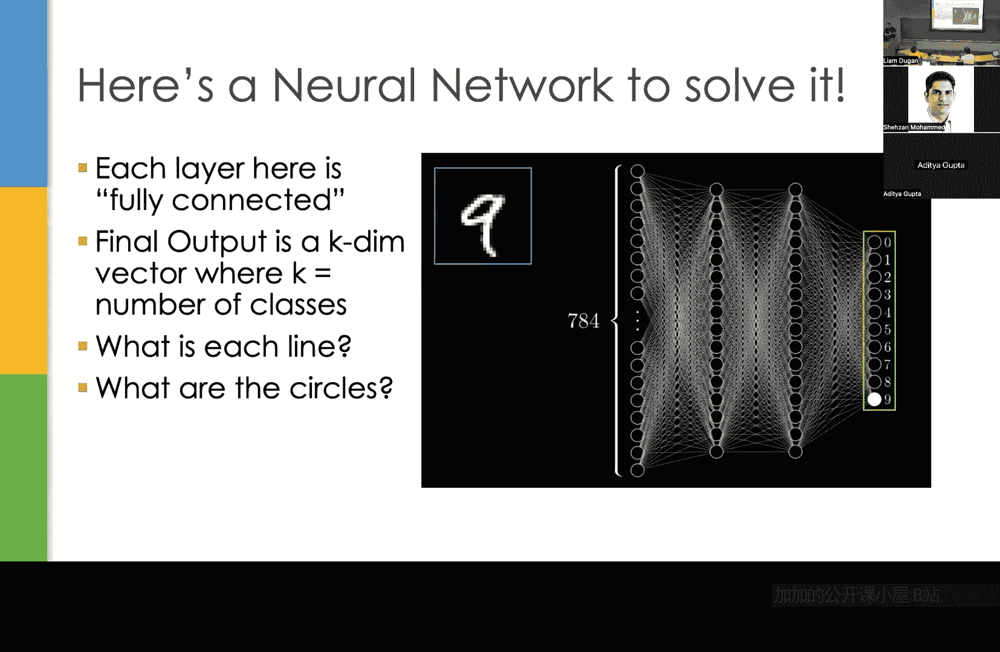
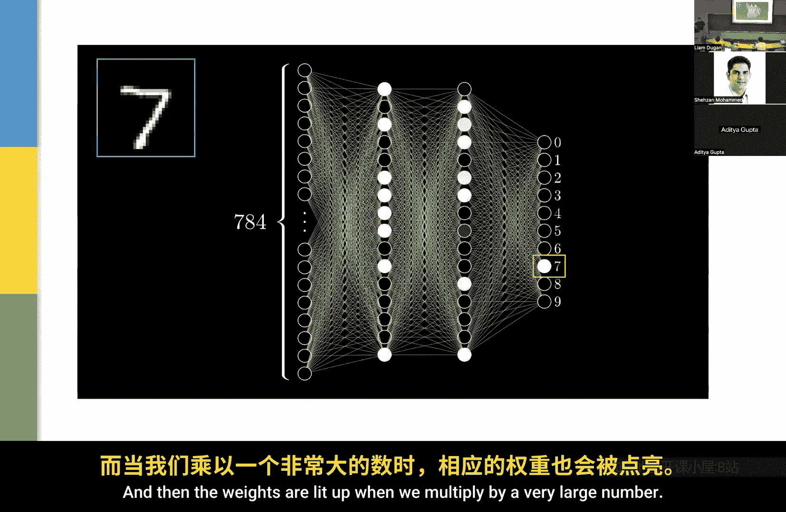
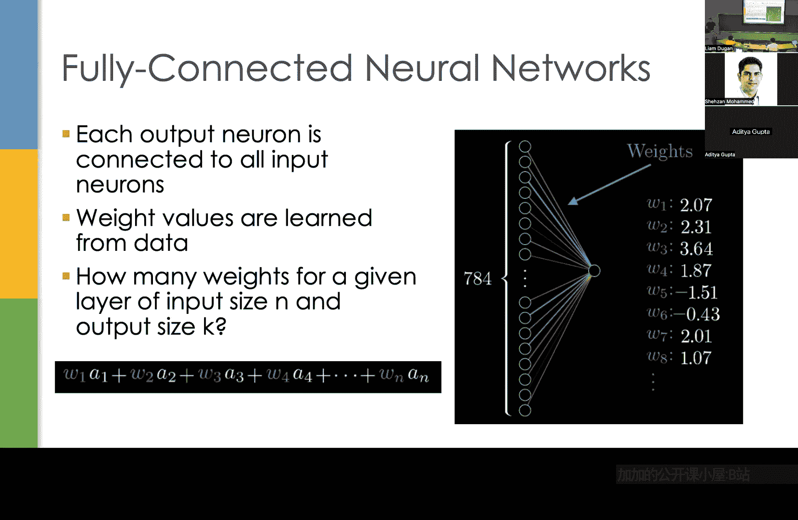

# 宾夕法尼亚大学【中英⚡GPU编程｜CIS5650 2024 GPU Programming】 p21 P21 2024-10-28 - Lecture 10 Introduction to ML -BV1JeMnzFEWv_p21-

But okay， that were good， I just had to hit the end。

Yeah。I expecting more people of theIt's all good。I don't wait that matter matter of doing that concern。

Oh。Yeah。家应该是可。你这真是你知道。Okay。可以。嗯。我不定。X。你你好怎么我现在给我打电话都。This。啊，你不是。I。私。

Okay hello everybody well Shaan's not here today so I'll be like facilitating I guess this is Liam this is a guest lecture I will introduce him and then he can give us lecture so Liam was a student in this class in 2018 his team was the first to work on a DxR project and we the first student team in academia to do so he interned in Nvidia and then he rejoined Penn PhD with a focus on natural language processing he's interned and collaborated on research with Morgan McGire at Robblx and John Hopkins Johns Hopkins。

And this is his fourth consecutive guest lecture in the class and put a student favorite every year I can tell you I enjoyed this one quite a bit last time so it's good pay attention anyways with that I will hand it over right。

Thanks so much。 Yeah， I'm kind of surprised they keep inviting me back over and over again like at some point。

 you know， you got to got to spice it up， but no， it's great。

 I actually really really enjoy talking to the students in this class because I feel like。😊。

I don't know in a lot of the stuff I do research world。

 a lot of people are less concerned with the actual nuts and bolts implementation of the models and the acceleration and getting to talk to GPU students is great because they're like。

😊，But how does this relate to the you know to GPU bank conflicts warps you know and yeah happy to talk about machine learning so I'm going to give two lectures this week so this is the first of the two it's just the introduction to ML I basically have to get all of the introductory stuff out of the way so that we don't have to require you to have taken ML before I talk about the second lecture which is the really good stuff which is just how to optimize machine learning in Kuda and then after those two lectures we've had many student groups attempt final projects with machine learning and a lot of them have been really successful we had like many pass tracer optimizations with like denoising with ML and then we had like image super scaling projects so yeah I'm really excited to see what you all do。

And yeah， with the introduction out of the way， first thing I always want to ask is how many people here have taken a machine learning class at all at Penn？

Wow， okay the proportion of hands keeps going up year after year the first time I asked this question there was like one or two hands of and now like half the class has this So this may be a lot of recap for the people who raised their hands out of curiosity who's taken like 520 like the core machine learning class Okay that's that's a good amount for you guys like this will be all review So feel free to feel free to like work on homework or something during this。

😊，Cool all right， so just as a really quick intro I know I didt already introduced me but i'm a fourth year PhD student。

 I was an undergrad also here I did Comp and then submat for in Robo is anyone here in Robo or Comppi。

😊，Yeah。嗯。And yeah， like you said， I took this class in 2018， surprisingly in the same room。

 never never changed from the same room， and I research primarily in generated content detection。

 so I do detect AI generated text and images， but I've also dabbled in doing like speech processing and then also just general large language model research。

Cool， so in this lecture we'll cover the absolute basics from zero so if you've never seen LL before like get ready because I'm going basically give you like the entirety of 520 and like one three hour class so good luck with that and then also importantly we're going to talk about how do we know like what architectures to use。

 how do we improve the basics of machine learning and then also talk about potential tasks that we can apply machine learning to and that's to get you started thinking about what your final project is going to be。

Cool。So。A key part of this lecture is that we're not going to spend too much time talking about the theory or the math and my main goal is just to not intimidate you all like machine learning is actually pretty simple at its core。

 it's just when we get into a lot of this sort of stuff outside the core that it gets really intimidating but that being said we do have to cover a lot of ground so the lecture is going to be really fast please feel free to interrupt me with questions if you don't understand something and you really want to know。

All right。So starting off neural networks， I like to start off with a very basic example。

And that's with I would argue the first really useful applications of neural nets in an actual real world problem。

 which is handwritten digit recognition if you've taken an ML class you know how famous this project this problem is so our task is given a handwritten digit we want to classify what number it is so whether there's one2。

3，4 five so on and so forth and our input is going to be a vector of length 784 with the pixel values is of zero to1 so if the letter is the number is。

Over one of the pixels， then it'll be one， and if it's not at zero and if it's sort of on the border。

 it would be some number between zero and1。So。Here's the neural network that solves the problem we take the 784 length vector and we put it。

Into the input of the neural net。Like this？And then we have these connections。

And then the dots activate， and then ideally， if we've trained it correctly。

 the dot corresponding to seven will activate at the output and we will classify the digit as a7。😊。

Going back one slide， the final output is a K dimensional vector where K is the number of classes does anybody know what these lines are and what the dots represent？

你听到。Yeah， weights and。And notes yeah exactly right so each one of these circles is actually just a number and each one of these weights represents a weight which is just a multiplication operation。

So when we put in our number， the lit up dots are the ones that have like a high value。

 and then the weights are lit up when we multiply by a very large number。

Okay。So for example， one set of weights you can see here， like two， three， negative 1， negative 0。4。

And these weight values are learned from data。Typically with machine learning。

 we just sort of hook up all of the weights and then we try to learn what the values of the weights should be from our data。

Does anyone know how many weights you would have for a given layer of input size N？

In this example on a right， it's fairly straightforward right， 784 weights。

 but if we had an output size K dimension。How many weights would we have in a layer？Yeah。

 simple n times k this gets more complicated， the more complicated we get with the architecture。

 but in the very basic case where you have everything connected to everything， it's always n times K。

😊，Cool， well， so unfortunately， there's a catch because we can't just do this forever。

 We can't just have。This over and over and over again。

 like how I had in this example and the reason being that。Linear algebra is。

LinearSo if you do these weights over and over and over again。

They all kind of collapse into one layer the way people usually talk about weights in a neural network is by looking at them as matrices so for example。

 if we have an n by K layer we have an n by K matrix we take an input vector and we're multiplying it by this n by matrix to get an output dimension k vector if you're doing that over and over and over again you guys know from your matrix transformations that multiplying a matrix a times b times C can just be written as one matrix so in fact all of the layers of the neural network collapse to one layer and that's bad because we don't get any extra sort of representational capacity and so in order to actually train a network that has multiple layers you need some sort of nonlinearar function。

