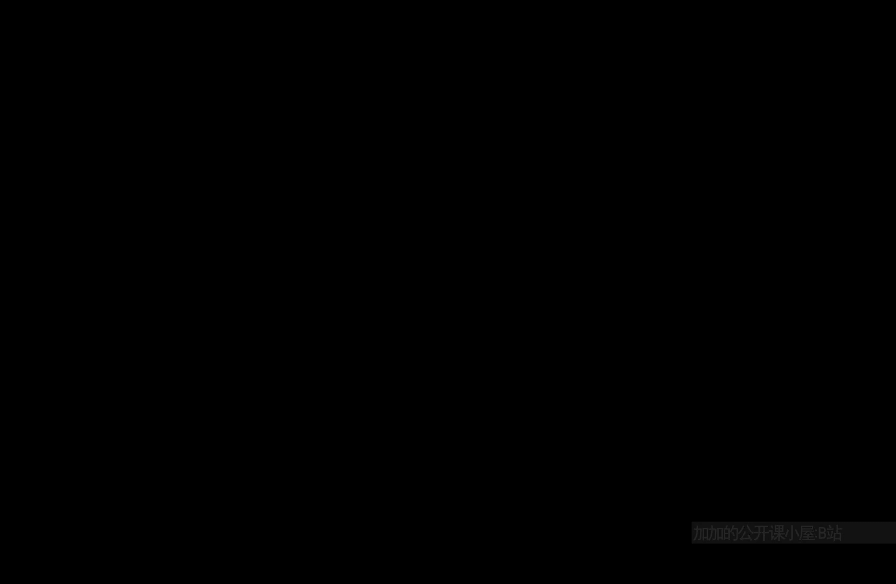
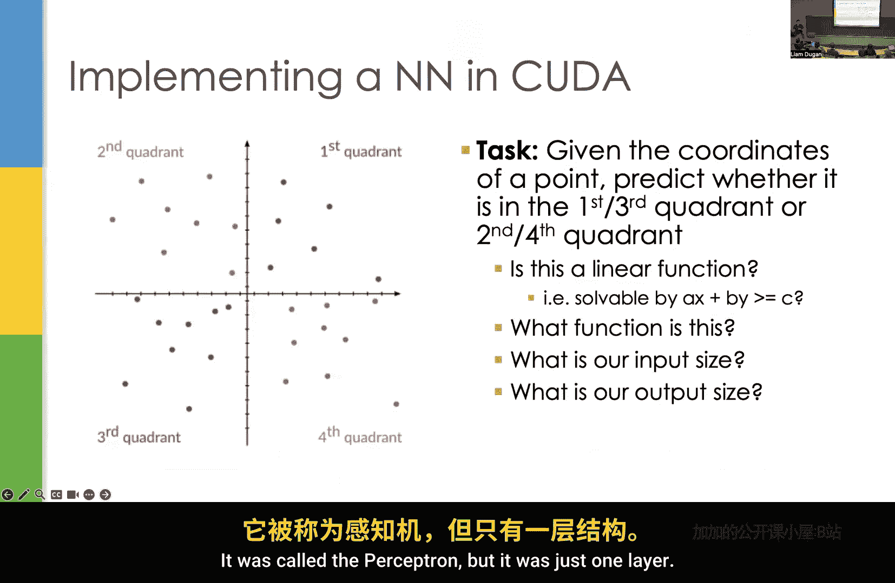

# 宾夕法尼亚大学【中英⚡GPU编程｜CIS5650 2024 GPU Programming】 p22 P22 2024-10-30 - Lecture 11 Optimizing ML with CUDA -BV1JeMnzFEWv_p22-

Okay， so I'll test my audio to see if you can hear can you hear。

variable variable ratechaing can be done wait'。😊。

All right。So。Let's get started。So today's lecture is going to be a lot more。

I guess what's the right word， let's say Gry than the previous lecture because we're going to be going through neural network optimizations in Kuda directly and I'm actually going to be walking you through the code for a neural network in Kuda so there's going to be a lot of code on the slides for the first half in the second half we'll relax a bit more and sort of talk a little bit higher level but I always feel like I have to preface this first half of the lecture because this is probably the most like in the weeds part of either of the two lectures and I think it's really necessary just primarily because a lot of people don't really open up the black box of like machine learning implementation they like use pie Toch or they use other libraries but they never actually see like how would I directly implement this and how would I optimize it under the hood and then I'll talk a little bit more about when we get into the code what optimizations you can immediately see from the code that we have and then yeah we'll go from there。

So。Like I said， the first bit review of machine learning。

 second bit is directly implementing a neural net in coUuda。

 and then the second half is going to be at a higher level like what are the ways we can speed up our neural network optimization using coUDa and then some linear algebra subroutines and then going beyond talking about hightch and tensorflow finally and other things you can use to optimize those networks。

Okay。So the lightning review of an already pretty fast review of machine learning， so first off。

 neural networks are just simple high dimensional functions。

 they take an input vector and have a function that's parameterized by tons of weights and biases and then output another vector。

In order to train a neural network， we have to introduce this concept of a cost function that tells us how bad our network is for a given input。

 this can be either a mean squared error or cross entropy depending on the task。

And then using that cost function， we learn all of our parameters by doing gradient descent。

 which is iteratively stepping in the direction of the negative gradient of the cost function。

So the way that we update the weights using the gradients's called back propagation。

 it's literally just the chain rule， we calculate the partial derivatives starting with the very last layer and working backwards all the way up through the network to get the derivatives with respect to the first few parameters we typically call this a backward pass a forward pass is the initial prediction and the backward pass is calculating the gradients backwards。

And so improvements to neural nets， the main thing is just add more depth。

 this is the deep in deep learning and this is very expensive， but it works very well。Finally。

 a few of the optimizations we talked about when doing classification， use cross entropy loss。

And don't use sigmoid as your nonlinearity instead use relu or other sort of activation functions that get rid of the vanishing gradient。

 which allows for much faster back propagation。When doing steps with our optimizer。

 we use adaptive momentum， which is not only adding momentum to each gradient update but also paying more attention to rarer features and giving those a much higher boost and then of course don't forget to pick a good learning rate。

 one thing I forgot to mention is even though we have this fancy optimizer we still have to at the end of the day just pick a learning rate there's no way to learn a learning rate than if will be。

The other thing we talked about is convolutions， so these are really really great for images。

 these take advantage of translational invaris and they can save you a lot of parameters when optimizing for classification tasks on images。

 we also run max pooling to further reduce the dimensionality of our filter outputs。😊。

And so a CNN or convolutional neural network is basically just a sequence of convolutional layers followed by a sequence of the traditional linear layers and these deep convolutional neural nets work really well on images。

Okay。Compvolution neural nets can learn filters for really high level features。

 so in the first few layers we have sort of low level features and then as we get deeper and deeper we can compound the layers so that by the end we're learning filters for high dimensional high level features。

And the whole point is that we use different architectures when doing machine learning to exploit some sort of symmetry。

 some sort of property of our input or task there's a lot of different neural network variants。

 one of them is a recurrent neural network for speech。😊，Sequence tasks， I should say。

 can use for speech， transformer networks， generative adversarial networks， et cea。

 but all of them take advantage of some sort of property of the input that we want to preserve。

And then finally CNNNs can be used for many different tasks。

 we talked about this at the very end yes of Monday's lecture。

 but you can apply CNNs to a lot of tasks that are really important for graphics such as image denoing and resolution upscaling and that you should really make sure to pay attention when you can generate as much data as you want because those sorts of tasks are ripe for training a machine learning model。

Okay， are there any questions on the material from Monday go for something I was curious about let's say you have a CNN trained on setting images of animals like a or Y and then you after it's trained you give it animal see which is not in the training set just completely different an animal is there any meaning like if it classified that is something like is it can you say like oh well animals E therefore most resembles of things from this training set or it meaning class。

Maybe。I think it depends， I would say you would have to look at which specific filters we're activating。

Oftentimes the way that we visualize these filters is by looking at the input that makes them the most active so on the far right you'll see like the goose filter。

 the honeycomb filter ETC right if I have like some variant of some species of duck。

 let's say but it's not in my training set but I test on it and then I classify it as a goose and then I see that the goose filter is really really highly has really high weight then you can probably reasonably say like I see the network thinks this is a goose because it's it closely resembles a goose。

That being said， if I had like I don't know a tree and everything I've ever looked at as an animal。

 it might get some like some small but non-zero activation from every filter and then the network will just pick basically a class at what in essence is random and so I don't think that it's fair to say for that case that like a yes tree is most similar to like automobile or like you know whatever animal at the sites let's say giraffe。

Co， is that。Good， any other questions on？On Monday's lecture。Okay， if not。

 we'll start getting into the weeds。So how do we actually write a neural network in KUuda？

So for our neural network， we first have to define what our task is and I'm going to give the simplest yet most illustrative task there is。

 which is given。A set of coordinates of a point x comm a Y predict whether it's in the first and third quadrant or in the second and fourth quadrant this is another classic task in machine learning and the reason is related to my question the very first question in order to solve this task can we solve it。

As a linear function， AKA is the solution slfiable by like something like AX plus BY greater than or equal to C。

Why is that？You want to go for it？Yeah， they just sort of just visually there is no line dividing the two different sets from ourminary Yeah exactly that's exactly how I would have explained it where if you take a line you cannot separate the two sets of points if they were not opposite quadrants you would be able to do that but since you can't this is not a linear function thus a single layer neural network couldn't possibly learn the correct answer to this function no matter how much training we give it because it's a linear function you cannot learn nonlinearities with one layer and so this necessitates us having two layers with a nonlinearity in between and it turns out that with that now it's possible to learn the function。

Is that clear to everyone？This actually was the example in the 1950s that people used to prove that single layer layer neural networks couldn't just learn anything like the original iteration of machine learning was built by the Navy。

 it was called the perceptron， but it was just one layer they would just learn the matrix weights and then a paper came out that just said。

