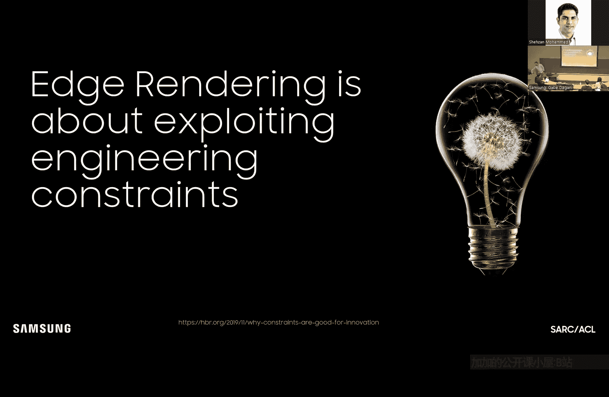
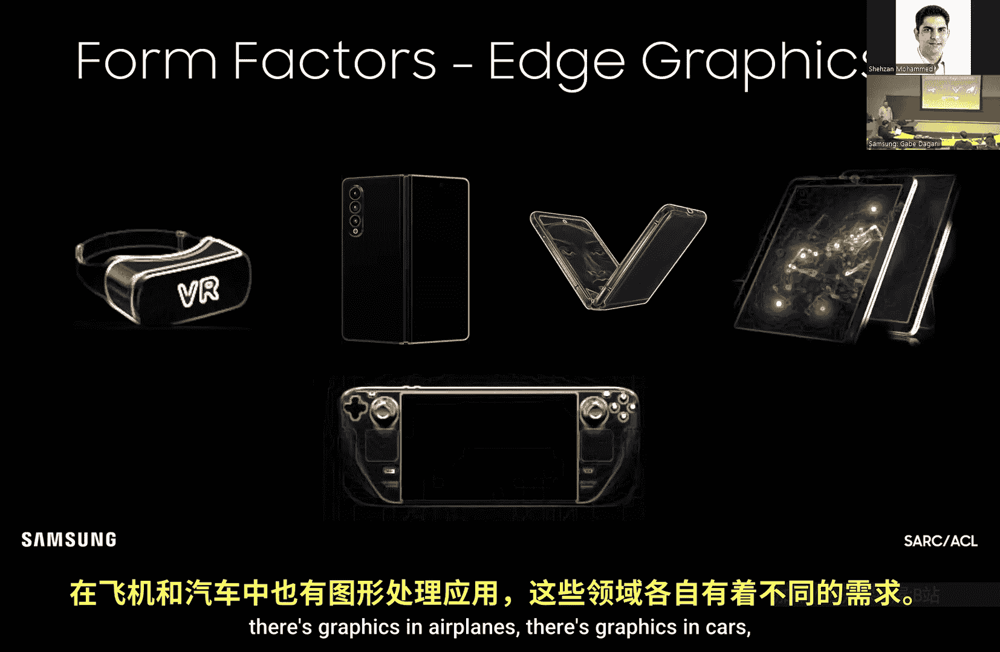
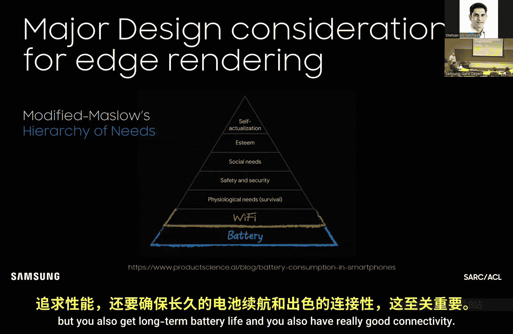
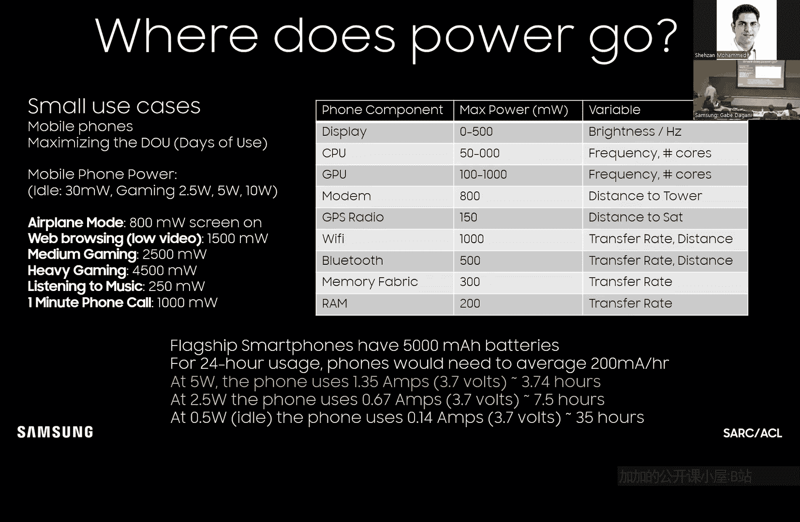
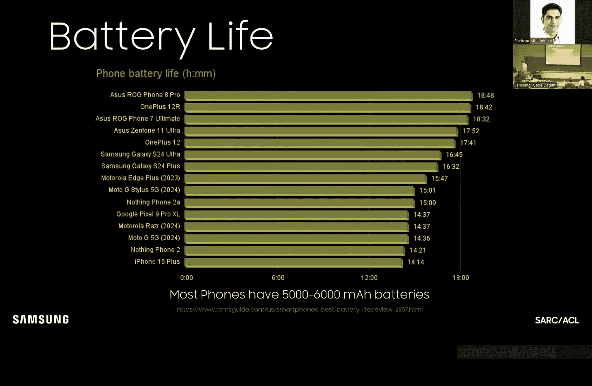
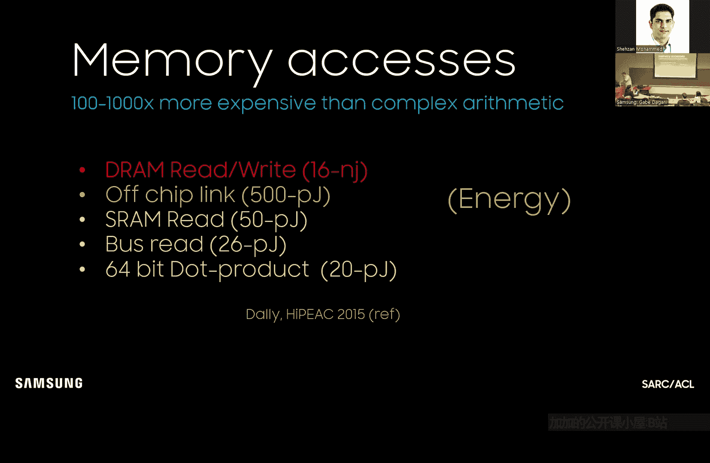
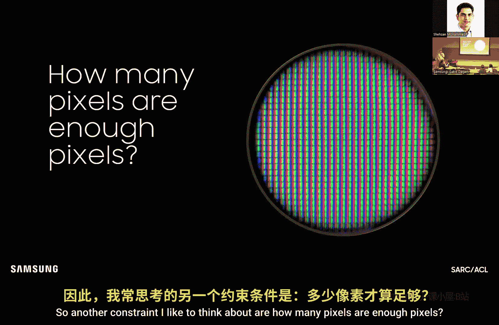
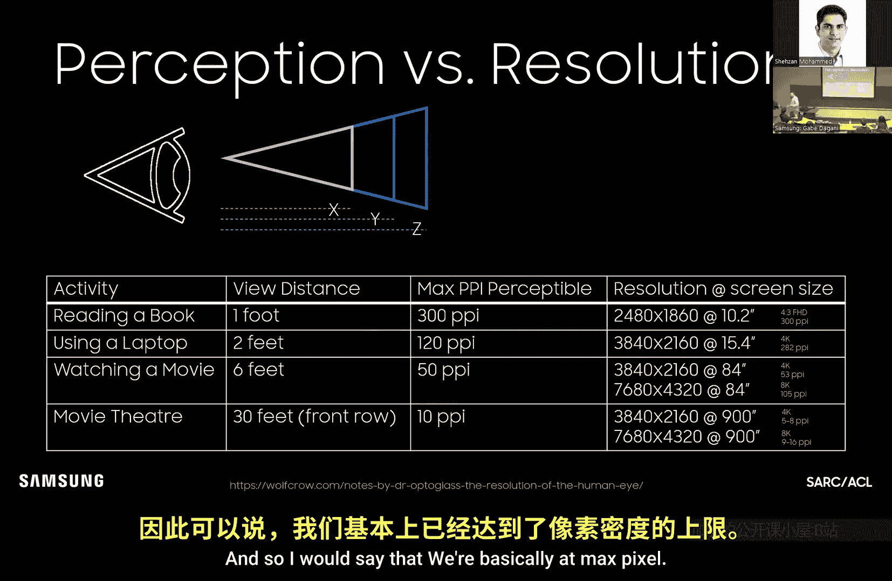
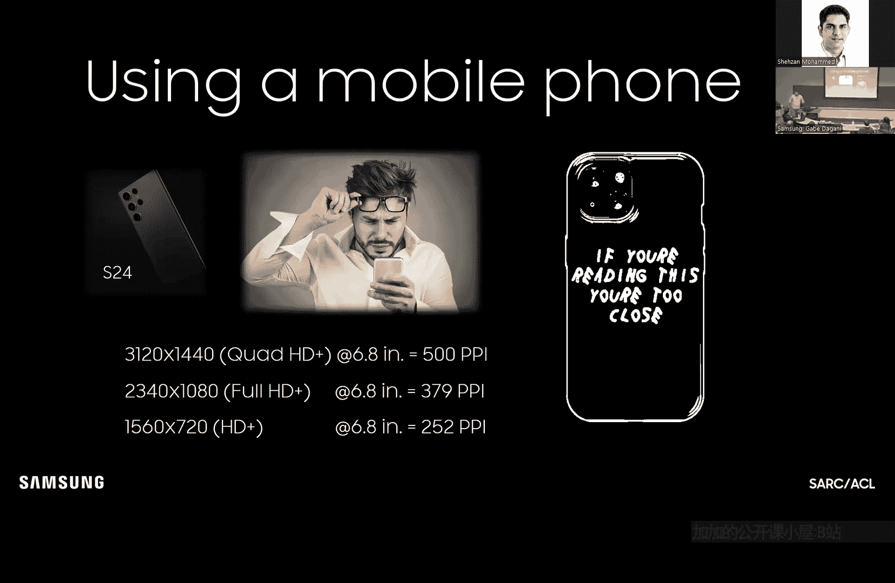
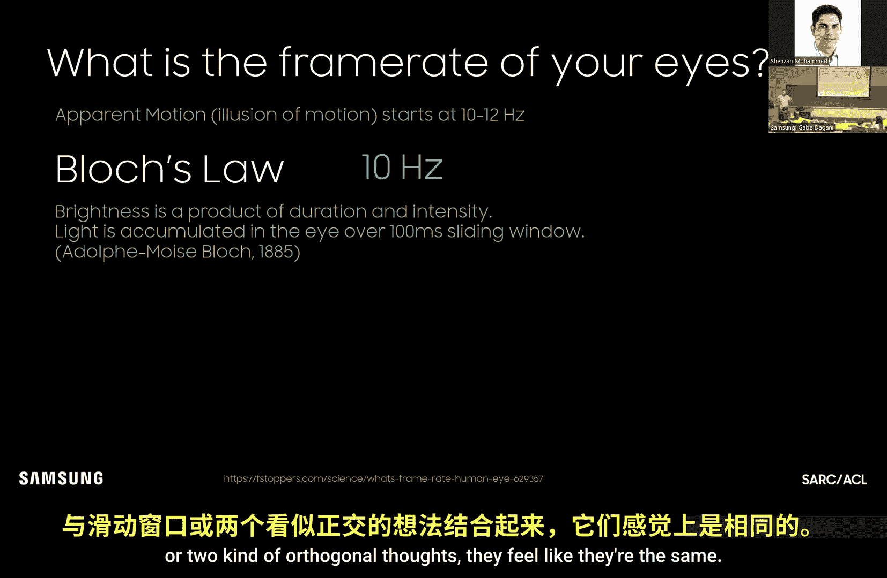

# 宾夕法尼亚大学【中英⚡GPU编程｜CIS5650 2024 GPU Programming】 p23 P23 2024-11-18 - Guest Lecture 4 Graphics on the Edge by Gabe Dagani -BV1JeMnzFEWv_p23-

our final guest lecture of the semester， a special one we have Gi Bri Grni coming from all the way from Austin gave leads Samung's GPU software decision called their in X chips so really heavily involved in the graphics drivers another software that literally runs the GPU so we are very excited to have you you for coming gave spend the vast majority Samsung before that had students that Intelport another graphics placesbe's third guest lecture in the class all in person I think that might be a effort by itself I like doing in person Iscape another alternative thank you。

嗯。So that was a pretty good introduction， so I don't think I need to say anything about myself anymore。

No， it was good， it was good。So I try to talk about something that's different from all the other like super engineers and super genius as you've already heard from。

 and I think the one thing that makes me unique is that we are making GPs for cell phones。

And there's a lot of constraints that come with having something that you can fit in your pocket that lasts all day and that doesn't burn a hole in your genes。

So I want to talk about what those constraints mean for GPU and graphics。

So as you can tell， like I just said， we have lots of form factors for graphics that don't just include a big graphics card in a desktop or in a server or even in your laptop。

So I've worked in graphics and pretty much embedded almost my entire career。

 I did do a stint of Intel working on like desktop graphics and then I've moved around to console graphics。

Cell phone graphics， automotive graphics， industrial graphics， there's graphics and airplanes。

 there's graphics in cars。

And so they all have different requirements。This is more of a joke slide。

 but it's also important where you've heard of Masl's you know hierarchy of needs。

 they just add Wi-fi and battery for the modern human as something that's super important。

 in fact when's the last time I think anyone has turned or not used their phone in a day， right？

Like if you had like a phoneless day， it feels like you're losing a limb。

And so it's very important that you don't just get performance。

 but you also get long term battery life and you also have really good connectivity。

So one question that I like to typically think about is where does all this power go in your pocket？

And so this is a lot of information， I'm going to kind of talk over it。But with mobile phones。

 we call one of our main primary strategies or our targets is to maximize the DOU or days of use。

And so that's almost more important than having the most powerful rocket ship in your pocket that you could possibly have you want something that will last for a long time。

And so we look at the different mobile phone power settings and I think for us Ile is like 30 milliwatt。

 I know that won't say a lot to a lot of people， people don't think in terms of that。

 but I'll kind of talk about it a little bit， we have gaming at two and a half watts。

Gaming at five watts and then super powerful peak gaming at something like 10 watts okay and so if you look at this。

 we say in airplane mode when you don't have a lot of radio。

 you're using a basic basically 800 millwatts， which is mostly screen and a little bit of power。

Web browsing 1，500 milliwatts for your TikTok videos。Okay。You got medium gaming， 2。5 watt。

 This is like your candy crush and your brawl stars。Heavy gaming at close to five watts。

 this is like something。Not quite ginian impact， but maybe something that's more along lines of。

A a lot more than a 2D scroll， definitely 3D。ok。You have listening to music， it's almost nothing。

 a quarter of a watt， you can do that for a long time and then one minute phone call is one watt。

 it's actually a lot。And so we look at this， where does this go。

 say display can be anywhere between zero and 500 millwatts， half atatt。

 depending on your brightness。CPU is， so I should say 50 to 1000 watts。

 so I messed up GPU between 101 watt。Moem 800 ish if it's on and doing something and these are variables obviously this is what can change make it go higher lower you can have brightness or frequency distance to tower for RF transfer rate on wfi and Bluetooth memories the transfer rate and Ram RAs transfer rate and so I look at these kinds of situations。

And you just， you know， you just do regular algebra not algebra。

 but just simple arithmetic and you say flagship smartphones have about a half 5。

000 million amp batteries for 24 hour usage at five watts。You know， playing a pretty heavy game。

 you'd have about three and a half hours of gameplay。At two and a half watch。

 you'd have double that seven and a half hours。And if you wanted to be idle。

 it should last for something like 35 hours， that sounds about right？You know。

 just looking at that math。

And you look at the battery life a little bit longer and we say most phones have between 5000 6000 milliamp hour batteries and so youd see all the fancy phones from this past year have anything from 14 hours to 1819 hours of battery life just to general use just if you take an average of what most people do and that's about right to and this is kind of where that comes from。

So。

まぜかな。And so when you think about it， like what is where is all of the power going on the chip？

And I really like to point out that。Memory accesses the DM are over two orders of magnitude more expensive。

Than any kind of arithmetic。So you have DM rightss。

 16 injoules doesn't sound like a lot when everything else is in Picojoules it is。Okay。

You have off chip links， like if you have RA that's outside of the chip。

 anything that uses a Phi or a physical output。It has to have an amplifier up。

 an amplifier down that costs a lot of power。 that amplifier costs power that opt amp。

You have SRAM reads 50 picojoules， bus reachs， 26 picojoules。

 but a 64 bit dot product it's only 20 picojos， it's almost nothing。

 that's an expensive high precision calculation， which means that sometimes it's going to be more power efficient to procedurally generate the data if you need than to read it from a table。

So another constraint I like to think about are how many pixels are enough pixels？

goinging back to like first principles。You know that humans older than five years typically can't focus closer than four inches。

Right even VR， they're making like they're doing some lens cleaning to get that perspective in focus。

At  four inches 2020 Vi， you have a max perception of 2200 pixels per inch。Legally accepted 2020 Vis。

 about 900 pixels pered。But I'll tell you， that's way， way too much。

So let's just think about like what we typically do， reading a book at one foot。

 the max PPI perceptibles， about 300 pixels perch， which is what a Kindle is。

If you look at the Kindle stat， it' 300 pixels perch。Using a laptop of two feet， about 120。

 you think about that because。Your ability to distinguish pixels is diminishing in a inverse。

Square lot type of rate， watching a movie at six feet。

 50 pixels per inch and then movie theater at 30 feet front row is about textbook 10 pixels per inch and if you look at what we typically see in resolution。

 we're doing way better。Reading a book at the rate that at a Kindle is。

 it's already over 300 pixel per inch， at's maximum， can't really see anything lower using a laptop。

 we need 120 and typically a 4K laptop has 280 twice as much as you need。

 which is why a 2K laptop is probably okay。Watching a movie 4K is exactly at the max perceptible。

 8K is way overkill， you can't even see the difference。In a movie theater。

 this is the only one where if you're on the front row。

 maybe 8K would be better because at 4K or at 5 to8 PPI when you can max seat 10 pI。

 that's just like perfect vision。But at8K， it actually is above the vision constraints and so I would say that。

We're basically at Max Pixel that's kind of what I'm trying to get at and the next slide kind of talks about that a little bit so at phones we're not going to keep jamming more pixels onto the screen there's just its it's worthless it's not actually providing value but it's taking more battery。

So I'm also going to go first principles yeah。Yeah。

We'm about to go into the refresh rate that was a great transition thank you placed I planted this guy in the audience。

So what makes a picture move？I know there's a book called the Biography of the Pixel by Alvire。

 it's awesome， please read it， it's really good it's this thick but half of its bibblography so you can feel really good about yourself。

So what is the frame rate of your eyes， that's actually a trick question your eyes don't have a frame rate。

A parent motion kind of starts at 10 to 12 hertz， but the reason that's true is because your eye accumulates light over 100 millisecond sliding window。

So you're always seeing 100 milliseconds in the past。Does that make sense？So as your eyes accumulate。

I know right and this is called Bs law and。Having the idea of a frame rate with a sliding window or two kind of orthogonal thoughts。

 they feel like they're the same and so you can have an apparent motion problem， but it's not exact。

