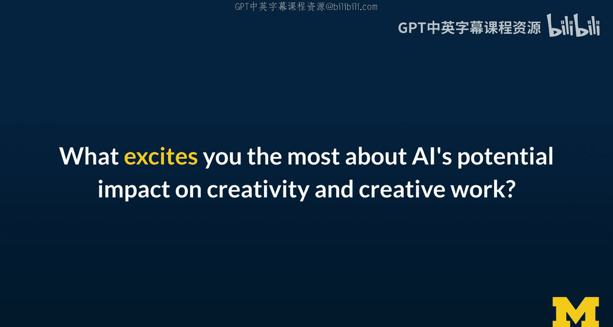
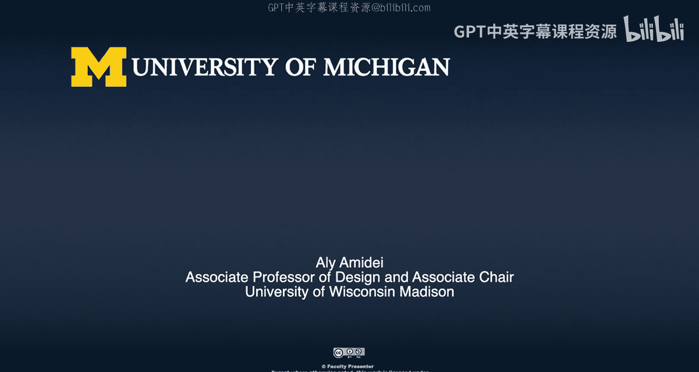

# 密歇根大学《AI用于创意工作｜AI for Creative Work》中英字幕 - P10：9_领域之声：艾丽·阿米迪.zh_en - GPT中英字幕课程资源 - BV1DXNiznEXk

So far， AI has impacted my creativity by allowing me to take big risky swings。

 basically prototyping an idea to give me a proof of concept in a fast and low stakes way。

 it can foster experimentation that lessens the negative impact on my art practice and project flow。

