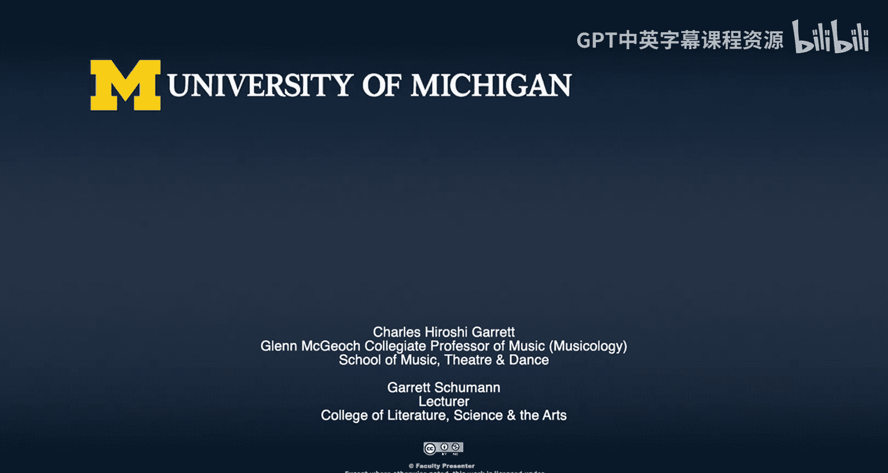

# 密歇根大学《AI用于创意工作｜AI for Creative Work》中英字幕 - P12：0_欢迎学习本课程.zh_en - GPT中英字幕课程资源 - BV1DXNiznEXk

We've begun to explore how AI tools are being used to enhance creativity in the workplace。

 and you have had a chance to consider how integrating AI might impact your own creative workflow。

 Let's take a moment now to think about next steps。

Before adopting the latest and greatest AI application。

 it's crucial to think critically about weather and in what situations it's appropriate to integrate AI。

How do we learn to use AI responsibly in a creative context？

 Is there a set of best practices for using AI in the workplace。

 Is AI always an appropriate solution to meet the challenges we face， in this module。

 we turn to the practical and ethical dimensions of using AI in a creative context。

 It's important to understand the capabilities， as well as the limitations of AI。

 And it's especially important to assess and weigh the risks of using AI in the workplace when it comes to key issues related to AI governance。

 Su， data security and intellectual property。 We'll begin by discussing how to use generative AI responsibly。

 how to keep up with the legal landscape that surrounds AI and how to steer clear of reputational risks that can arise when companies adopt AI tools for the wrong tasks。

 Then we'll arrive at a central component of the entire course。

 a process that you can use to identify， evaluate and either justify or rule out。

The use of any AI tool， we call this essential four step process， Cif。Which stands for specifyify。

 identifydent， focuscus， and trust by applying this process to your work by learning how to sift through your AI options。

 you will be able to start enhancing your creative work responsibly， ethically and productively。

