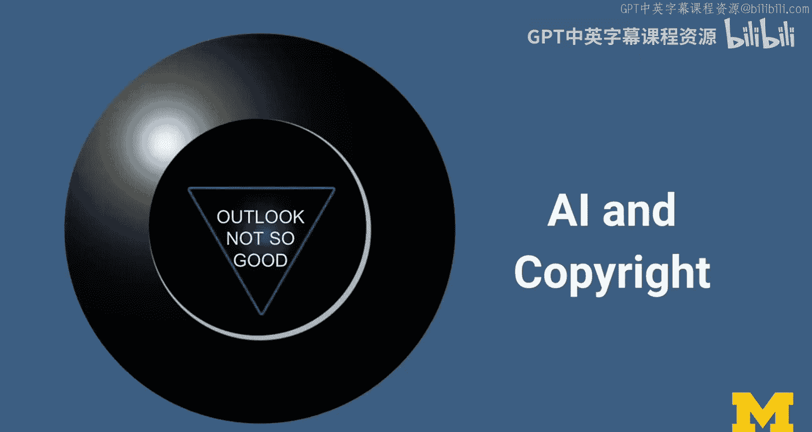
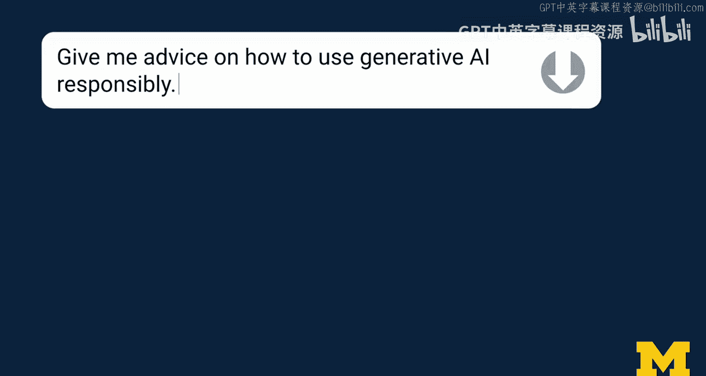
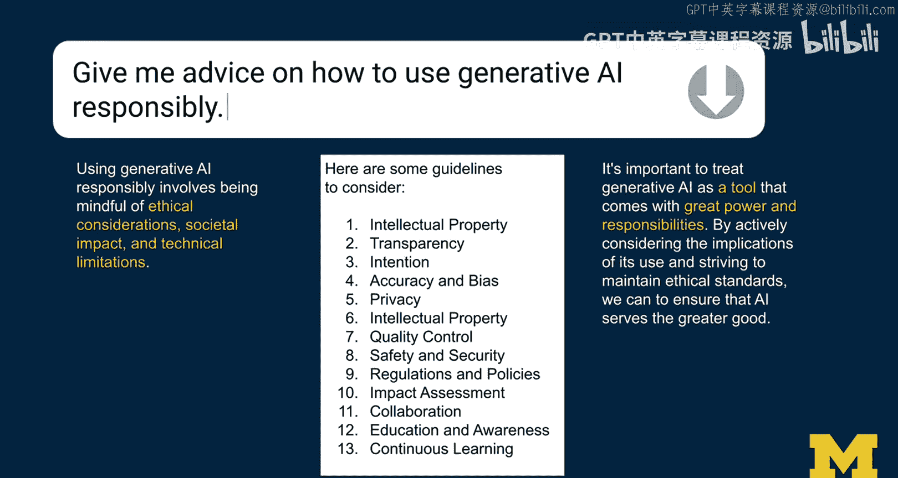
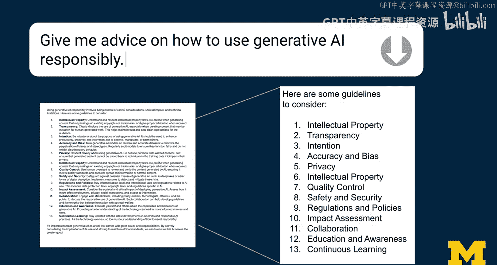
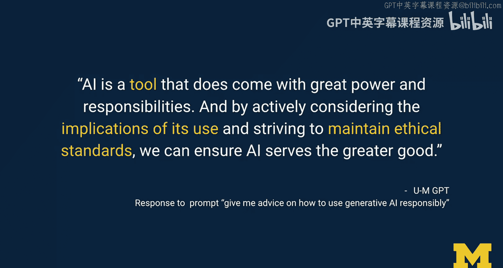
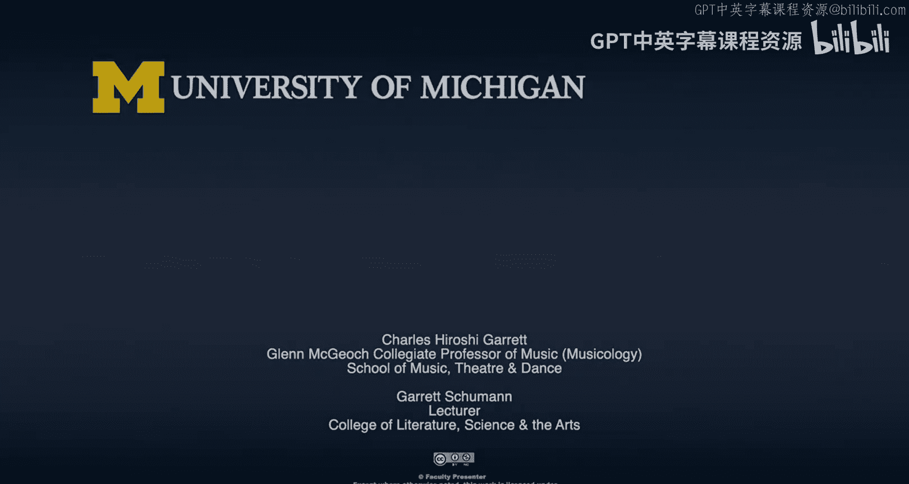

# 密歇根大学《AI用于创意工作｜AI for Creative Work》中英字幕 - P13：1_生成式AI的负责任使用.zh_en - GPT中英字幕课程资源 - BV1DXNiznEXk

Generative AI is advancing so quickly that it's easy to get the impression that AI can solve any problem effortlessly。

 can answer any question accurately and can do so with just a push of a button。

Being caught up in the AI revolution also means many people feel urgency to hurry up and use AI to start integrating AI into our daily lives to not get left behind。

The sense of being immersed in everything AI all at once can be exhilarating。

 but sometimes exhausting。Tremendously exciting， but sometimes terrifying。

If you are taking this course， there's a good chance you're interested in how AI works and how it may help you become more creative。

These are two key goals for this course。But we also want to encourage you to take your time to learn what AI can do and recognize what it can't do at least not yet。

Just like learning to ride a bicycle or to bake a cake for the first time。

 it's important not to rush ahead。 You want to make sure not only that Gen A I can deliver the right results for you。

 but also to confirm Gen A I is the right tool for the job in the first place。

We encourage you to take your time with generative AI so you can discover its capabilities and think carefully about whether AI is appropriate or perhaps not appropriate for each task。

 for each project you aim to complete。

It's always worth thinking about whether AI is a right solution when it comes to issues involving ethics。

 sustainability， security， and intellectual property。

Here are three types of questions you can always ask yourself about AI。

Is it worth asking AI to perform a task that I can easily handle myself。

 considering that AI data centers already account for more than 1% of global electricity use。

Probably not if you care about the planet。Even a simple web search is far less resource intensive than querying a chat bot for basic information。

 Is it safe to use AI for proprietary work projects if the Gen AI app I want to use cannot ensure privacy and confidential data management。

Don't count on it if you want to protect your company and your customers。

Should my project team subscribe to an AI software package that is under fire for copyright violations and busy fending off IP lawsuits？

The outlook for adopting that software package is not so good。

Just there are many attractive reasons to adopt AI。

 there are also bright red flags that you can learn to spot before plunging in。Interestingly enough。

 AI chatbots often are able to help you answer these sorts of questions since they are fairly well trained on these issues。

Here I ask the University of Michigan Genrative AI tool， UMGPT。

 for advice on how to use generative AI responsibly。

UMGBT is a Gen AI program specifically tailored for use at the University of Michigan that draws on popular Gen AI language models。

 including GT4 from Open AI。And here is how the Michigan chatbot responded。

We can see the power of this chat bot， which immediately identifies more than a dozen ways in which you can explore how to more responsibly use GenAI。

As you review these suggestions， many interesting questions will come to mind。

How might your use of generative AI affect other workers in your work group or your company？

Do you think your use of AI might impact employment in your field or in other fields？

How can you better educate yourself about the capabilities and limitations of generative AI？

You can even ask your chatbot to tell you when it was last trained。

 whether it has special expertise in a particular subject。

 and also whether it remembers and learns from all of your prompts and exchanges or whether it keeps all of your chat conversations private。

UMGPT's helpful response concludes with an important observation worth underscoring。

AI is a tool that does come with great power and responsibilities。

 and by actively considering the implications of its use and striving to maintain ethical standards。

 we can ensure AI serves the greater good。

In the next module， we will explore in greater depth Two areas of special significance when using AI creatively in the workplace。

 First， legal issues related to AI and second， reputational risks of using AI。

