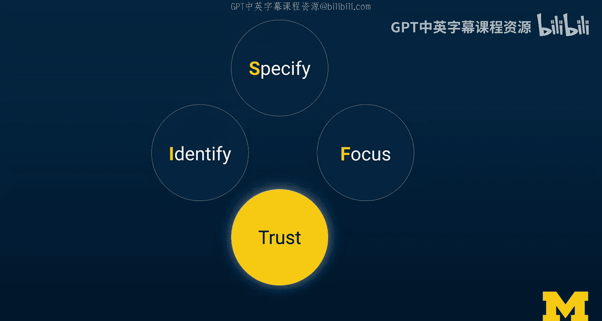
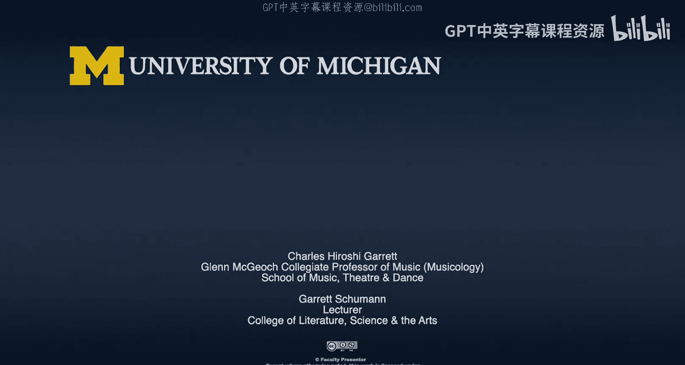

# 密歇根大学《AI用于创意工作｜AI for Creative Work》中英字幕 - P16：4_SIFT方法导论.zh_en - GPT中英字幕课程资源 - BV1DXNiznEXk

By now， you have already seen many examples that show how locating。

 understanding and assessing AI tools is critically important to the way people incorporate this technology into their creative work。

Here we'll introduce a structured approach to evaluating AI that's designed to make the process simpler and more reliable learning how to engage closely with AI technologies will also make it easier for you to justify whether to use AI or not to use AI to your managers。

 employees and clients We call this process Sft， specify。

 identify focus trust because it aims to help you sort through the vast array of contemporary AI tools and feel confident that you've chosen something that fits you the way you work and the way your organization operates If you are an individual creative professional。

 Sft will guide you to consider how the AI tools you are evaluating。

 support your workflow and brand as well as enhance your creative practice Sft will help you decide whether an AI tool is suitable for your creative work。

 compatible with your workflow and aligned with your goals and your mission。

Will help you make intentional choices about the technologies you choose to adopt by providing a consistent step by step process for evaluating AI To follow the SP process。

 all you need to do is specify the task you want to achieve with an AI tool and or the assistance you want an AI tool to provide to your work。

 you must know what you want the AI to do。 Otherwise you will not be able to find the best tool to use It is also critical that you understand how you benefit from adding AI into your workflow Next。

 identify the risks using AI may pose to you and your company's brand。

 as well as your organizational philosophies and workplace culture Next。

 focus on your voice as a creative worker。 How can you use AI to support。

 enhance and sustain your individual point of view。Finally。

 be sure you can trust your AI provider and where your chosen AI tools source their data。

In a moment， I will go into more depth on each of the steps in the Sift process。

 Then you will have the opportunity to apply Sift to your own creative needs and to reflect upon the best ways to align your workflow with today's AI tools。

 It's exciting to discover how AI might enhance your creativity and improve your work。

 But there's no need to rush。 So take the time to think carefully before you commit to an AI tool and always ask yourself whether AI is truly the best solution for any task you need to complete。

