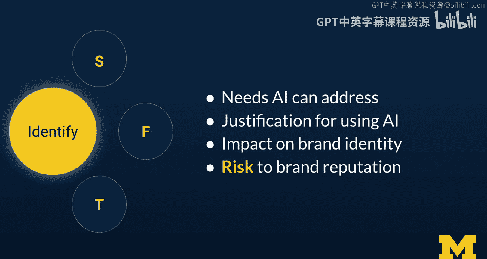
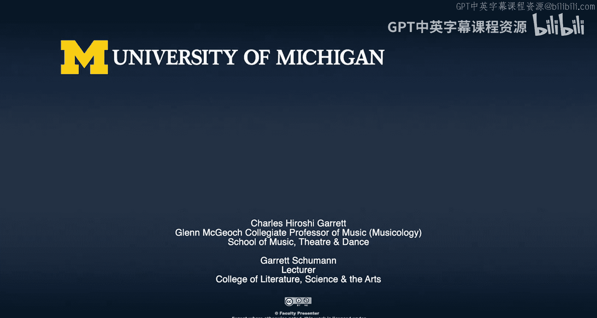

# 密歇根大学《AI用于创意工作｜AI for Creative Work》中英字幕 - P18：6_身份验证.zh_en - GPT中英字幕课程资源 - BV1DXNiznEXk

After specify， the next step in the Cft process is identify。

 which challenges you to consider the implications of using Gen AI on your working relationships and brand identity。

 It is critical for you to identify both the needs you hope AI can address and the justification for using AI to do so over other methods as this technology has been adopted more widely。

 We have seen instances where workers and enterprises disagree on the value provided by and the necessity to employ Gen AI tools。

This very issue was a contentious point in the dual strikes by the Scen Actctor's Guild and Writers's Guild of America in 2023。

Both groups of workers sought protections from film studios against applications of Jen AI tools that might threaten the longevity of their creative work in film and television。

AI has always been used to optimize and streamline laborious processes。

 But the fear that new generative AI software might replace or diminish people's roles in particular fields is not inherent to the technology。

 We， as people， must decide individually and collectively。

 how these tools are used and what their impacts on existing ways of work will be。

 The sag and WG A strikes show that in an enterprise setting。

 decisions around implementing AI must be made collectively。

 or else creative workers may struggle to justify using this technology and see it instead as a threat。

It is also important to use a similar thoughtfulness and sensitivity when you identify the potential impact of Gen AI on your brand identity。

Earlier in this course， I discussed the evident reputational concerns attendant to this technology in the musician Drake served as one example of how transparency can help avoid negative responses from consumers and audiences。

That instance also revealed Drake's lack of brand awareness or his indifference to creating a long standing connection to Gen AI music tools。

 both of which made the situation worse。 Drake's voice has been the target of AI synthesis software since 2023。

Although he himself did not choose to participate in AI generated songs that use a computerized clone of his vocal style。

 and he is not responsible for those projects， it is important for Drake to understand the implications of this longstanding association with Jan AI when he chooses to engage with the technology publicly。

This kind of consideration is a sobering reality that comes with the use of generative AI tools。

 For example， a nonprofit that works on environmental justice advocacy risks more with their brand's reputation by using Gen AI to create images for marketing materials on account of the technology's high energy requirements than an a company position differently。

It is very likely that you and or the organization you work for already has best practices in place to preserve and protect your public image。

The identify step in the Sft process encourages you to think clearly about interpersonal dynamics and brand identity before you use GenI so that applying this technology feels proper and justified to the people you work with and work for。

