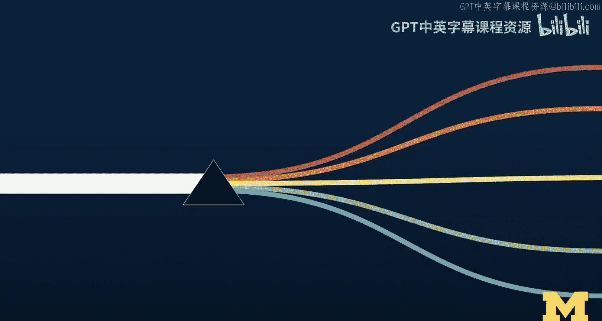
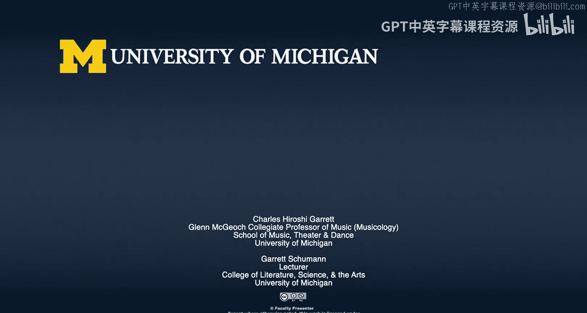

# 密歇根大学《AI用于创意工作｜AI for Creative Work》中英字幕 - P19：7_聚焦核心.zh_en - GPT中英字幕课程资源 - BV1DXNiznEXk

The third step in the SP process is focus， which encourages you to bring Gen AI tools into your creative work in a manner that centers and emphasizes your distinct creative voice。

You might be able to tell that this component of SiIF complements the previous two。

If you succeed at specifying what you need AI to do。

 it is more likely you will be able to focus on your creative voice as you work on your next project。

 Likewise if you feel like you are able to meaningfully express yourself while working with some Gen AI tools。

 it will be easier for you to avoid some of the intraorganizational risks discussed in the previous video on I as an experienced creative professional myself one way of thinking that helps me imagine applications of AI to my work that do not mute my individual perspective is to consider other forms of automation and workflow efficiency that already benefit me。

I am a composer and something that I use all the time in my work with notation and digital audio workstation software is hotkeys。

 Any creative worker who uses a computer probably depends on hot keys too This feature eliminates steps of my workflow contacts between me and the software I'm using。

I benefit creatively because I have more time to focus on the part of my practice and process in which my voice shines through the most。

Anyone can click a mouse， but not everyone can create the music I make。

 so I benefit from using the automation of hotkeys to give me more time to focus on the parts of my work where my individuality makes the biggest difference AI can do this too if you use the right tools in the right way。

Consider the example of a hip hop producer， beatmakerr or remix artist whose creative practice is divided between the logistical task of collecting audio files to incorporate into their musical projects。

 and the creative task of blending disparately sourced musical examples into exciting new works。

 like a prism that separates white light into individual colors。

 AI tools like moiseous and vocal remover can make the once arduous process of creating isolated stems of individual voice and instrumental parts from recorded songs。

 much more efficient。The trade off in this scenario is demonstrably beneficial for the creative workers involved。

The AI software provides a new opportunity to offload busy work that typically is not a place for meaningful individual expression。

 As a result， more of their work time can be dedicated to exercising their creative perspective。

This is a specific example， but any creative worker deals with tedious or boring parts of their practice。

 The repetitive nature of projectbased creative work can lead to a sense of monotony and working in a way that focuses as much time as possible on your personal and unique expression is a powerful way to make your labor more meaningful to you。

 using AI in a manner that supports and facilitates individual expression benefits freelancers and enterprises alike because creative workers want to flex their point of view。

 This is the passionate drive that motivates us。 Another reason why it is important to focus on your creative voice when you bring AI into your work is it can help workers resist trends in the tech industry that only benefit the large corporations that develop gen AI tools。

An imagined creative practice in which JenAI image creation tools produce designs with no customization nor personal expression。

 and leaves the tasks of downloading the file， organizing it and packaging it for clients to the people whose passion is poor creativity leaves no one satisfied except for a far off tech CEO。

Focusing on your personal perspective as you explore bringing AI tools into your creative work will leave you space to be you。

 fulfill yourself， and take control over the dominant narratives in AI's relationship to human creativity。

