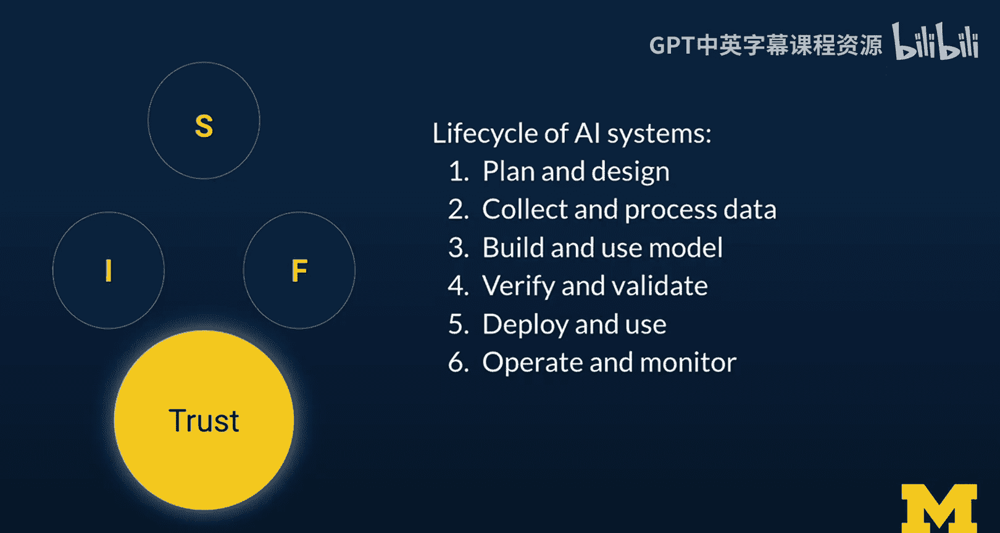
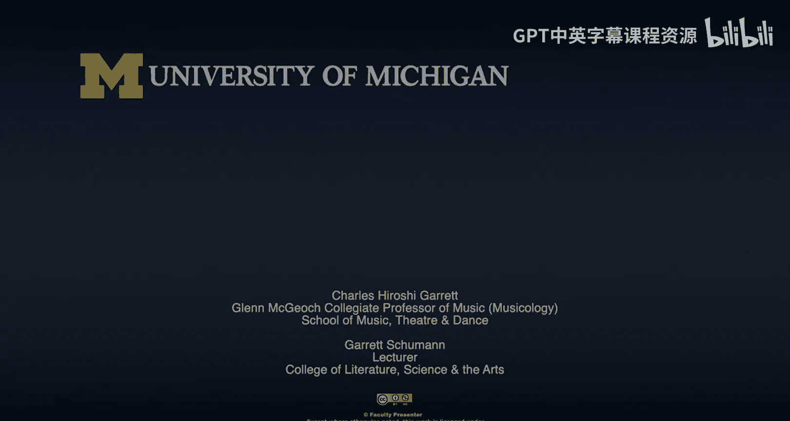

# 密歇根大学《AI用于创意工作｜AI for Creative Work》中英字幕 - P20：8_建立信任.zh_en - GPT中英字幕课程资源 - BV1DXNiznEXk

The trust component of the Sift process supports your relationship with AI tools by providing resources that will help you assess their reliability。

 dependability and other facts of their overall trustworthiness。By this point。

 you have learned to specify the tasks you want AI to accomplish。

 identify the impact AI may have on your work dynamics and brand and focus on the way AI can clarify and support your personal creative voice。

 Eablishing trust with your chosen AI tools is the final step in this process。

G AI may seem new and novel， and you may feel overwhelmed by its current cultural impact。

 as well as marketing strategies that tell the technology's potential strengths while minimizing its potential risks and weaknesses。

 But as the University of California at Berkeley's Center for Long term Cyber Securitycurity reminds us。

 Exp have emphasized trust as a key aspect of computing， cyberspace and automation for a long time。

The C， L TC cites this definition of trustworthiness from the National Institute of Standards and Technology。

Tworthiness is the demonstrable likelihood that the system performs according to design behavior under any set of conditions as evidenced by characteristics。

 including， but not limited to safety， privacy， reliability and resilience。

With respect to artificial intelligence， the C OTC outlines 150 different properties for assessing technological trustworthiness that connect to one of these seven characteristics。

Valid and reliable， secure and resilient， accountable and transparent， explainable and interpretable。

 privacy enhanced and fair with harmful bias managed。

As we have discussed in other material about evaluating AI tools。

 the enterprise that provides your AI software， service or system should be able to show how its product exhibits these qualities and understanding this comprehensive set of expectations can help you see where potential risks lie and weigh them appropriately based on your project's specific needs。

The CLTC also recommends consideration for an AI tools's engagement with and impact on people。

Does this specific piece of technology draw on human produced data。

 How does its application affect people， And the CTC outlines six stages to AI Tech's lifecycle。

 which is another detail to incorporate into your evaluation of a potential tool。

The lifecycl of AI systems is plan and design， collect and process data， build and use model。

 verify and validate， deploy and use， operate and monitor。

Gaiing full trust in your chosen AI tools will likely require an understanding of where the product lies in this life cycle。

 later stage steps like monitoring are crucial for the technology's longevity and sustainability。

Although the current state of US regulation regarding AI software means this framework is not standardized。

 you should expect transparency from whoever supplies your AI tools。

 If the developer provider cannot be clear about the product's characteristics and lifecycl。

 why should you trust it。

Now that weve engaged with the sip process in more detail。

 you can probably see how all four steps are reflexive and support each other in different ways。

Trust is easier to achieve after you have identified potential risks。

 It is easier to focus on how AI can enhance your individual creativity when you have specified what you want the technology to do。

 Now， all that is left is putting sift into practice。

