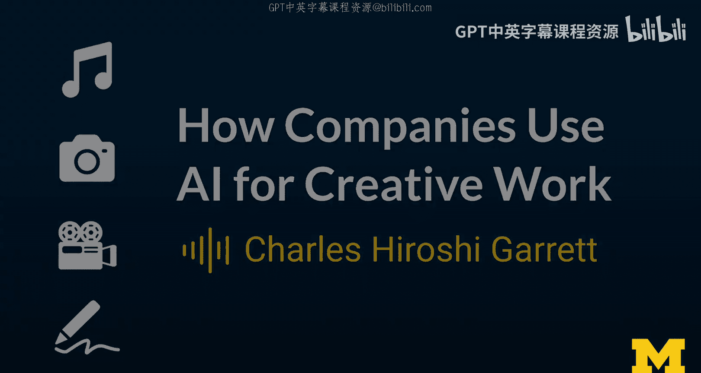
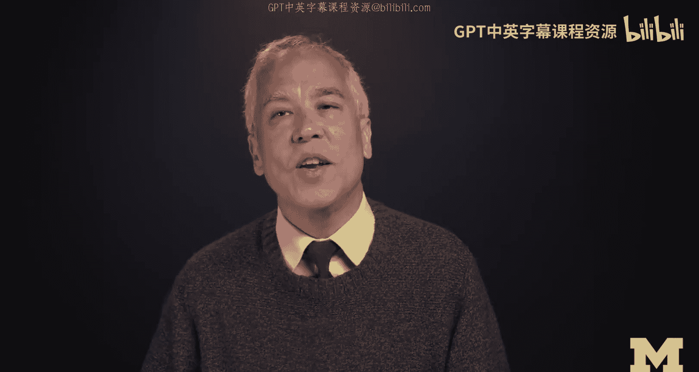
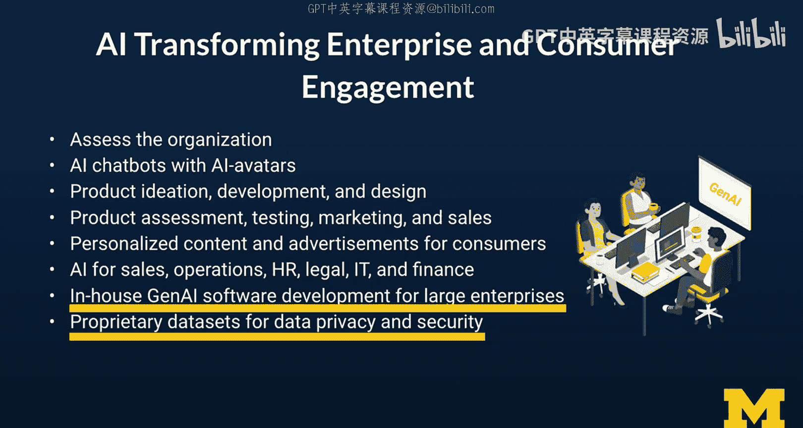
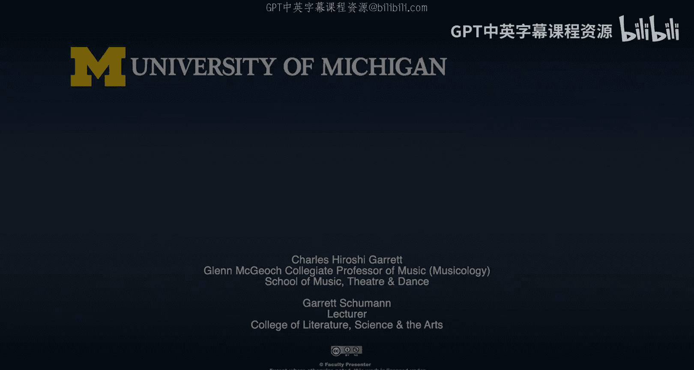

# 密歇根大学《AI用于创意工作｜AI for Creative Work》中英字幕 - P22：10_企业创意工作中的人工智能应用.zh_en - GPT中英字幕课程资源 - BV1DXNiznEXk

Generative AI is starting to reshape creative work， as we know it。Individual creative professionals。

 team leaders， project groups， large enterprises， even entire industries are exploring how Gen AI might assist。

 enhance and expedite the creative process。Integrating AI is not always simple or smooth。

 and revolutionary change is never without controversy。 Even so。

 Gen AI is being fused into the workplace at a very fast pace。

 and its impact to date is both wide and deep。 multifaceted and multidisional。

As this course makes clear， many creative workers are starting to harness the ability of Gen AI applications to brainstorm。

 to explore ideas and to generate new content， text， images， audio， video and much more。

 but the scope of transformation stimulated by AI is more pervasive。😊。

Many large enterprises now employ AI savvy personnel to assess their organizational structure。

 project workflow and internal processes to identify individual tasks and individual employees that would benefit most from AI automation or AI assistance。

By now， most customers are acquainted with public facing Gen AI interfaces that have been integrated into the customer service industry。

 including AI enhanced chatbots staffed by AI generated avatars。

AI is also transforming product ideation， development and design， as well as product assessment。

 testing， marketing and sales， just as Spotify's AI engine figures out what music to recommend to you。

 businesses across the spectrum are hoping Gen AI will help them target individual consumers with personalized content and advertisements。

Behind the scenes， GenAI is being used by salespeople， operations groups， human resources personnel。

 legal teams， IT staff and financial planners， whether to automate tasks， brainstorm ideas。

 improve efficiency， and or speed turnaround。Some large enterprises possess sufficient resources to develop their own in house Gen AI software。

 including large language models trained on proprietary data sets that consolidate insider knowledge while also preserving data privacy and addressing security concerns。

It appears that Gen A I is here to stay in the work。

 So this is a good moment for you to learn more about what Gen A I may or may not be able to offer to you as a creative worker。

