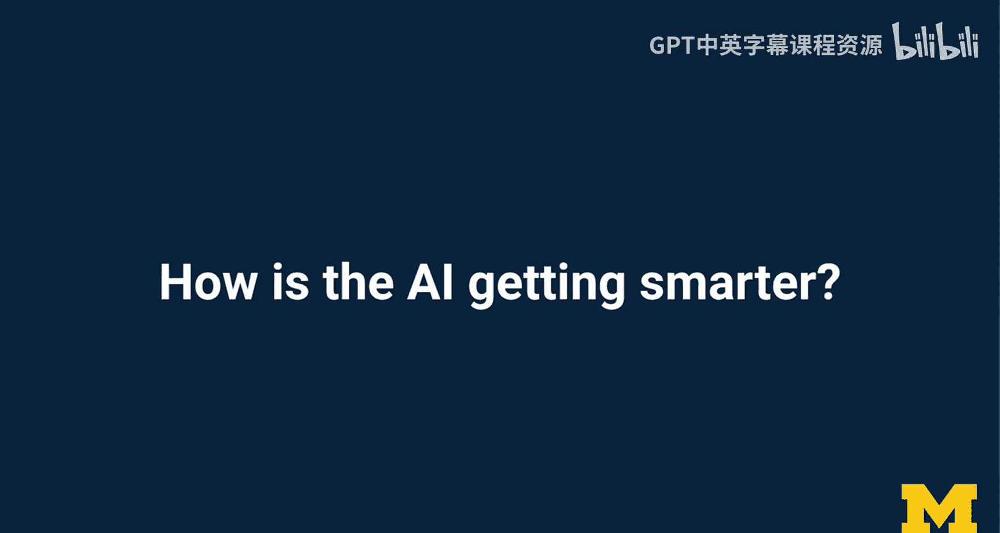
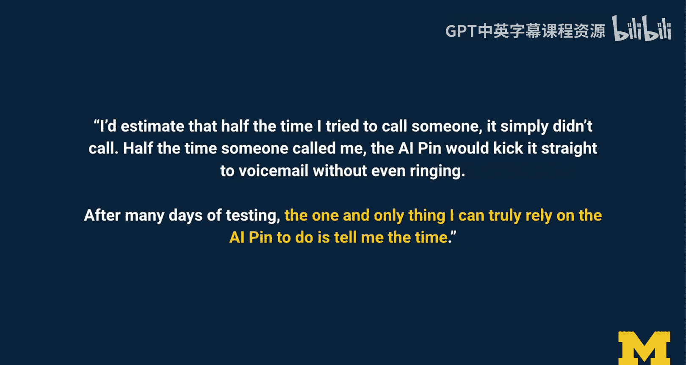
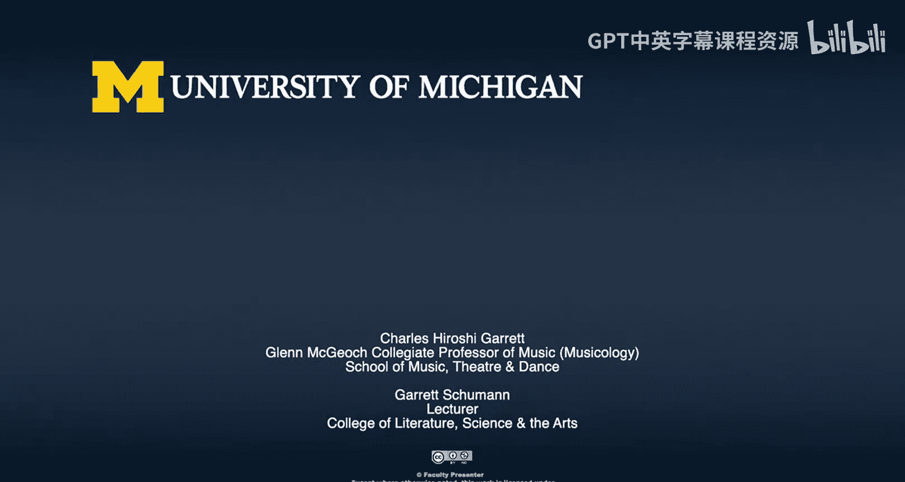

# 密歇根大学《AI用于创意工作｜AI for Creative Work》中英字幕 - P23：11_AI工具投资的批判性思考.zh_en - GPT中英字幕课程资源 - BV1DXNiznEXk

One of the most important decisions you， your group or your organization will probably make around generative AI is whether you should invest in a tool to support your work。

While the sift process you have already learned in this course can help you as you make this kind of decision。

 there are other considerations to keep in mind。

For example， Sarah Walker， a content marketing associate with cipher。

 an AI firm that specializes in creating compliant marketing materials。

 recommends directing these questions to your potential AI provider。

What types of AI are being used。Where does the data come from。How are the models performing。

How is the AI getting smarter。

You and your team should remember that generative AI is a product。

 and the companies that develop this technology use marketing to sell it。

Walker sample questions are very useful as they highlight concerns related to reliability。

 long term performance， and data provenance that are specific to certain AI tools。

But it is also important to assess AI tools like any other product you plan to purchase and integrate into your work。

In addition to price， factors like customer service and security。

 which are common to many other purchases your business makes。

 are also relevant to your evaluation of generative AI products。

Many AI tools are genuinely impressive， and virtually。

 all of them are presented to us as capable of amazing things。

 As we have mentioned at other points in this course。

 it is very easy to get swept up in the awesome power we are told to expect from Gen AI tools。

 but breathless excitement does not guarantee they are good products。😊。

David Pierce's review of the Humane AI pen published in the Verge on April 11，2024。

 gives us an instructive example of how to approach a new， flashy AI product。

Humane's website characterizes their wearable AI pen as something that takes users beyond touch。

 beyond screens。

The device is designed to take over many of the tasks we use smartphones to complete simply by listening to the user。

It even has a projector that displays texts， directions and other information on the user's hand when requested。

As Pierce describes， it can answer basic chaty BT style questions。 make phone calls， snap photos。

 send text messages， tell you what's nearby and more。

You can also do a few things just by tapping the touchpad， like keyboard shortcuts on a computer。

Double tap with two fingers to take a photo。 Double tap and hold with two fingers to take a video。

 Pierce acknowledges that Humane's marketing makes the AI pen seem like a phenomenally capable product。

 the bar here is high。Pierce begins his review by stating that the AI pen potentially could solve real problems involving smart phone functionality。

 I've come to realize that there are， in fact， a lot of things for which my phone actually sucks。

Often， all I want to do is check the time or write something down or text my wife。

 And I end up sucked in by Tik Tok， where my email or whatever unwanted notification is sitting on my screen。

Pierce continues。 Plus， have you ever thought about how often your hands are occupied with groceries。

 Cthe， Leashes， children， steering wheels and how annoying and unsafe it is to try to balance your phone at the same time。

I've learned I do lots of things on my phone that I might like to do somewhere else。 So yeah。

 this is something。But Pierce does not recommend the humane AI pen because simply put it does not work。

The AI pen is an interesting idea that is so thoroughly unfinished and so totally broken in so many unacceptable ways that I can't think of any one to whom I'd recommend spending the $699 for the device and the $24 monthly subscription。

Pierce describes his frustration with the product。 The more I tested the AI pen。

 The more it felt like the device was trying to do an awful lot。

 And the hardware simply couldn't keep up。He continues。

I'd estimate that half the time I tried to call someone。

 It simply didn't call half the time someone one called me。

 the AI pen would kick it straight to voicemail without even ringing。After many days of testing。

 the one and only thing I can truly rely on the AI pen to do is tell me the time。

Pierce's review is particularly instructive because it underscores the paramount significance of product testing to Pierce。

 the AI Pen's price only becomes a concern once he discovers it does not work。

The questions from Sarah Walker from earlier in this lecture are not related to a single specific product。

 but aim for something similar。 She wants to make sure the AI tool she assesses will work reliably and consistently for a long period of time without compromising user data。

When you evaluate AI products， it's also important to consider the product's sustainability in terms of the quality of what it delivers to the user over time。

As some large language models like Chat GBT have aged。

 AI generated content has made its way into the training data。

 making the text it generates less reliable。By testing products。

 consulting reviews and communicating with the product developer to assess how well they are performing over time。

 you can gain confidence that your chosen AI tool will sustainably deliver quality results。

