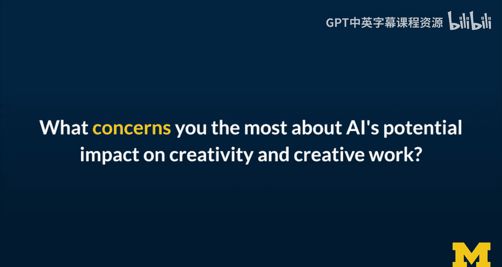
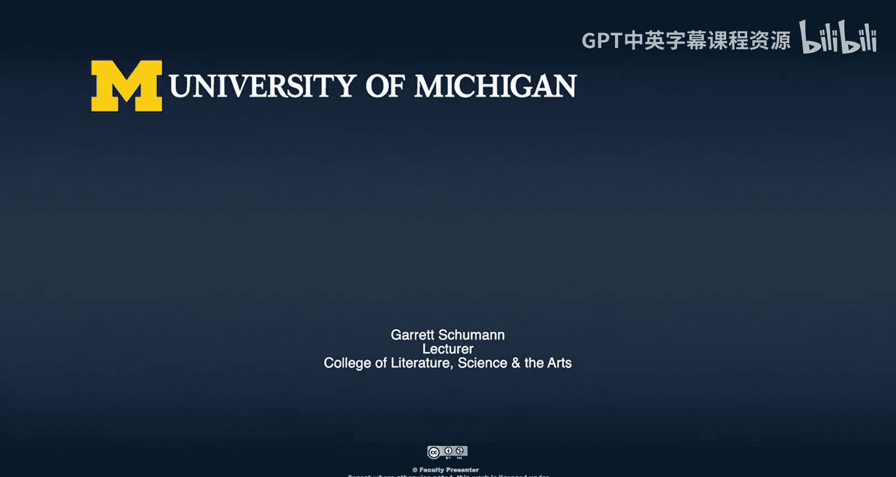

# 密歇根大学《AI用于创意工作｜AI for Creative Work》中英字幕 - P25：13_领域之声：加勒特·舒曼.zh_en - GPT中英字幕课程资源 - BV1DXNiznEXk

AI is a technology。 So like any other tool， the meaning it carries is limited to what we as its users。

 give it。I'm concerned that we don't know exactly what will come out of the way Jan AI programs in particular tend to be developed。

 which is with very little consideration for sourcing and data safety。Additionally。

 I find myself dismayed by applications of AI that reinforce existing structures of power and resources on a large scale。

 instead of using the technology's potential for transformation to change that status quo。

Another worry I have is that the industry developing AI is not strong enough to sustain the technology。

Current business reporting indicates there is little planning among the companies who control the resources powering current AI tools with respect to their and the technology's longevity and sustainability。

And it seems unlikely， at least in the United States。

 that governmentment regulation might intervene to incentivize that kind of forethought。

