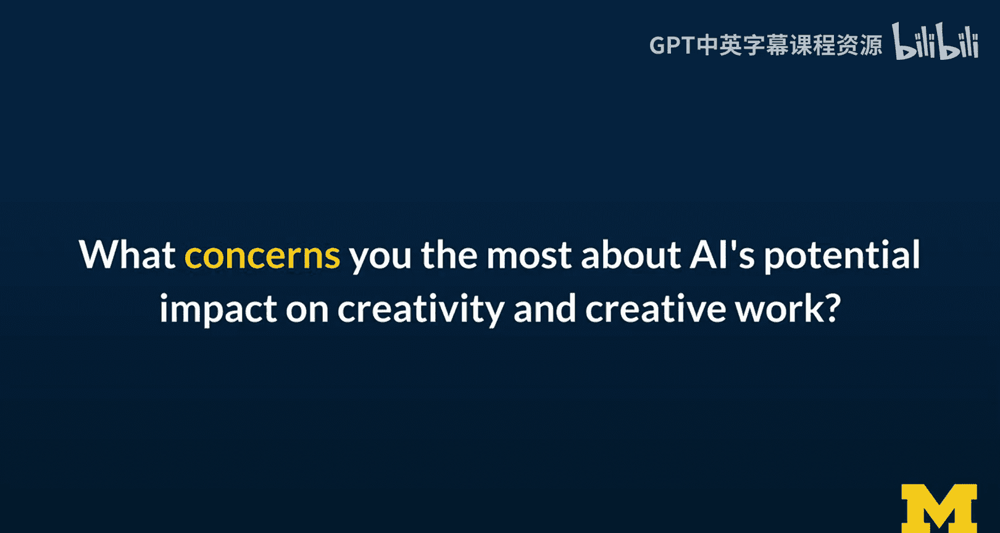
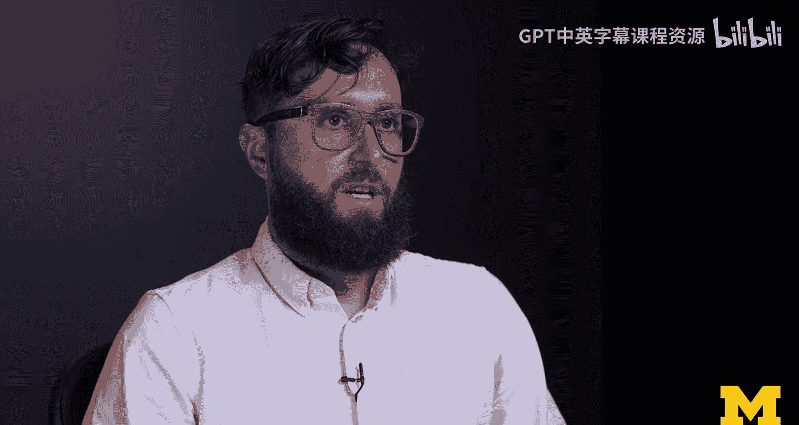
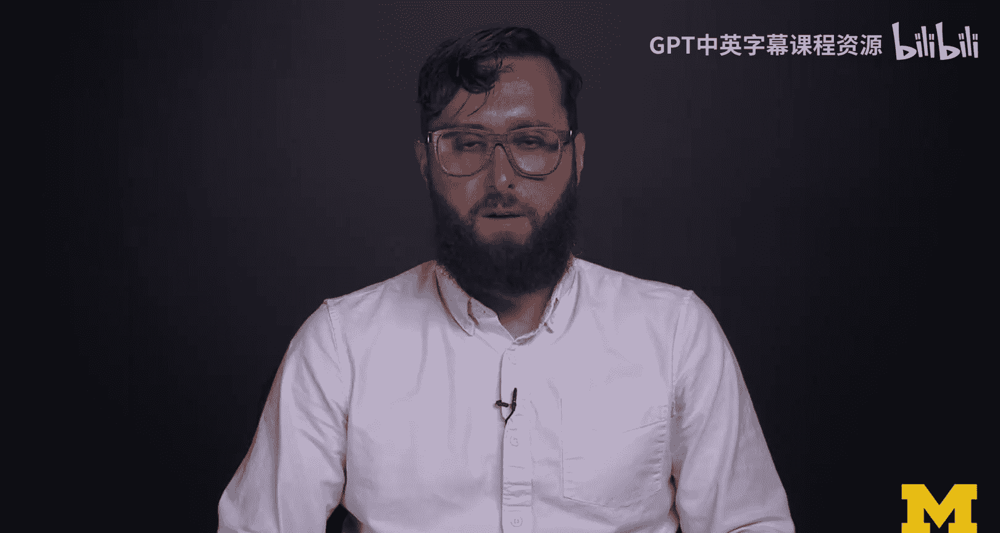
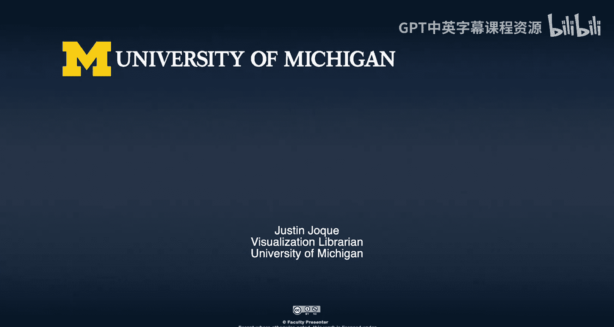

# 密歇根大学《AI用于创意工作｜AI for Creative Work》中英字幕 - P26：14_领域之声：贾斯汀.zh_en - GPT中英字幕课程资源 - BV1DXNiznEXk

My biggest concern is that AI will be used for creative work in context in ways that do not produce good quality artwork。

 because it is cheaper than humans。 It does not unionize or ask for a raise。

 I fear that it will be used extensively as a tool for making content。

 simply because it can further undervalue and exploit creative labor。

