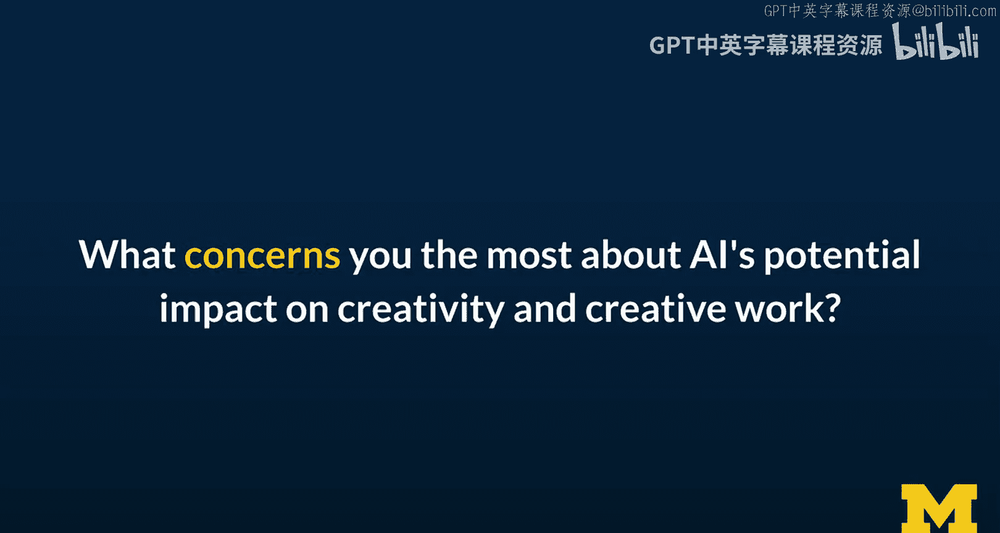

# 密歇根大学《AI用于创意工作｜AI for Creative Work》中英字幕 - P28：16_领域之声：亚当·昆兹.zh_en - GPT中英字幕课程资源 - BV1DXNiznEXk

Well， I think it falls in those same lines and I think it's not people and companies specifically trying to utilize AI to allow their employees to work。

At a higher level it's instead can they try to make less jobs and the same person just output far more work at the same level with less less employees working on the same project so I think that's a little bit concerning about it if we just are all going to raise the bar that's great if it's just let's do the same content but with less people and people being paid that obviously is concerning。

