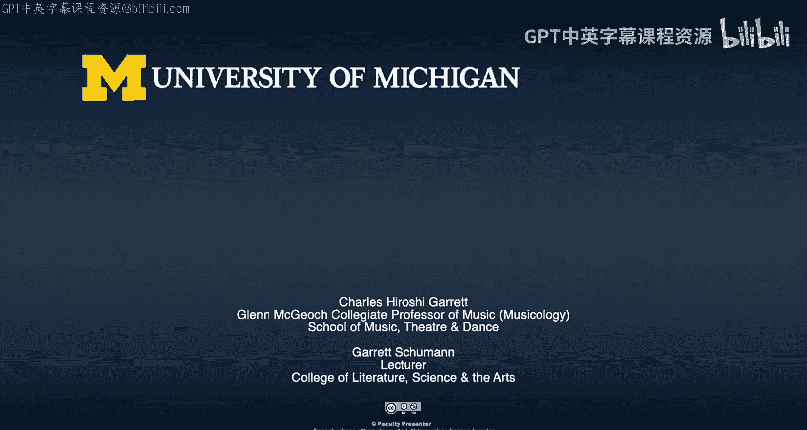

# 密歇根大学《AI用于创意工作｜AI for Creative Work》中英字幕 - P29：0_欢迎学习本课程.zh_en - GPT中英字幕课程资源 - BV1DXNiznEXk

At this point in the course， you've learned to think critically about AI to use generative AI responsibly when AI is an appropriate solution and to weigh the risks and rewards of using AI in the workplace。

 You also have learned about the sift process， which will help you assess the many AI tools available to enhance creativity in the workplace。

 Now is the time to go deeper and push further to think more deeply about AI and human creativity and to broaden your horizons when it comes to using AI tools in your creative practice。

 What makes creativity a fundamentally human quality。

 How can you learn to collaborate with AI while strengthening your individual voice。

 How does working with AI， in fact， help you retain your essential humanity。Ultimately。

 answering these questions requires reflection， so in addition to introducing new ideas and additional creative opportunities。

 we'll ask you to revisit material from earlier in the series to underscore the way these concepts resonate with you and your personal creative practice。

