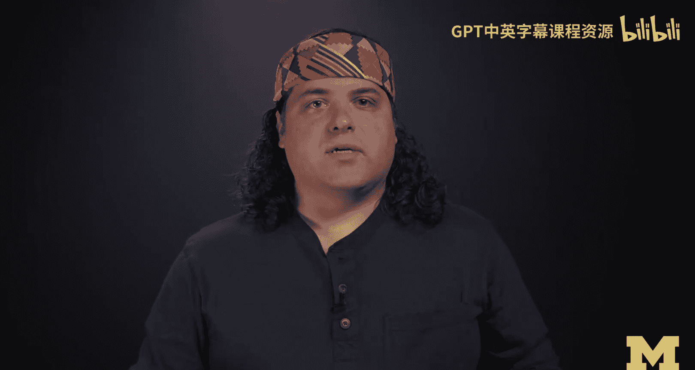
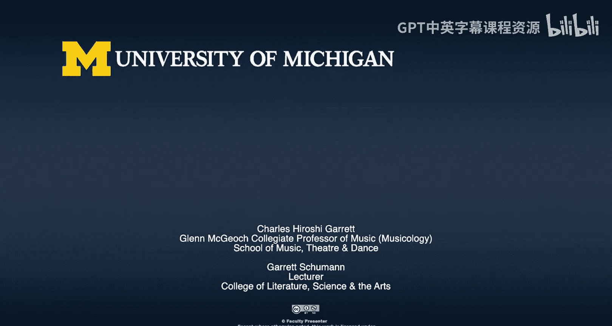

# 密歇根大学《AI用于创意工作｜AI for Creative Work》中英字幕 - P30：1_AI与深度思维.zh_en - GPT中英字幕课程资源 - BV1DXNiznEXk

The last two courses have exposed you to different ways generative AI might be able to support your creative work。

 as well as methods you can use to ensure you， your group and or your organization implement AI technology responsibly and sustainably。

By and large， we have focused to this point on the initial act of adoption and generative AI's immediate impacts。

This course will challenge you in thinking more deeply about how the tools you choose to add to your workflow might transform your creative practice and strengthen your individual voice。

We often see AI portrayed as a productivity multiplier。

 something that can maximize workers' efficiency by eliminating time consuming tasks that are either tedious and iterative or abstract and difficult to approach。

 but this perspective is limited。True， generative AI technology can save time to allow people to do more。

 but that more can and should mean more than just volume。After all。

 when AI simplifies someone's workflow， it also creates space for higher level thinking。

The following material incorporates lectures and readings to explore the benefits of deeper thinking and features demonstrations from experts and practitioners to show how powerfully AI functions in the real world。

Through contemporary and historical examples， we will see the impressive ways various creative professionals have used AI to expand their creativity。

 amplify its reach and reflexivity， and hone their working practices。

 AI has been the focus of decades of experimentation by creative professionals in various disciplines。

 and these precedents can form a valuable foundation as you engage with this technology in new ways。

Think beyond productivity。 Imagine what your creative work could be like if it could transcend the limits of its status quo。

 including many things you might never have considered before。

Sure， AI can be a time saveer， but it can also be a mirror that gives you a new vantage point on your creative thinking and processes。

 reflects your tendencies back to you and gives you a choir of voices instead of just one to carry your creative work to the finish line。

