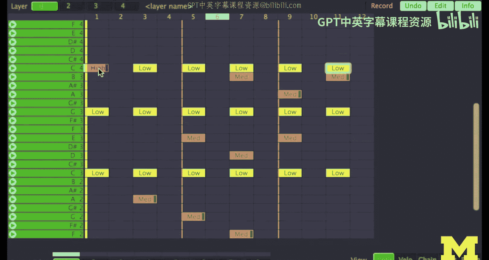
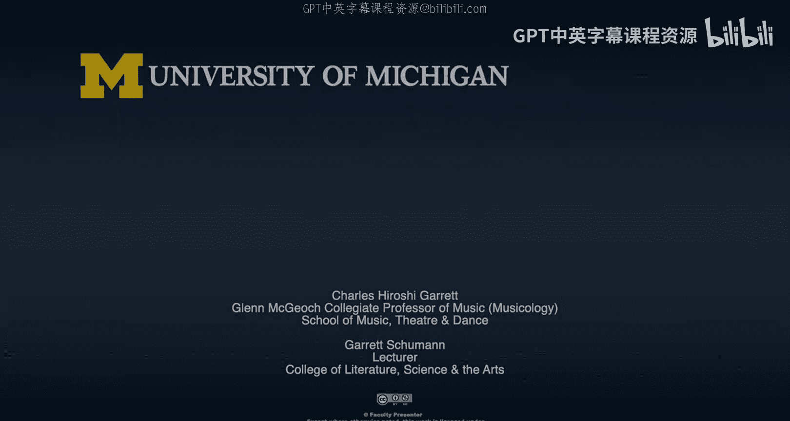

# 密歇根大学《AI用于创意工作｜AI for Creative Work》中英字幕 - P31：2_人工智能与艺术思维.zh_en - GPT中英字幕课程资源 - BV1DXNiznEXk

Much of the conversation involving the potential impact of AI on creative work focuses on how it can save time or increase productivity。

 In this demonstration， I'm going to show you and discuss the ways a couple different AI powered music tools lead me and others to think differently about our creativity。

When I think about AI and creativity， I get the most excited about its capacity to change the way individuals frame and conceptualize their creative process。

I am a musician， and one of the software tools I like to use with certain projects is called Stooks。

 which is an algorithmic probabilistic Mii sequencer。

 This means it controls the rhythm and notes performed by software instruments I choose within my preferred digital audio workstation。

 Stos forces me to think differently about creating a musical idea。 Traditionally。

 music composition is wholly deterministic。 I， the composer or songwriter。

 decide what notes are performed at a given time。 But when I use Stooks。

 I choose to let go a full control over exactly which notes of a looping pattern will be performed as it iterates over and over。

😊，The tool allows me to set the probability with which it will choose to play a specific note at a specific moment in musical time。

Sttos also has a feature called Chain， which allows me to build melodies by influencing the software's decision to move from one note to the next and so forth。

But in the end， I cannot fully predict the final performance Stookus will deliver。

 I can only set up an array of preferences and general guidelines for the program to follow。

 Let's watch the short demonstration in which I play with Stos in real time to transform a blank。

 randomized musical texture into something with more traditionally melodic elements。🎼。🎼The。🎼，🎼ままなま。🎼。

🎼ダメなまの舐めな。🎼The。🎼ままままままま。🎼，🎼まままならら。🎼。🎼。🎼ななななななな。🎼哒。🎼。🎼，🎼まままま。🎼，🎼The。🎼ど。🎼。🎼，🎼。🎼ババメバメバら。🎼。🎼拜拜。🎼。🎼。🎼，🎼。

🎼今まだは。🎼なななななな。🎼The。🎼，🎼ままだま。🎼，🎼まナまナのだ。🎼ロめのよね。🎼。🎼The。🎼。🎼。🎼，🎼。🎼，🎼The。🎼。🎼，🎼，🎼Yeah。🎼。🎼。

🎼な。🎼Working with a tool like Stos fundamentally changes what it means to create music in comparison to conventional methods。

 I must relinquish a degree of control to the software， making it a collaborator of sorts。

 Instead of just an instrument in the musical texture。

 The limits of my ability to determine the outcome of the performance。

 force me to think differently about basic musical parameters like melody and harmony。

 than I would in a traditional setting。 This changes what creativity means when I work in this context。

 My decision making is reshaped by new but specific constraints。

 And I need to adjust my approach to musical expressiveness to fit the software strengths and limitations。

😊，Sttos is an algorithmic tool， but it is not hard to find contemporary machine learning software that similarly impacts the paradigms of musicians creative practice。

 For example， Rave is a celebrated sound synthesis program that uses deep learning to accurately replicate an audio input provided by a single performer。

This tool allows a kind of performance that is otherwise impossible。

 A soloist can play alongside themselves， not on a pre recordedded track。

 but with a computerized co performer based on their specific voice or instrumental sound。

The reflexivity here is novel and compelling。 The software acts like a mirror of the musician who trained it。

Like Soks， which is a free software plugin compatible with any standard digital audio workstation。

 Rabe is an open source tool designed to work with Max MSP and other common platforms where live electronic music production。

 Rabe is also designed to work with limited training。

 The input audio used to train Ra only needs to be three hours long。😊。

This level of accessibility means Stos and Rave can inspire many more musicians than more costly software。

 The musicians who engage with these tools break away from conventions in music making and in the marketplaces for creative technologies。

😊。

