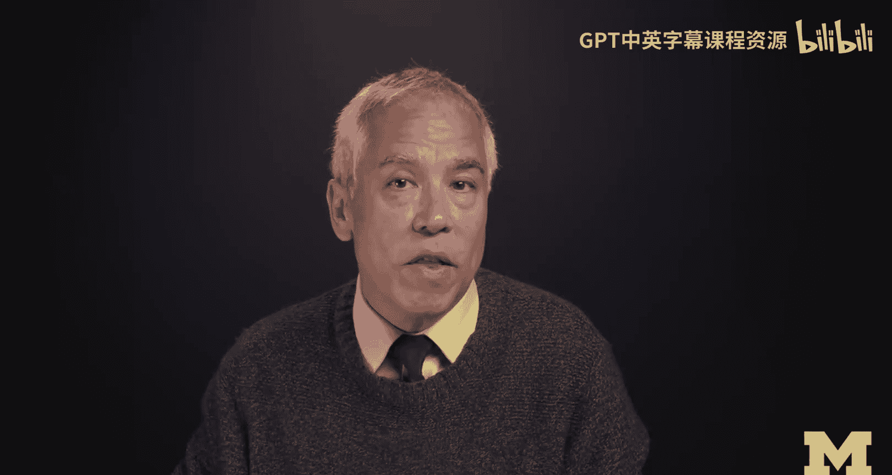
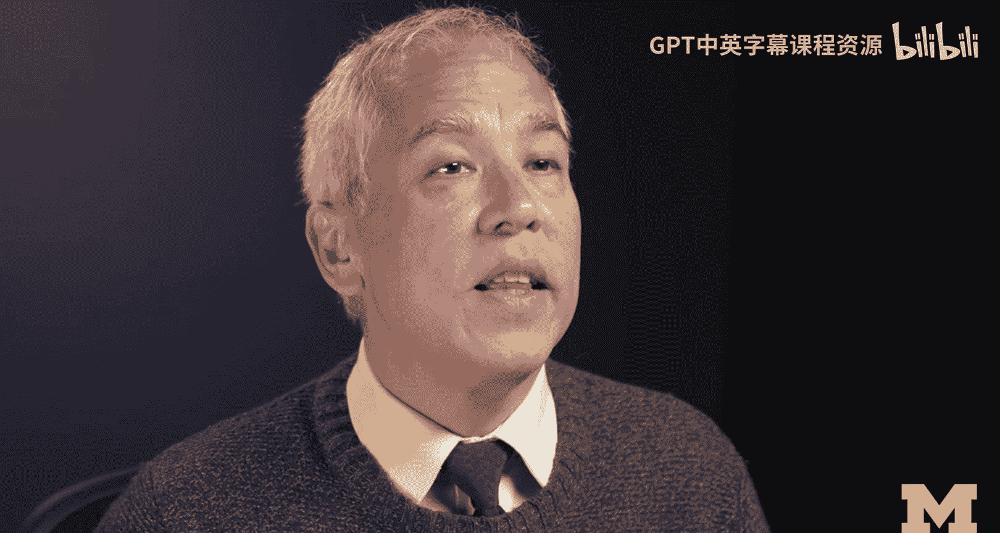
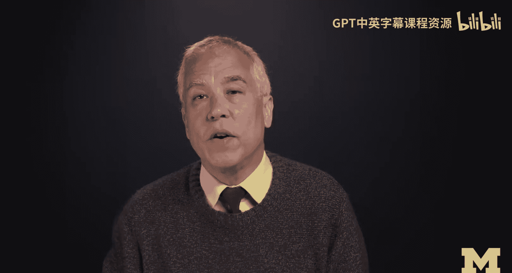
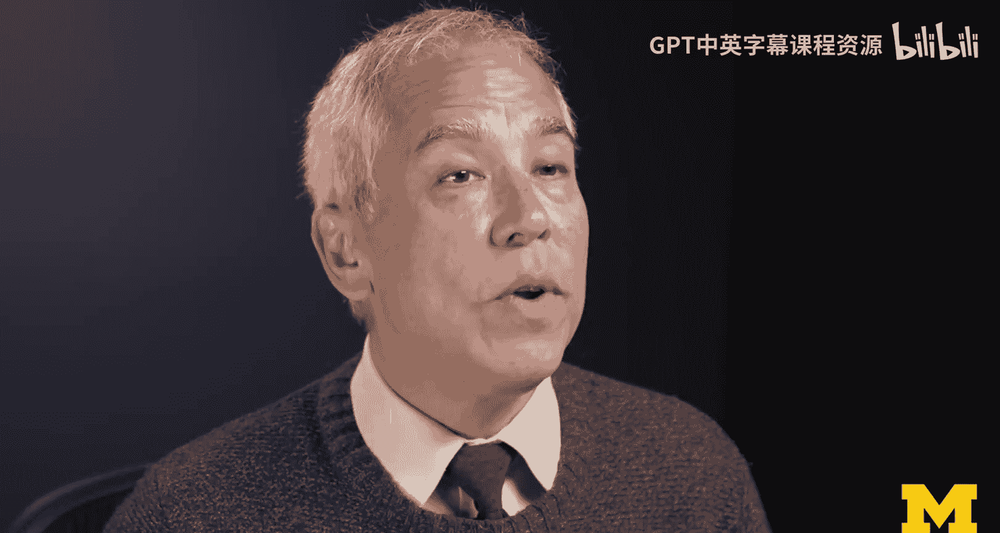
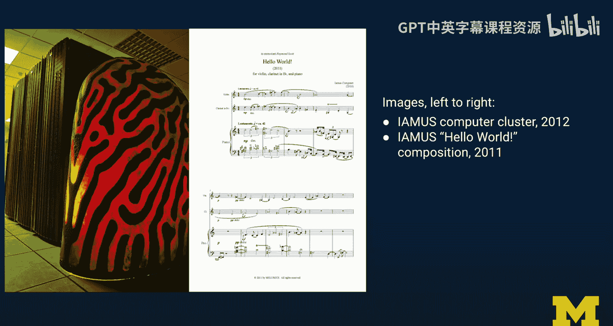
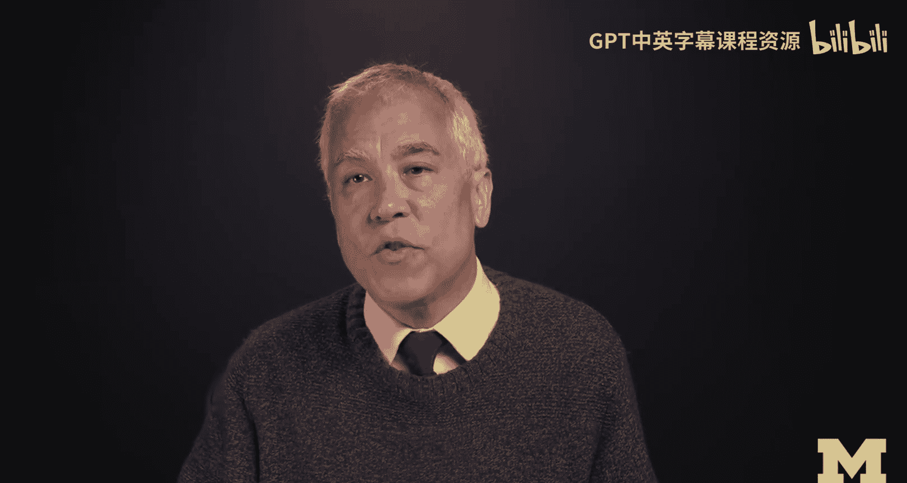
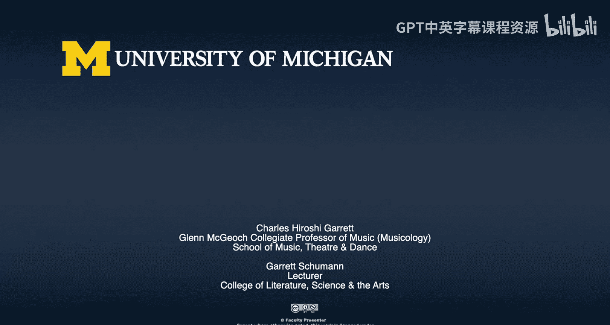

# 密歇根大学《AI用于创意工作｜AI for Creative Work》中英字幕 - P32：3_实验性艺术扩展的历史演进.zh_en - GPT中英字幕课程资源 - BV1DXNiznEXk

Yeah。

Experimentation with computing technology and AI by creative artists and musicians has evolved in many directions from the mid 20th century to the present。

 starting with rudimentary algorithmic programming and advancing to the complex AI software available for today's creative workers。

Computing advances during and after World War I meant that by 1957。

 composer Lejaron Hill and mathematician Leonard Isaacson were able to program the Iiliac1 Illinois automatic computer to produce an entirely computer generated string quartet。

😊，By the later 1960s， the German generative art pioneer， George Nees。

 was able to craft algorithms that produced intricate computer graphics using programmable plotter machines。

😊，Soon after， Harold Cohen developed Aaronin in 1970。

 a drawing software program that is often cited as the earliest example of AI software for the creation of visual art。

😊，Lori Spiegel， an innovative American composer who worked on drawing programs and digital music projects at Bell Labs。

 created magic Mo， an intelligent instrument， a user friendly music software program that enabled the general public to compose algorithmic music on their home computers。

😊，She also released an influential album， The Expand Universe in 1980。

 which captures her most significant musical experiments throughout the 1970s。😊，In 1981， David Cope。

 another influential musical thinker， began developing a software program called experimentsiments in musical Intelligence。

 which not only analyzed music by composers such as Johan Sebastian Bach。

 but also created new compositions in the same style。😊。

This revolutionary achievement in algorithmic composition sparked controversy and debates about the nature of creativity。

 Cope's sustained research LED to the release of Emily Howell， an interactive computer interface。

 He carefully trained to compose music that subsequently released her own albums。😊。

Visual artists during this period continued to experiment with new technologies。

 and some used AI to explore generative processes， putting sophisticated algorithms in motion that produced unpredictable。

 complex and often surprising imagery in the form of fractal artworks。😊。

Towards the end of the 20th century， as computing power increased and internet use exploded。

 AI's role in experimental art and music further expanded。😊。

Visual artists like Ken Goldberg， an artist and roboticist。

 began to explore interactivity and the concept of telepresence。

 where on users could control physical objects in a gallery space。

 lending online realities with physical ones。😊，Pioneering AI artists such as Carlar Sims and Eric Millickan likewise demonstrated how AI assisted visual art could both move audiences and garner critical acclaim。

Music researchers based at scientific laboratories and universities continued to make noticeable strides in the early 21st century。

 In 2010， AI researchers in Spain developed a software program。

 IA M US that began producing its own original contemporary classical music。😊。

Meanwhile， at Sony Labs in Paris， the sustained research of French scientist and composer Francois Pechet LED to a number of breakthroughs in music。

 AI and machine improvisation that eventually LED to his appointment to direct the Spotify lab that develops computing tools for music creation。

Even more dramatic advances powered the explosive growth of generative art。

 leading to seismic events， such as the 2018 Christie's auction， where the AI artwork。

 Edmon de Bellella me sold for more than $400000， and the release of popular social media apps that enabled users to generate。

 edit and filter images with the press of a button。😊。

Drawing on sophisticated neural networks and deep learning algorithms。

 Today's AI software in the fields of generative art， such as stable diffusion， day and mid journey。

😊，Ingenerative music， such as Uio and So AI now enable users without advanced training to issue simple prompts that create music and visuals sometimes so advanced to be indistinguishable from human generated creations。

😊，Such dramatic advances have challenged and transformed the nature of creativity。

 The definition of art and the roles that humans and machines will play in the growth of art and music in the decades to come。

