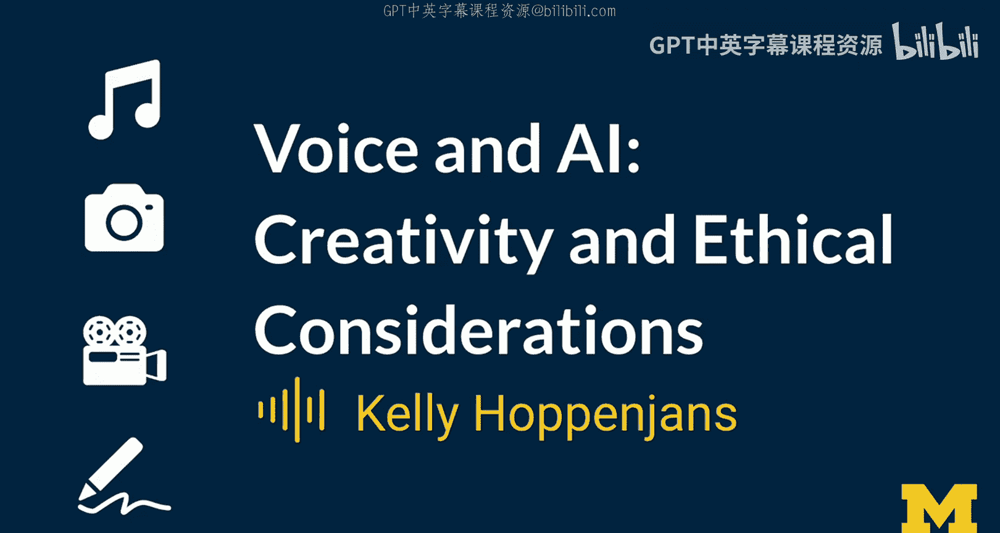
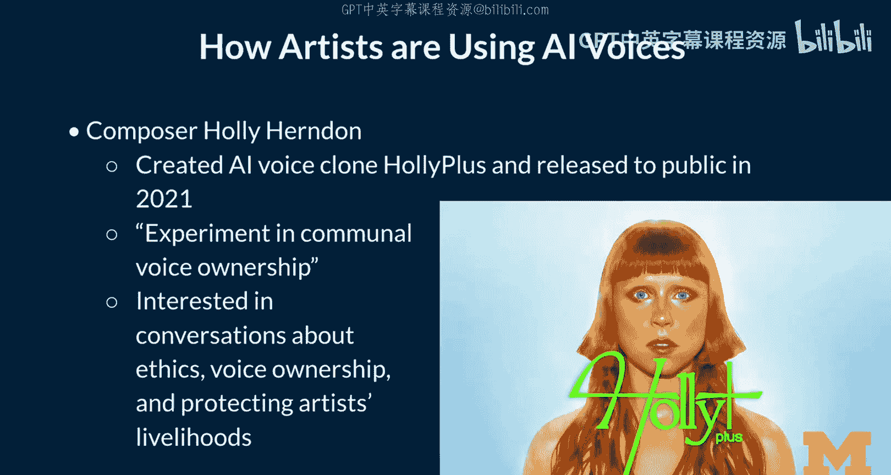
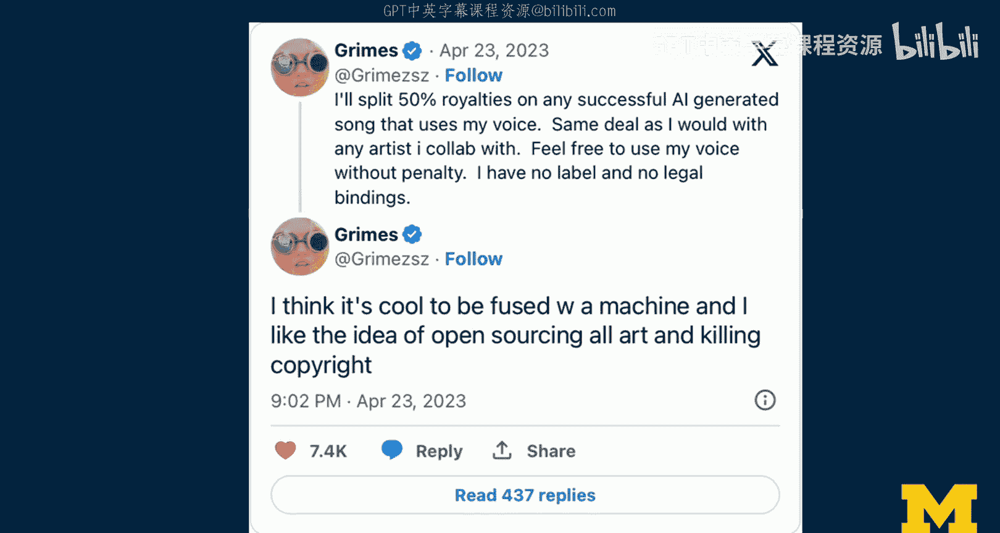
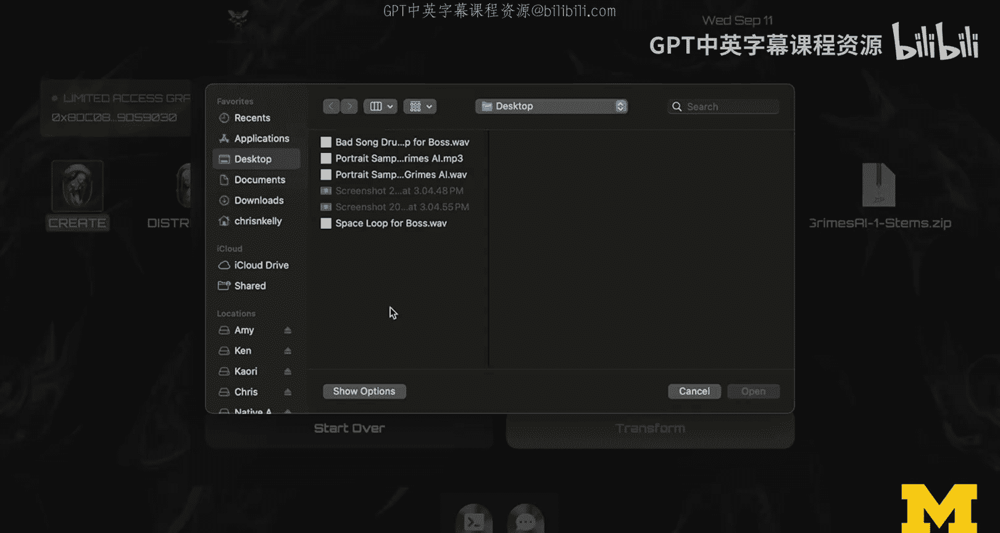
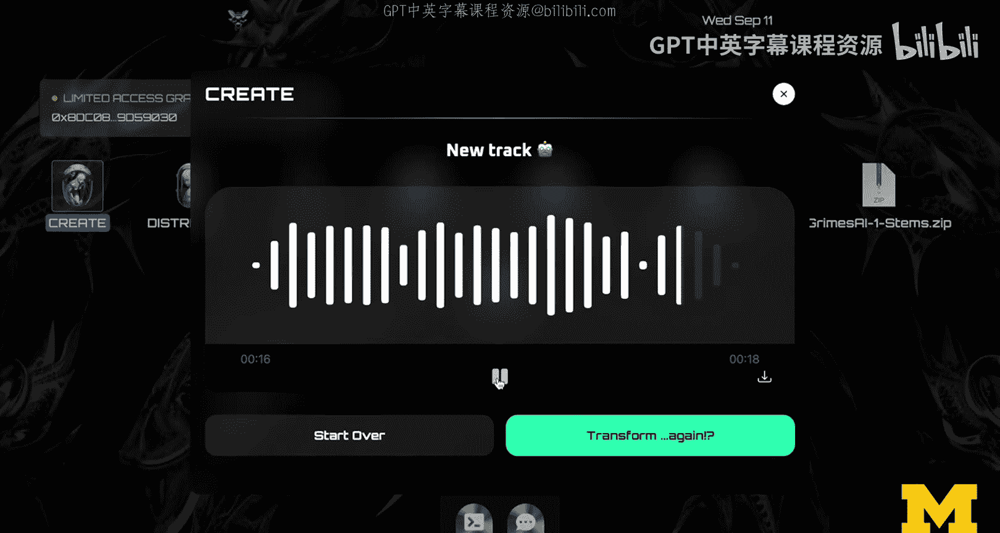
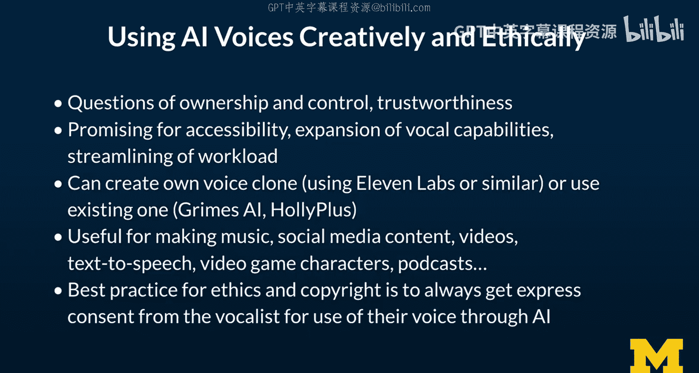
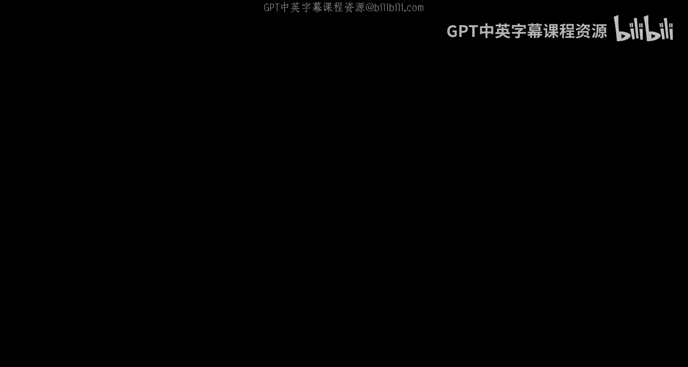
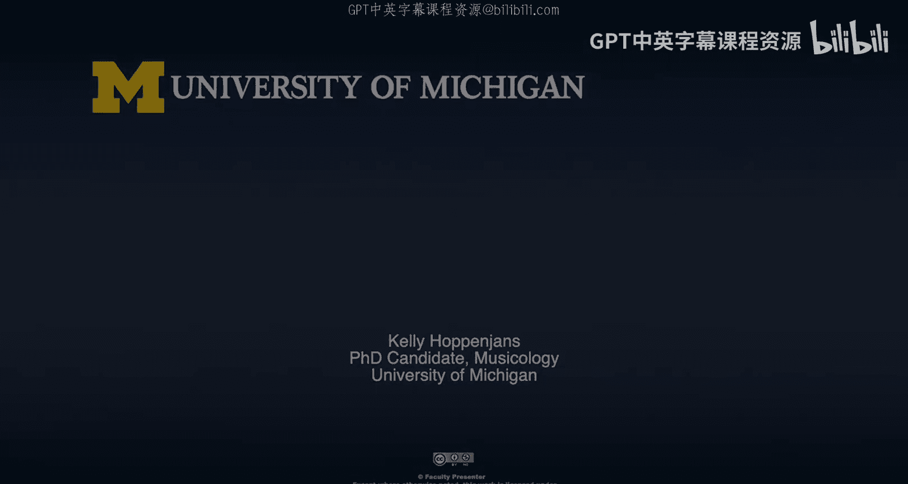

# 密歇根大学《AI用于创意工作｜AI for Creative Work》中英字幕 - P35：6_声觉智能：创造与伦理的双重考量.zh_en - GPT中英字幕课程资源 - BV1DXNiznEXk

Hi， my name is Kelly Hpppinjas， I'm a singer songwriter and a PhD candidate in musicology at University of Michigan。

 and I research voice and technology in 21st century US pop music Part of my work involves researching and experimenting with AI voices。

AI can be trained to replicate people's voices for speech or singing。 We call these voice clones。

 You can train an AI to mimic a human voice using recordings of the desired voice as training data。

 The clones can mimic tone， cadence， articulation， even breathing。

You can use the AI voice clone in a couple of different ways。 if you're using it to replicate speech。

 you may tell your clone what to say by giving it text that the clone will speak aloud。

 This is what we call text to speech。 Chaty Bt's voice library works this way。 as does 11 labs。

 one of the most prominent AI voice services。 I use their site to create a vocal double of myself。Hi。

 I'm Kelly's AI voice double， I think I sound a lot like her。

These are some popular AI voice clone programs that you can explore for singing。

 many AIs use a singer's performance and turn that into the desired AI voice clone。

 which is to say you sing and it turns your voice into someone else's in others like vocaloid's AI plug in。

 you can input lyrics and Midi data， including pitch， rhythm， intensity。

 vibrato and breathing to have one of their personalities in their voice bank sing it for you。

Voccaloidid combines AI voice technology with their familiar nonAI voicebank software。

 which dates back to the early 2000s， their most famous character who you may know from that period is Hatsunimiku。

 the virtual pop star who tours as a hologram pictured on this slide。

While vocallod's characters are trained on real voices， they aren't real people。

 many other speech and singing AI voice services offer unlicensed clones of famous people or characters。

This means that some users clone others voices without their consent。

 sometimes with unethical intent。 For example，11 Las was used to clone President Biden's voice for fake robo calls。

 urging Democrats in New Hampshire not to vote in the 2024 primary。

 So there is great potential for creativity with AI voices， as well as real ethical concerns。

As you can imagine， many artists are excited about the opportunities AI voices afford them。

 as well as concerned about the problems it raises for their ownership and control of their voice and likeness and their ability to make a living as voice professionals。

Electronic composer Holly Herndon released her voice clone Holly Plus in 2021 to the public。

 Anyone can create with it。 Herndon calls it a quote， experiment in communal voice ownership quote。

 and aims to encourage people to explore AI tech creatively。

 while also foregrounding conversations about ethics。

 ownership and the need to protect artist livelihoods。

Dark pop artist Grimees created and released her voice clone to the public in 2022。

 She positioned her clone as a tech positive antidote to music。

 industry manipulation and control of artists， and she splits royalties from any songs created with her voice 5050。

This is Grimes's website， Elf Tech， where you can turn your voice into Grimes， you can speak or sing。

 but I'll demonstrate singing here。This is a short clip of me singing a song that I wrote called Porttrait of Your Life。

L in a portrait of your life。 It's not quite what you had in mind the tragedy of an ordinary life。

 Can you imagine I've uploaded it into Grimeme's AI。

 and I'm pressing transform to turn my voice into hers。 I'm showing this in real time。

 So this is really how quick it is。 And here's Grme singing my song。😊。

You living in a portrait of your life。 It's not quite what you had in mind the tragedy of an ordinary life。

 Can you imagine。

While Grimees and Holly Herndon have made their own voice doubles available to the public。

 other creators are using these and other AI clones to make music。

 The artist Keto used Grimeme's AI to create the songCd Touch in 2023。

 earning her an endorsement from Grimees herself， and a couple million streams on Spotify。

Many other producer， songwriters have created songs using Grimeeses and Holly Herndon's voices。

Hip hop artist Drake released Taylor made Freestyle in 2024 amidst his rat beef with Kendrick Lamar。

 and used an AI of Tupacak Shacur's voice to resurrect the rapper who passed in 1996。

Drake did not ask Shaur's estate for permission to use the deceased rapper's voice。

 and his estate sent Drake a cease and desist letter。

 The song was subsequently removed from streaming platforms and is an excellent example of the legal and reputational risks in using AI voices without consent。

Other creators have used AI clones of famous voices to create unusual。

 often humorous style clashes or mashups on social media。YouTuber Grande made AI M& M rap about cats。

 and creator Dustin Ballard， known by his social media handle there I ruined it。

 has created many versions of popular songs sung by AI artists。 For example。

 he had AI Johnny Cash sing Aquas Barbie Girl and AI Frank Sinatra seeing little John in the East S Boy get low。

 None of these artists have consented to having AI voice clones made。

 and the law is currently unclear about whether these creations infringe on the vocalist copyrights。

Finally， Randy Travis， who had a stroke in 2013 that severely damaged his singing and speaking ability。

 released his song where that came from in 2024， transforming country singer James Dupre's voice into Travis's through an AI voice clone。

This work exemplifies the creative potential of AI voices。

 as well as the technology's applications and accessibility for non speaking people who want to express themselves vocally。

🎼She had eyes like diamond。🎼car the来。🎼HowBut they were dark and deeper。🎼Then and night。

AI voice technology raises questions about ownership and control of voices Do we have the rights to control how our voices are used。

 Law have been proposed like the No fakeakes Act in Congress to protect people against unauthorized and nonconsensual uses of their voices and likenesses through AI technology。

In Tennessee， the Elvis law has recently been enacted， the law adds voice to existing name， image。

 and likeness protections。However， the law is behind the technology's capabilities。

 so it falls to us to determine how to ethically engage with AI voices。Additionally。

 AI voice doubles prompt concerns about trustworthiness of voices used in deep fake technologies。

 as in the President Biden Robocall example from earlier。

How can we trust that a person truly put their voice to the words we're hearing？

Social media sites often require creators to add a disclaimer that states when content was created with AI。

 but many music streaming platforms like Spotify do not require such disclaimers。

These AI clones can be quite convincing， so it is often difficult to tell if a voice is real or AI。

On the other hand， this technology has great potential for a creativity as it enables people to expand their vocal capabilities far beyond what is physically possible。

Users can also create vocal doubles so that their voice can speak or sing for them。

 which can enable us to streamline our workloads， creating more and faster without tiring our voices。

 This technology also holds great promise for non-speaking people to express themselves with voice。

 and for creating text to speech content， for people who are blind or have low vision。

For your own creativity， you could consider using 11 labs or a similar program to create a vocal model of your own voice for use in content creation。

Remember that you should only make a vocal double of your own voice or get consent to make one of another person。

You can also use others voice clones that have been made widely available with their express consent。

 like Holly Plus， Grimes AI and Voice swapap AI with these voices， you could create music。

 social media content， videos， text to speech content， video game characters， podcasts， and more。

I hope that this lecture has introduced you to some of the capabilities and concerns about AI voices and that you feel confident in experimenting with these voices to see what you can create。

😊。

