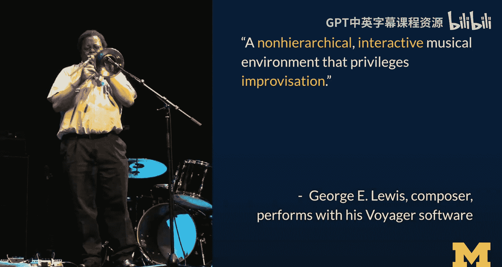
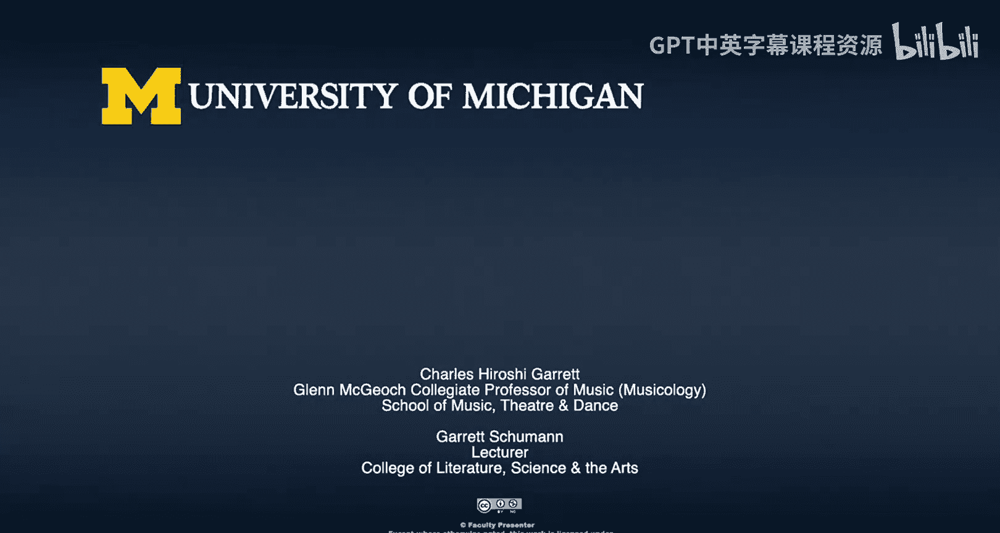

# 密歇根大学《AI用于创意工作｜AI for Creative Work》中英字幕 - P38：9_协作创新范例.zh_en - GPT中英字幕课程资源 - BV1DXNiznEXk

The notion that AI can participate in creative collaborations with people is fraught and fascinating。

Engaging AI in collaborative context highlights the reality that the way AI tools currently make decisions is different from how people make decisions。

 As a result， when we think about AI's role in collaboration。

 we must keep in mind that it cannot be a collaborator in the same way as a person。

This is not necessarily a weakness。 There is value in AI's surprising outcomes。

But if we want to approach AI as a potential collaborator。

 we must accept that the technology does not think like we do。In this way。

 collaboration with AI is fundamentally expansive to the creative process。

 as what AI actually offers will most likely be different from what a person might bring to a project or performance。

The work of Bahini Vera， an award winning writer and journalist。

 demonstrates these dynamics and what she characterizes as her collaboration with Chat GT。

Va describes her experience in an article entitled Confessionions of a Vi AI Write。

 which appeared in Wired magazine in September 2023。

Vera found success working with the software to write a story about family loss。

 But because the large language model is not highly customized。

 she had to ignore its more generic outputs and focus on Cha G's responses that resonated with her perspective on the true events。

I tried again and again。 Each time I deleted the AI's text and added to what I'd written before。

 asking G 3 to pick up the thread later in the story。At first， it kept failing。

 And then on the fourth or fifth attempt， something shifted。

 The A I began describing grief and language that felt truer。 And with each subsequent attempt。

 it got closer to describing what I had gone through myself。😔。

Vas back and forth with chat GT resembles aspects of collaboration。

 as her experience working with the software resulted in new writing neither could create on their own。

But the conclusion of various's article is not triumphant。

 Gen AI outputs are limited by the data on which the tool is trained。 And in this case。

 the voice Chay B T generates is very generic。Moreover， as Vera writes。

 Chat G P's lack of corporeality places meaningful boundaries on its understanding of the world。

 These limitations act as a barrier to the inside AI writing currently can possess。

As various summarizes， quote。If writing is my attempt to clarify what the world is like for me。

 the problem with AI is not just that it can't come up with an individual perspective on the world。

 It's that it can't even comprehend what the world is。

Va's article offers an important lesson about what we should and should not expect from a public facing Gen AI tool like Cha GBT。

Throughout this course， we have encountered more highly customizable AI software。

 such as the sound synthesis program Brave。 And we can imagine how a writing tool that is more explicitly or individually trained on Vera' work might meet her expectations more successfully。

😊，In contrast， some creative practitioners who collaborate with AI fully embrace the non humanity of the computer instead of wishing the technology could more successfully imitate human decision making。

Composer George E。 Lewis has developed sophisticated algorithmically powered improvising computer programs since the 1980s。

 Writing in 2000， Lewis describes his software Voyager。

 the most celebrated of his experiments with AI as a non hierarchical interactive musical environment that privileges improvisation。

😊。

This unconventional description， again， reminds us to think about collaboration with AI as something very different from collaboration with people。

 simply because computers are not human。 It is notable that Louis has worked exclusively with self made tools in his multi decade career。

 which has enabled him to develop modes of collaboration that suit his creative values and point of view。

😊，Ultimately， the most important limitations on how people collaborate with AI going forward may be determined in part by the trajectory of the tech industry itself。

But the examples of Vahini Vera and George Lewis powerfully demonstrate how creative workers in multiple disciplines continue to learn to collaborate in meaningful。

 personal， individual and different ways with their non human counterparts。

