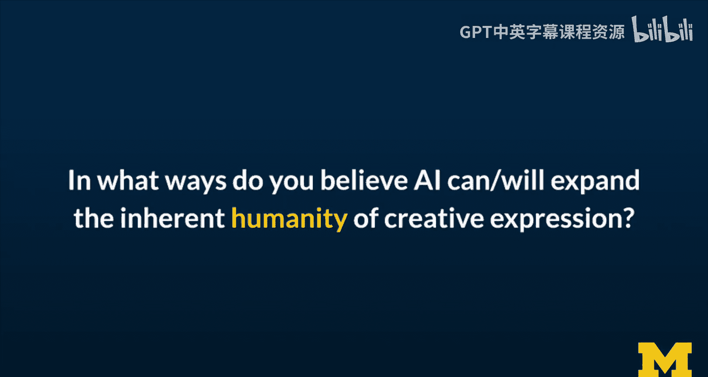
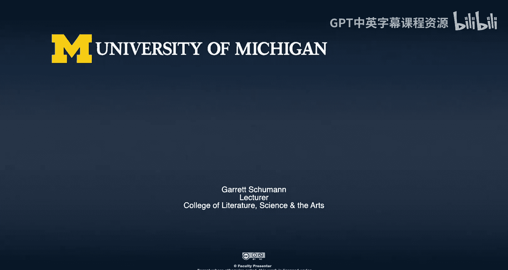

# 密歇根大学《AI用于创意工作｜AI for Creative Work》中英字幕 - P41：12_领域之声：加勒特·舒曼.zh_en - GPT中英字幕课程资源 - BV1DXNiznEXk

So I alluded to the following and my answer to the first of these questions back and course one of this series。

 Imagine that I， a composer， had my own highly personalized AI program that is trained on all the music I've ever created。

 This would expand my creative process in an incredible way by externalizing my brainstorming and allowing me to be in dialogue with my creative tendencies and preferences。

 Instead of holding all that complex thinking inside my head。😊，In this course。

 we have encountered examples of rudimentary experiments along these lines。

 and we have seen AI tools that separate individual creative expression from a person's body that already exist in the form of vocal models like Hollyplus and others。

 But it is exciting to think how transformative it would be to reproduce an individual's creative instincts as a software form that allows the user to interact with their own thinking from a new perspective。

😊。

