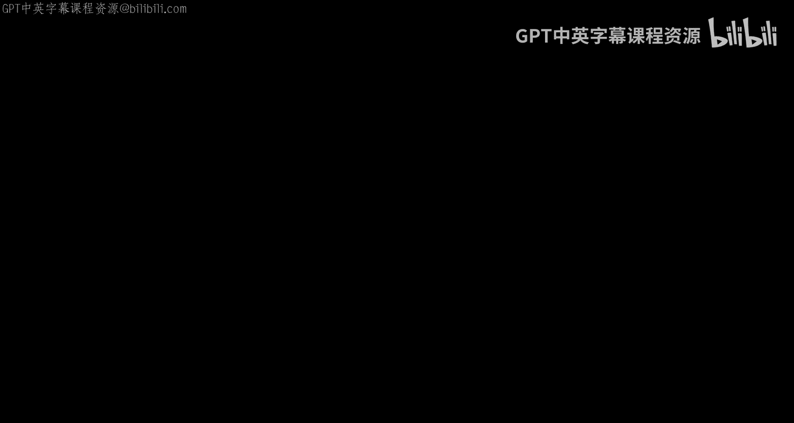
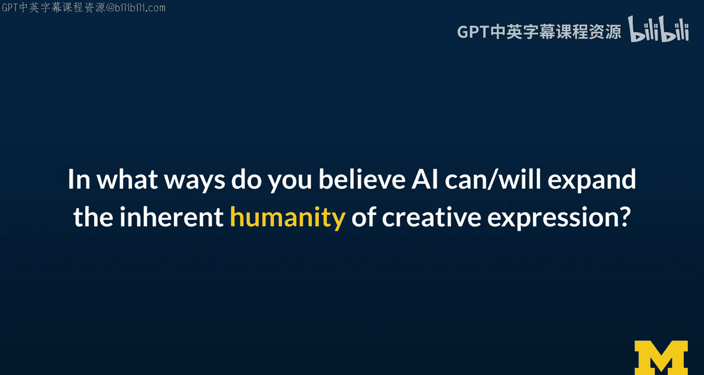
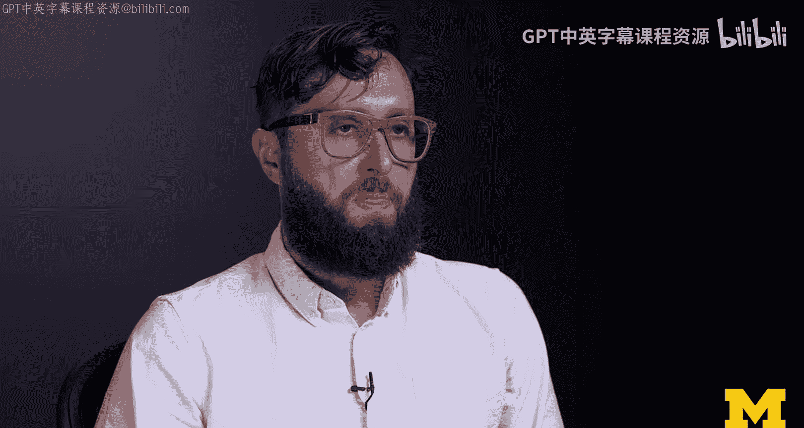
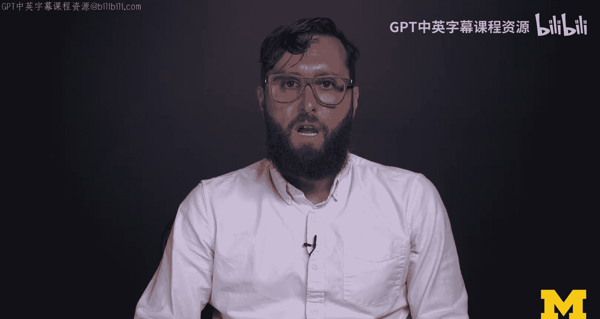
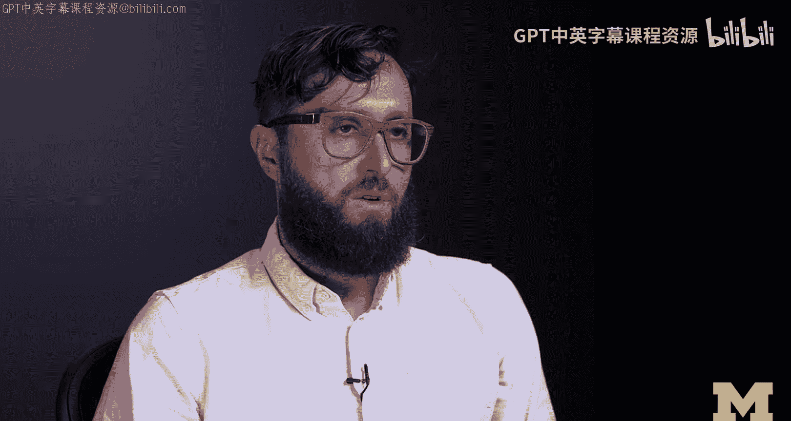
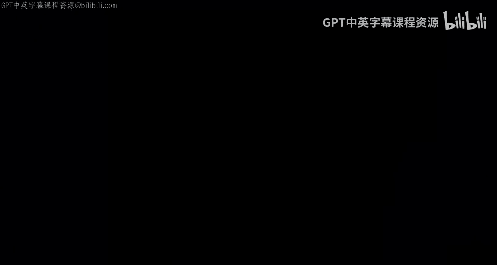
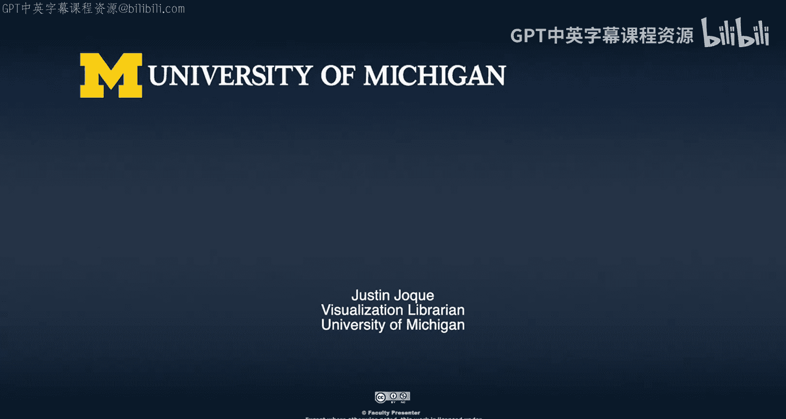

# 密歇根大学《AI用于创意工作｜AI for Creative Work》中英字幕 - P42：13_领域之声：贾斯汀·约克.zh_en - GPT中英字幕课程资源 - BV1DXNiznEXk

To my mind， the most exciting things being done with AI are the creation of really complex。

 often real time systems for generating and modifying creative content in ways that otherwise would be impossible。

I can give one quick example， it might be called machine learning or even simply an algorithm rather than artificial intelligence。

 but you can still get the idea。The algorithm for autotune was initially developed for signal processing for earthquake detection before someone realized it could be used to move a singer's voice to the correct note。

I recently read it is also now being used in pacemakers to detect variations in heart rates。

From the earth to our ears to our hearts， of course even autotune has been used to produce boring。

 similar sounding music， but has also been used in very creative ways to create unique sounds and styles made possible by the real-time manipulation it makes to sounds in ways that artists can use to augment and change their own voice or other sounds。

