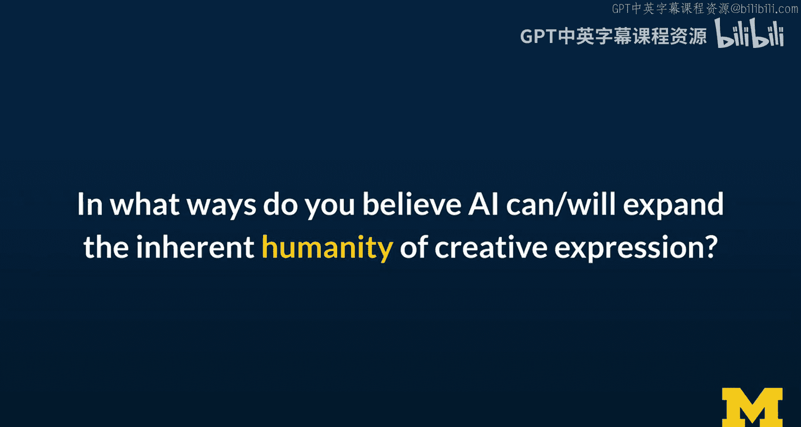
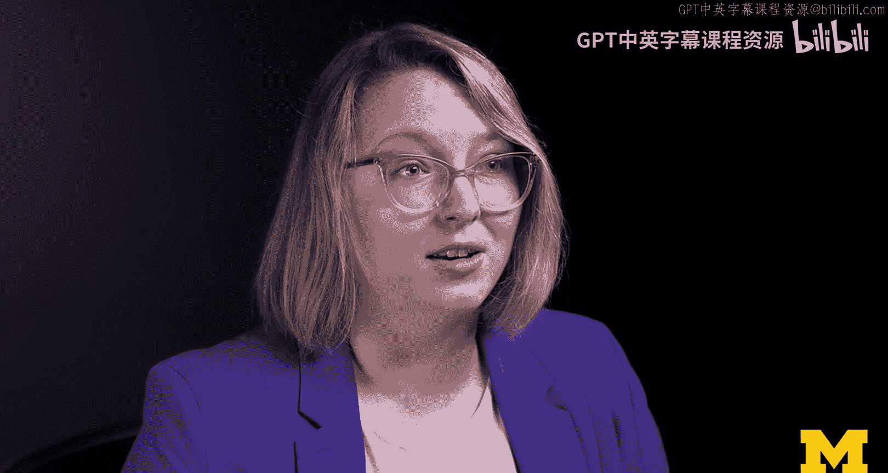
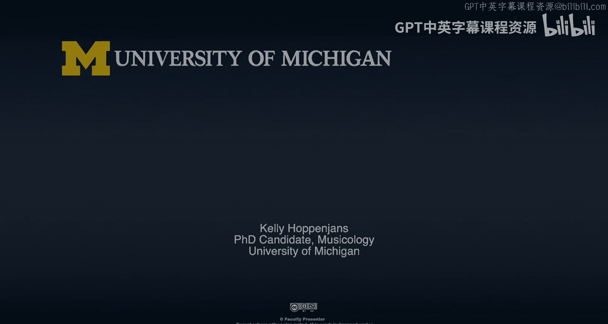

# 密歇根大学《AI用于创意工作｜AI for Creative Work》中英字幕 - P47：18_领域之声：凯莉·霍彭詹斯.zh_en - GPT中英字幕课程资源 - BV1DXNiznEXk

I think creativity with AI is always fundamentally human in origin。

 even if the technology obscures this， aside from the need for a human prompt。

 AI couldn't function without vast databases of human creativity to draw from， whether that's books。

 music， social media posts， or anything we create。And that's not to mention the work of AI programmers and of workers who label and clean data for AI systems whose labor is criminally overlooked。

 my hope is that despite the novelty and charm of AI art。

 we remember to look for the humanity in it and to center human ingenuity and creativity in our own AI collaborations。

AI may produce believable facsimileles of human expression。

 but it's up to us to infuse them with deeper meaning and resonances。

