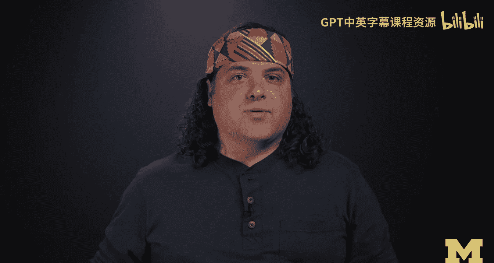
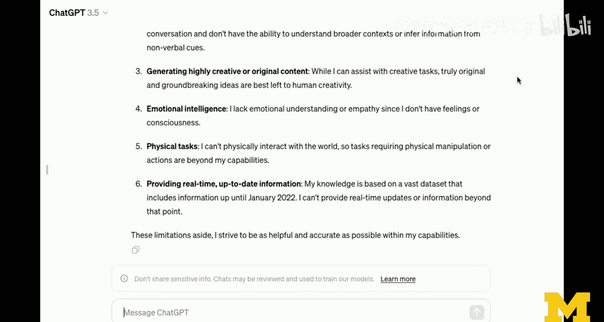
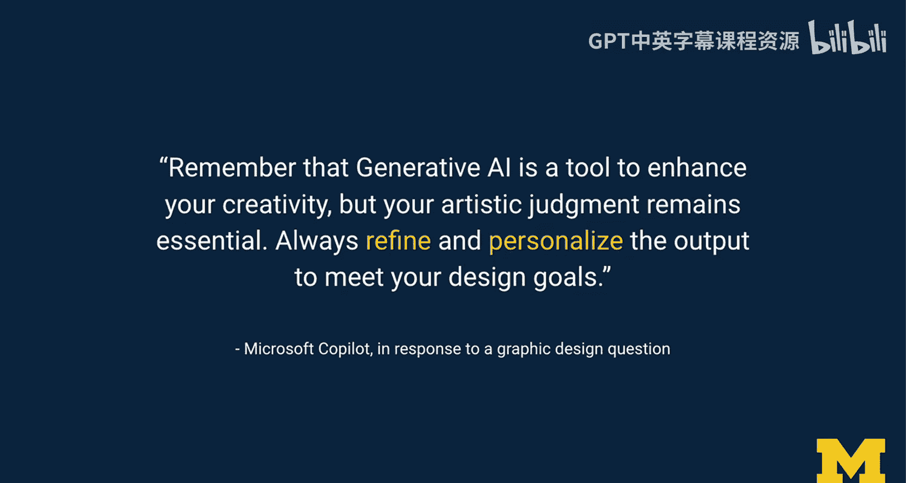
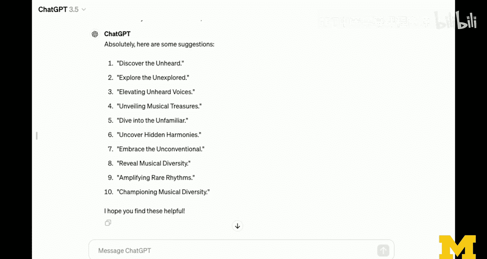
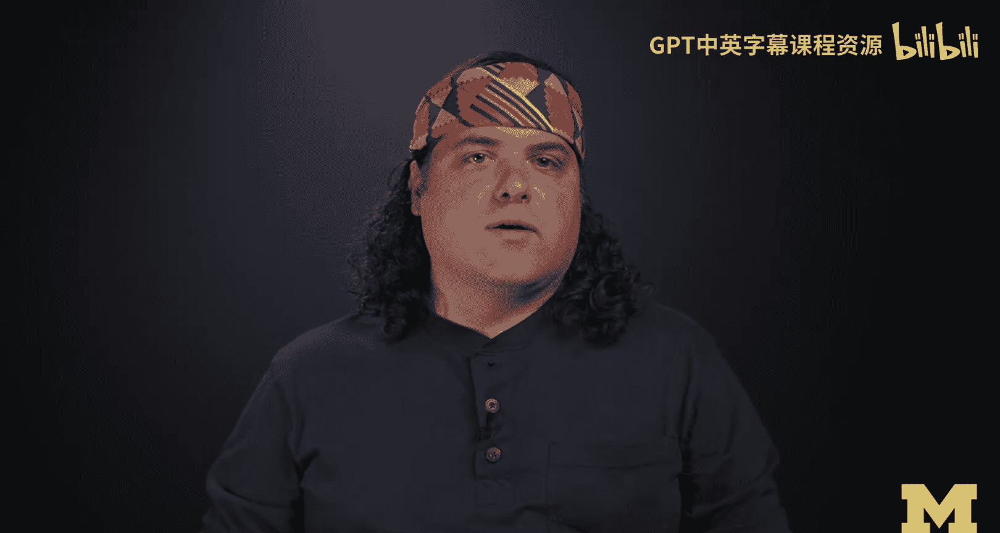
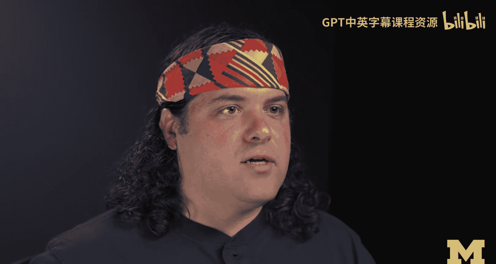
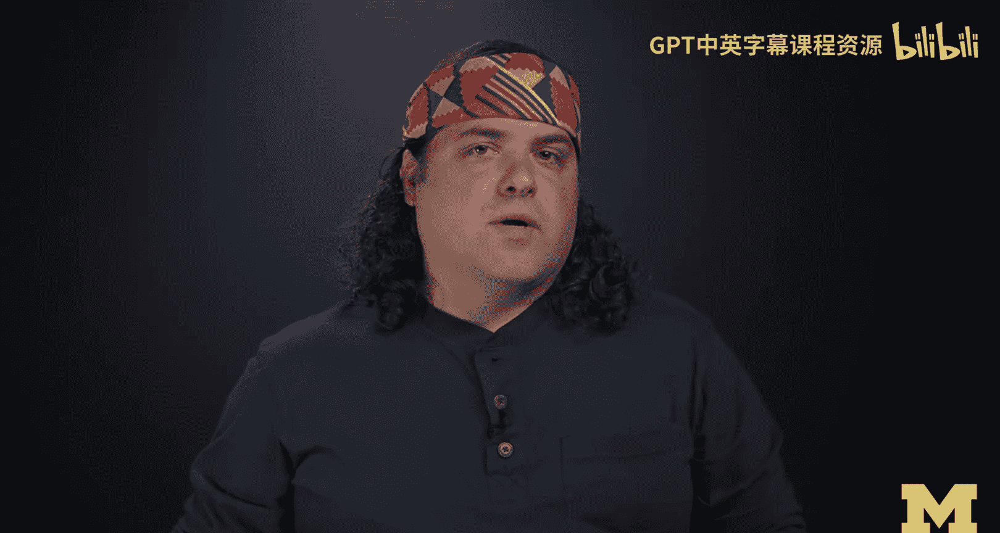
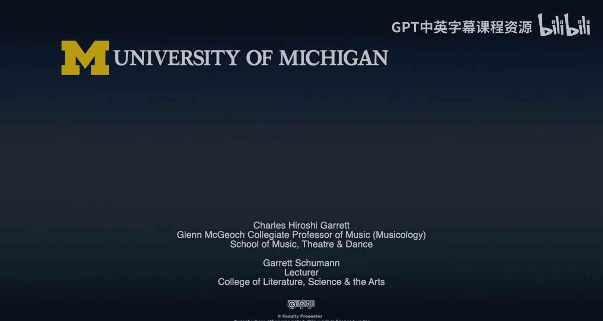

# 密歇根大学《AI用于创意工作｜AI for Creative Work》中英字幕 - P6：5_AI工具极限测试演示.zh_en - GPT中英字幕课程资源 - BV1DXNiznEXk

What are the limits of generative AI tools when it comes to enhancing creativity in the workplace？

The answer depends on your creative field， your goals。

 and your preferences as to how the content you create with AI is sourced and generated。

Every AI tool has strengths and weaknesses， and one revealing way to assess every tool is to ask the program directly about what it does well。

 what it struggles with and how it can assist with specific types of work。

Let's test this by asking Cha E BT about what it cannot do well。In response to my question。

 it is interesting that Chat EBT includes generating highly creative or original content as one of its weaknesses。

The program's response also specifies that truly original and groundbreaking ideas are best left to human creativity。

This tells us that creative professionals and or enterprises seeking our creative work should not depend entirely on Gen AI and that a creative worker's individual voice and judgment remain important。

 We see similar results If we assess another public facing Gen AI tool。

 Microsoft's copi with some more focused questions about specific types of creative work。

Let's suppose you are a graphic designer， and you want to learn from Copiot what it might be able to do to assist you in your work。

 you can simply ask how can a graphic designer use generative AI。

In addition to generating text and image content， Copit recommends using Gen AI to do the following。

Custom art styles。It recommends you experiment with different prompts。Concept exploration。

It recommends you use generative AI to help you brainstorm。Automated variations。

It recommends if you're designing a logo， for example。

 to use JenAI to create many different versions based on your input。

And if you are concerned about generating imagery that is based on copyrighted materials。

 Coilt suggests。Use abstract descriptions for image generations。

 If you are too specific or want something too realistic， the Gen I I might violate copyright。 Also。

 it recommends that you review and curate the outputs that it gives you。

 This puts the responsibility on you， the creative worker to make sure that you haven't violated copyright。

This is as far as copilot goes without additional prompting and refinement。

 Note that it does not explain how to execute these suggestions in a particular program。 Also。

 like chatt GPT， Microsoft Copit emphasizes the importance of human judgment and discretion in the creative process。

Here's a quote from Microsoft Coilt。Remember that while generative AI can assist in content creation。

 human curation and quality control remain crucial。Here's another quote from Microsoft Copilot。

Remember that while generative AI can be a powerful tool。

 it's essential to curate and refine the output to align with your design vision。 As a designer。

 your creative judgment remains crucial in shaping the final results。And finally。

 here's another quote from Microsoft Copilot。Remember that generative AI is a tool to enhance your creativity。

 but your artistic judgment remains essential。 Always refine and personalize the output to meet your design goals。

With this in mind， and because you may not always be able to ask your Gen AI tools direct questions about their strengths and weaknesses。

 it is always important to experiment with a tool to test its limits and judge how it meets your needs。

Here， I plan to ask Cha GT a basic marketing question to support my work leading a classical music nonprofit organization。

I've learned from my earlier exchange with Microsoft Copilot that crafting a detailed prompt will produce more specific and useful results。

So I spend a little time making my request for a new slogan as clear as possible。

 This prompt is inspired by Coilt's suggestion to have Jenna AI assist with A B testing marketing materials。

So Im saying I run a classical music non nonprofit。

 We specialize in presenting rarely performed and underrepresented 20th and 21st century composers。

Our current slogan is here， different。Can you help me come up with some additional marketing tack lines that fit our brand identity。

And are concise。Like here， different。Chatypt works very quickly and delivers many results。

 maybe too many。I will need to work with these suggestions in order to find a slogan that fits my organization's needs and is true to my voice as a marketer。

It could be that Cha E PT is suited better for other marketing tasks。

 providing a starting point where brainstorming a bunch of ideas and not yet ready in all cases to deliver a final product。

Before concluding， I want to point out an important difference between chat ET and Microsoft's copi。

Both programs are free， well known and pitched to be approachable for and used by beginners。

The basic version of Chat EBT I am using here is a simple text generator。

 More advanced versions of Cha EBT can see， hear and speak。

 While Microsoft Coillot is multimodal and can generate text and images。

 as well as assist with other Gen AI tasks Later in this series。

 you will have an opportunity to watch a longer demonstration video of Coilt's advanced capabilities。

Another distinctive feature of Microsoft Copilot in comparison to many other early AI engines。

 is that it will share links to any websites It accesses when it generates responses to your prompts。

 This approach to sourcing is more transparent than what we find in basic versions of chat GBT。

 and its list of sources gives you the option to explore further on your own。

 Here are some of the websites Microsoft Copiot referenced in its responses to my questions about marketers and graphic designers using AI in their work。

 specifically with the goal of avoiding infringing on copyrighted materials。

It is important to be mindful that， as with any Gen AI outputs。

 there may occasionally be errors in the source lists generated。 For example。

 some sources may be omitted or overreed。

