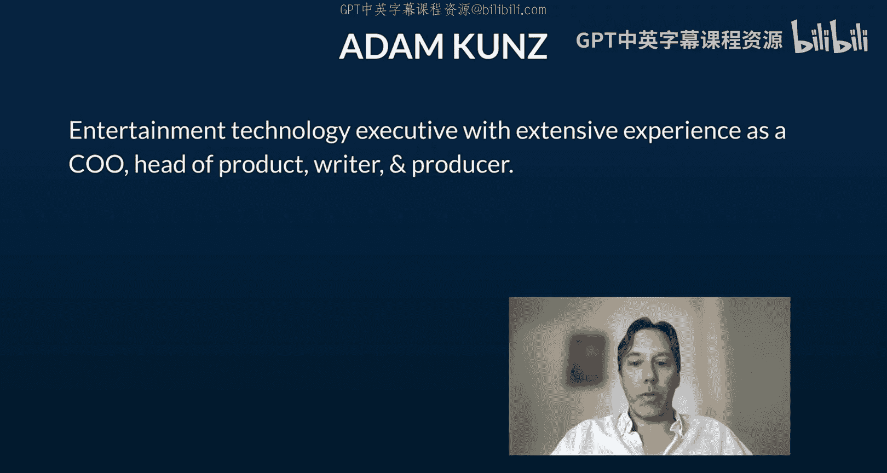
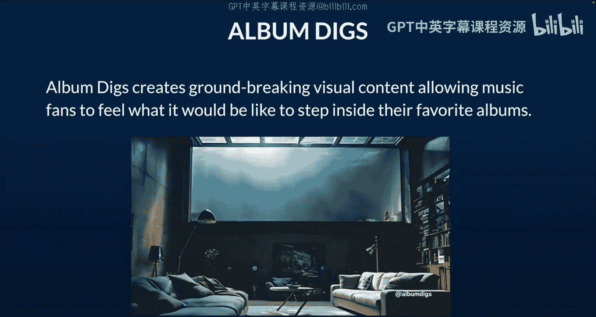
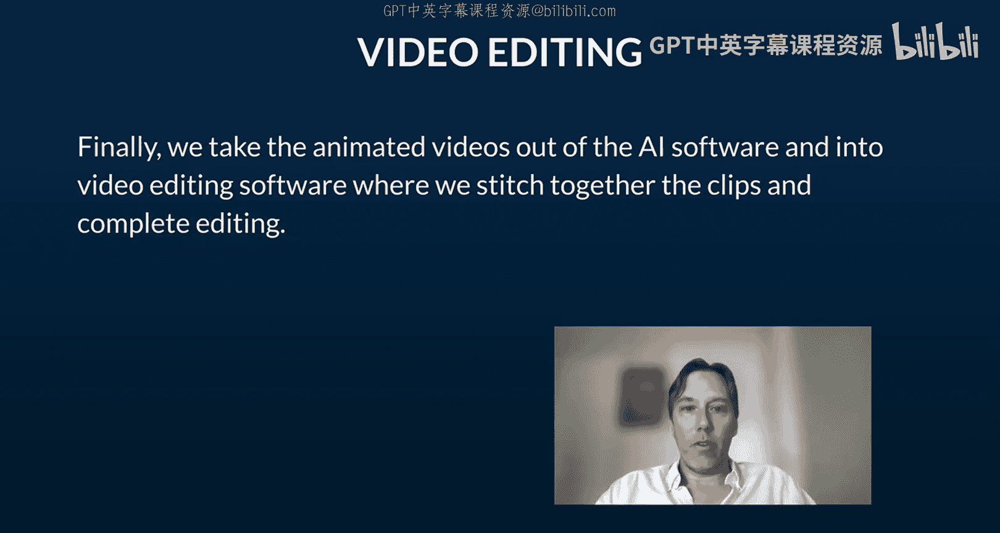
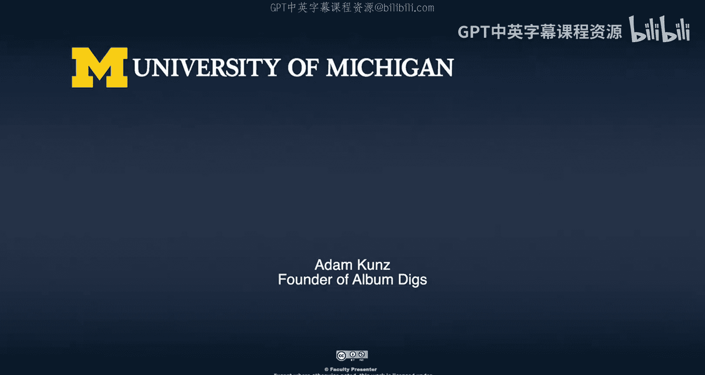

# 密歇根大学《AI用于创意工作｜AI for Creative Work》中英字幕 - P7：6_亚当·昆兹的实操演示.zh_en - GPT中英字幕课程资源 - BV1DXNiznEXk

My name is Adam Coons。I am an entertainment technology executive with extensive experience as a CO had a product writer and producer so over my career I originally started in the entertainment technology space with a company called Mogley with that company。

 we built proprietary algorithm doing AI before it was cool that allowed people to remix and mash up songs regardless of musical talent and that's why I first started working with the major record labels Sony Warner Universal and I also took very many early stage companies from there and did partnerships with larger corporations。

What I'm going to be talking about today is a little bit of my process through album digs。

Album Digs is a groundbreaking visual content grade where we allow music fans to actually feel like they can step inside their favorite songs and albums our unique approach to visual content has been collaborated on by music legends and featured in Premier outlets we post the content on social media channels like Instagram。

 TikTok Facebook and we're going to be launching YouTube so you're going to see a little bit of this video you may recognize some of the albums that we're actually working with here you might recognize what we're actually creating content around so this is done as part of a long process that integrates AI with human creativity and art direction and I'm going to walk you through that process in detail。

So。Here are the stages of the process I'm going to be going through， listening， the mood board。

 prompt engineering， iterations， replication， direct placement， prompt animation。

 layered animation and video editing。So we'll start with listening。Now this part of the process。

 it assumes we've already chosen an album and this is where we're beginning so when we start off with an album we actually deeply listen to the music by playing the album for beginning to end while we research it and that can be a process of looking at music videos。

 concerts， reading album reviews， looking at behind the scenes and scouring social media to really deeply understand the fan base。

Once we've completed that， we start creating a mood board and that can include photography of similar feeling spaces。

 furniture， architecture， or reflections of the aesthetics from the music videos， live shows。

 Almarkt， all different types of imagery that we want to put together that really is an accurate reflection of that album。

Once we've compiled all that we're going to move over into the prompt engineering phase of this。

 so we actually take our imagery and we feed all of that from the mood board into AI along with text prompts。

 these text prompts they're really depicting the feel of what we think the album is that's maybe not fully indicated from the imagery we're putting in what the color palette is。

 but we're also giving prompts that say the time of day。

 the photography style any environmental conditions that might be happening and we then wait that prompt in comparison to the imagery to either more heavily reflect the imagery or the text depending on which of those is needed。

So next we keep adjusting the prompts to get closer and closer to our vision of the space so this is the iteration phase and eventually if we keep tweaking this we find a part of that image that looks correct it might not be the entire image but we can feel like this corner of the images is what exactly is we were looking for for this corner of the room and then we begin to mask other parts of the image and we rework those with additional prompts until we get one exact room that's completely right none of these initial images are exactly perfect so this is a really long part of the process as well where we may tweak and go through hundreds and hundreds of iterations until we finally find the right central image that reflects this album。

So next is the replication phase what we're trying to do is build an entire house around this album as 2D images and the first room once we have that we want to extrapolate that out to reflect or seed emulate as it's called the entire look of the house so that's that's going to be room by room and each room can have additional Easter eggs that reference different lyrics from different songs so we might model the next room off of this track and this room off this track or the exterior of the house something that looks like it would house all of these rooms and environments that reflect the album as one cohesive elements so we're going through and we're using that first image to be our reference point for all of the future images。

So next comes direct placement once we have each of these rooms and we have all the different rooms and exterior shots of the house that we want。

 we sometimes need to take this out of AI and put it into our own software to do direct object placement typically with AI you're not going get an exact item you want so there might be for example。

 a bands logo that once we want to put up on the wall with permission and if we do that we have to do that exactly through our own separate 3D lighting and environmental software because if we try to do it within an AI it's going to be an interpretation of that logo but it's not going to be that exact logo another example is we worked with some sculpture and street artists to put their work into our content and for the albums that inspired them so。

With each of those we went to put their exact sculptures within the room and light those properly and make them feel like they were sitting in these fake rooms we'd created。

 but to do that through AI would have once again morphed and skewed those images and created its own version of them that wouldn't have been their exact artwork so this is the place where we actually have to take step away from AI and do our own like I said 3D lighting environmental work to place everything correctly。

We can also at this phase of the process use AI again if the edges of what we're doing look a little bit incongruent with the image that we're placing them on。

 AI can actually help with that again in this phase to make this seamless the transition between one part of the image and in what we've placed in the entire greater image。

So the next part of this phase is the prompt animation phase we take all of these completed images into additional AI software and we animate them that process involves feeding those static images and AI along with text prompts and those text prompts really would explain the action of this shot so this can include everything from camera movement to environmental effects descriptions we might want to describe that there's some sort of you know foginess to this room or we might want to describe that the camera how the camera is panning or that's a static shot for each of these images。

嗯。Next week could do the layering of the animation parts。

AI often doesn't understand exactly what should be specifically in the foreground or what shouldn't so we'll go through and we'll make things have less motion that are closer up and make things that are farther back move farther back well actually also take environmental effects and we'll try to add those in certain places through additional ambient noise so for example there was a fireplace in the room we would want to give that fire a lot of extra ambient noise so we highlight that layer and well make sure it has the extra ambient noise same would be for if there's an ocean out of window we would want to give that extra motion。

Next is the video editing part of the process so we take the animated videos out of the AI software and we actually stitch together those clips and that piece of this when we're actually making music videos like for our new YouTube channel that's when we actually sync the lighting effects to the beats so we take the objects that are lights in the room we sync those to the beats that we can have a complete experience that allows people to feel like the environment is reacting in real time to the music that's the final part of the process before we post the content that you actually see on our channels。

