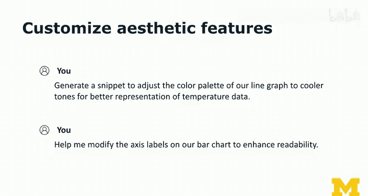
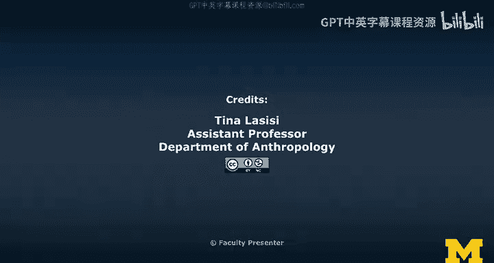

# 密歇根大学《AI驱动的数据分析：实用入门指南AI-Powered Data Analysis： A Practical Introduction》 - P10：9_数据可视化方法.zh_en - GPT中英字幕课程资源 - BV1PdMUzUEbK

Ask anyone who has to make plots for their research。

 there's nothing more soul crushing than telling yourself you're just going fix something up real quick and realizing that you've been messing around with font size or colors for five hours I mean。

 to be honest I'm sure I'll find some kind of way to waste my time on finicky perfectionistic details but I would say that generating the code for creating visuals has become significantly easier now that I can count on Gen AI to help me mess around with the code for the plots So real quick what is data visualization and why do you want to do it。

Data visualization is essentially the art and science of turning your data into graphical representations。

 so why bother well？Visuals can communicate complex data in a way that's easy to understand at a glance。

 whether it's showing patterns， relationships or just providing a clear summary of your findings。

 Good visualization speaks volumes。 A picture is worth 1 thousand0 words is a cliche for a reason。

With the weather data at hand， let's explore different types of visualizations and incorporate how JenAI can assist in generating the necessary code to create these visuals。

Line graphs， these are ideal for showing trends over time。 For example。

 if you want to observe the temperature fluctuations over several months。

An example with JenAI is help me write a Python script to generate a line graph for monthly average temperatures from this weather data。

You also have bar charts these are great for comparing data across different categories。

Suppose you want to compare average rainfall in different seasons。You could ask JenAI。

 assist me in writing code to produce a bar chart comparing the total rainfall in each season based on the weather data。

You could also try your hand at scatter plots。 These are best for examining relationships between two variables。

 You might be interested in how wind speed correlates with humidity on particular days。

You could then ask DenAI， generate Python code for a scatter plot that shows the relationship between daily wind speed and humidity。

Then there's histograms。 These are useful for understanding the distribution of a specific variable。

 like daily maximum temperatures。With JenAI， you could ask。

Can you guide me through creating a histogram for the distribution of daily maximum temperatures using this weather dataset？

Once you have the initial code to generate these plots。

 customizing their aesthetic features like colors， labels。

 and titles can make them more effective and also more visually appealing。

Here's how JenAI can facilitate this process。Create a snippet to adjust the color palette of our line graph to cooler tones for better representation of the temperature data。

Help me modify the access labels on our bar chart to enhance readability。

Think of using generative AI as hiring your very own superstar intern for the data age。

 It takes over the tedious， repetitive tasks of coding and tweaking visuals。

 leaving you free to focus on what really matters， crafting those killer questions。

Just like many professors and CEOs delegate the implementation details to focus on strategic questions。

 Now you can do that too。 this isn't just about making things easier。

 It's about elevating everyone to the role of thinker and strategist letting AI sweat the small stuff。

 but here's a note of caution。 Don't let the gap between strategy and execution grow too wide。

 a good leader not only delegates effectively， but also understands the basics of what they're delegating。

If you're unclear about what you want or you don't know how to instruct your AI intern or you can't assess the quality of its output。

 you'll find yourself at a disadvantage。Being overly dependent on AI without understanding its processes can lead to results that。

Don't quite hit the mark。And while it's tempting to think that you don't need to know anything about coding。

 a little knowledge goes a long way。Understanding the basics helps ensure that the work done by your AI truly aligns with your vision and delivers the insights that you need。

