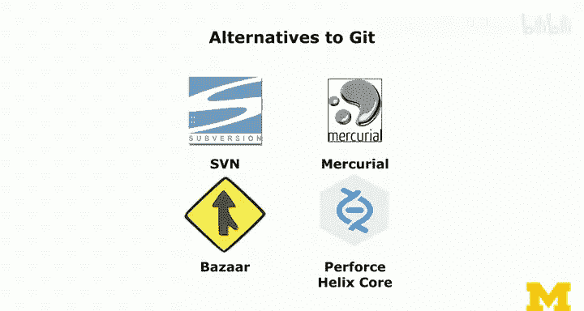

# 密歇根大学《AI驱动的数据分析：实用入门指南AI-Powered Data Analysis： A Practical Introduction》 - P11：10_辅助性技能培养.zh_en - GPT中英字幕课程资源 - BV1PdMUzUEbK

Now we've made it to the last module。 You've done a lot。

 You've learned how to identify data and acquire it。

 You've learned how to analyze data and visualize it。 And now in this final module。

 I'm going to teach you some practical support skills。

 I'm talking about saving and sharing your work。 I cannot overstate the importance of saving your work properly。

 You may be thinking， I know I know， hit the save button back up your data。

 But this isn't what I'm talking about。 Yes， those things are important too。

 But people often forget that just saving your work isn't enough。 It's how you save it as well。

 how you keep records of different versions that you make。

 I'm talking about the chaos that is starting something。

 saving that draft then making the final version， but actually know it's not the final version because someone gave you more edits。

 and then you make some more changes and look at your folder now。

The solution to your agonizing problems is a concept called version control。Technically。

 it's what you're doing manually when you name different versions of your document。

 but what if I told you there's a better way？There are automated ways of doing version control。😡。

Things like Google Docs that automatically save your progress and allow you to go back to previous versions are an example。

For data analysis， you can easily track changes to your project using something called Git。

Git is the most commonly used software program for this purpose。

 but there are also alternative options of version control like SVN， Mercurial。

 Bzaar and Purforce Helix corere。Another accessory in our toolbox is GitHub GitHub is an online platform where you can house your version controlled project。

 GitHub also serves as an online community and portfolio for people in the programming and data analysis world With that。

 let's get you set up with these tools。😊。

