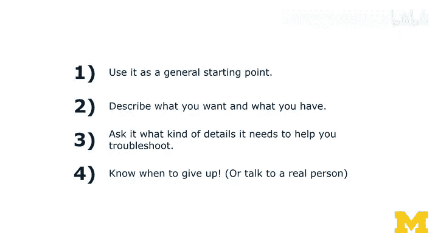

# 密歇根大学《AI驱动的数据分析：实用入门指南AI-Powered Data Analysis： A Practical Introduction》 - P12：11_生成式AI技术助手.zh_en - GPT中英字幕课程资源 - BV1PdMUzUEbK

AI is now your personal IT guy so many things that you to take ages to learn can now be figured out on your own with the right AI assistant。

Actually， before I put together this course， I'd never use Jupiter notebooks。 surprise I'm an R user。

 so all my experience has been in our studio， but figuring out how to use new software is pretty easy now using Gen AI is basically the new。

 Let me Google that for you。 It's just the most efficient way to figure things out。

I think back to the frustration of searching for how to set up a Python development environment。

You'd often come across a sea of generic guides and hope to find one of them was considering your exact setup。

With GenAI， this process is a lot more painless say you're setting up a Jupyter notebook。

 you can now ask， how do I configure Jupiter notebook for Mac O？Like I said at the beginning。

 this course is focused on using commonly available basic AI chatbots。

 but there's a lot of progress being made on building AI directly into coding environments。😡。

Things like GitHub Copilot can easily be integrated into visual Studio， and every few months。

 theres a new advancement on this front。Companies are now training GPT like models on their own documentation。

 which means no more reading through pages of docs or clicking around， searching。

 hoping you'll find what you need。Now， remember， JenAI tools are not oracles。

 there's no guarantee that they will get things right。

There are various things that affect their performance。

 especially if you're asking about something that's very niche or rare。

 it probably won't have enough references in its training data set to give you a good answer。

My advice is use it as a general starting point。Describe what you want and what you have。

And consider asking it what kind of details it needs to help you troubleshoot。But if all else fails。

 no one to give up or talk to a real person like an expert。

