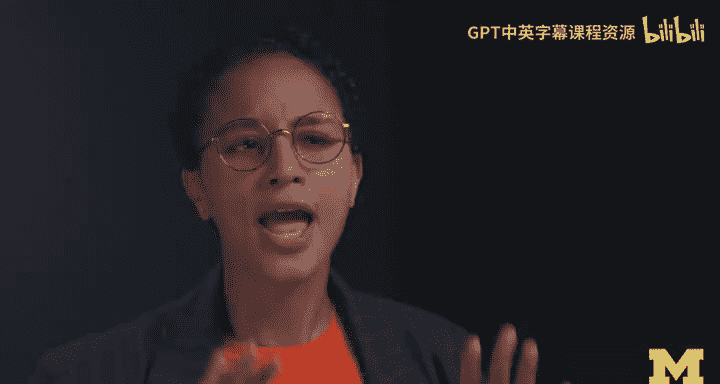
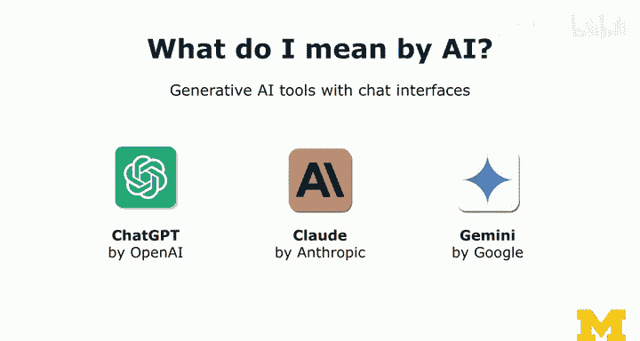
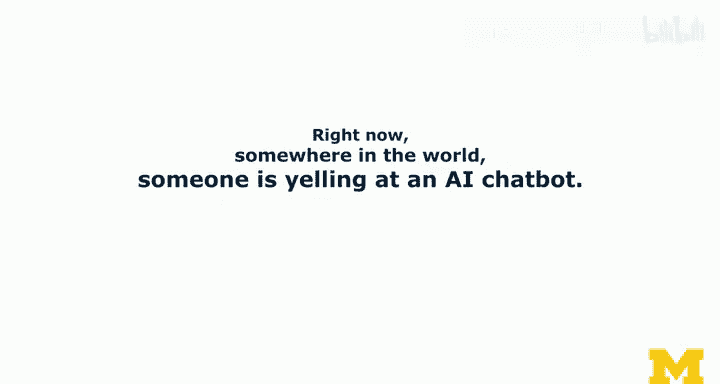
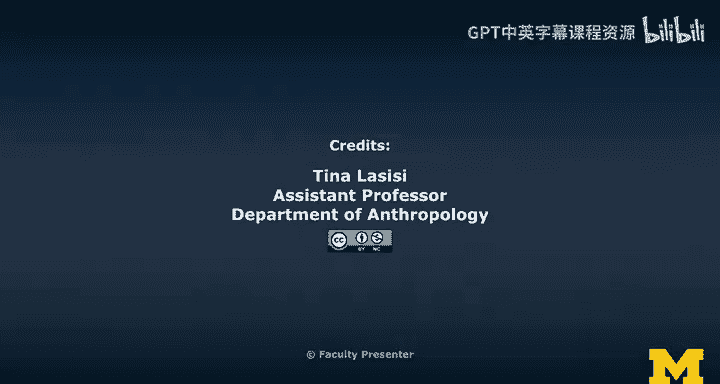

# 密歇根大学《AI驱动的数据分析：实用入门指南AI-Powered Data Analysis： A Practical Introduction》 - P1：0_欢迎学习本课程.zh_en - GPT中英字幕课程资源 - BV1PdMUzUEbK

I'm Dr。 Tina Asisi， Asant professorfessor of anthropology at the University of Michigan。

 and I'll be your instructor for this course。I got most of my skills and data analysis during my PhD when I had to learn Python from scratch to make an image analysis program to measure the shape of hair。

Since then I've worked on analyzing all kinds of data， including genetic data in forensic contexts。

 demographic data， and even 3D facial data among many other things fast forward to the end of 2022。

 everything changed when open AI dropped chatGPT to the public Since then I've been using this tool and a lot of other AI tools to speed up my analyses and also to do new more sophisticated analyses。

I've also been teaching my graduate students how to use these tools。

 which is part of the reason I decided to take all of those one on one sessions and wrap them into a course for the broader audience。

Now， is this course for you？I would say that this course would be useful for two broad categories of people。

 newbies， AK， complete beginners to data analysis and people who've done some data analysis。

 but want to know what's changed now that AI is in the picture。

 This course is structured to get you to first think about the context of data analysis。

 Then the actual specifics of analyzing and visualizing data。 and then finally， zooming back out。

 and this time thinking about the things that support data analysis but aren't necessarily part of it。

😡，When I say AI in this course， I will be referring specifically to generative AI tools that have chat interfaces unless otherwise specified。

So things like Open AI's ChaGBT， Anthropics Clade， and Google's Gemini， among many others。

Even in this subset of tools that we can classify as AI chatbots。

 there are a lot of variations in features and performance。

 and this landscape is changing really rapidly so instead of teaching you how to leverage something like the integrated features of chatGPT's premium data analysis。

 we're going just assume basic models with the fewest bells and whistles and we're going to focus on the much more broadly applicable skill of knowing what to ask anyone who's been on this earth long enough has asked someone else to do something and been misunderstood。

Does the following scenario maybe sound familiar to you？

Why did you do that What do you mean I did what you asked me to do。

That's not what I meant How was I supposed to know instructions unclear？Right now。

 somewhere in the world， someone is yelling at an AI chat bot。Don't let that person be you。

I'm not saying that AI is never wrong or that there isn't any room for improvement。

 but at least by the end of this course， you'll have a better overview of the factors you need to consider in data analysis each step of the way。

😡，Put another way the accessibility of AI means that everyone can delegate now you get to be the boss。

 but being a good boss means knowing how to delegate well。

 which means knowing what you want and asking with enough detail。

