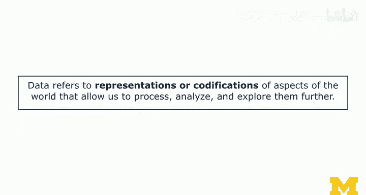
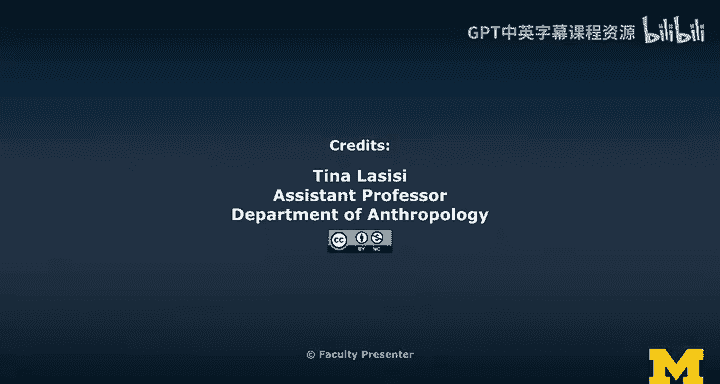

# 密歇根大学《AI驱动的数据分析：实用入门指南AI-Powered Data Analysis： A Practical Introduction》 - P2：1_究竟何为数据.zh_en - GPT中英字幕课程资源 - BV1PdMUzUEbK

What is data even before we can start on the analysis and even bringing in the generative AI。

 we need to get on the same page about the basics。 If you start digging around for a definition of data。

 you're likely going to encounter the data information， knowledge， wisdom pyramid。This framework。

 often credited to Russell Aoff， positions data as the base layer of the pyramid， factsact。

 completely raw， no seasoning， no context， no interpretation， nothing。According to the pyramid。

 data is then processed， organized or structured to become information From there。

 we use this information to build knowledge and ultimately we transform knowledge into wisdom。Now。

 I love a good pyramid scheme as much as the next girl。

 but it's important to note that this model has its limitations。Consider this。

 we sometimes view the world as containing information that we then distill into data。

 so what's going on？Well， the reality is that data and information are often used interchangeably。

 which speaks to the importance of understanding not just the words。

 but the concepts that they are trying to convey。So rather than sticking rigidly to this pyramid。

 let's expand our understanding of what we mean by data。The term data comes from the Latin datum。

 meaning something given。 This suggests that data can be seen as a given， which can mean a fact。

 but also more broadly a premise or a starting point。Jumping ahead to 1946。

 we see data being used to describe information in a digital context。

 processed or stored by computers。Add to this the fact that we often hear about sensory inputs like sites or smells as data that our brains process。

 or in debates， the demand for data implies a call for solid evidence。In scientific research。

 even physical samples like saliva or hair are considered data that we collect。

What ties these examples together is the concept of data as fundamental units of information。

 whether tangible or abstract。I would say consider data as anything recordable， be it observations。

 sounds， or even abstract ideas。 This flexibility allows us to creatively engage with the world。

 identifying potential data everywhere。At its core。

 data analysis is about collecting and deciphering recorded information to reveal patterns or insights。

 Humans have always done this from mentally organizing experiences to physically noting things down for pattern analysis。

So let's adopt a practical definition。Data refers to representations or codifications of aspects of the world that allow us to process。

 analyze， and explore them further。Extending this definition then。

 you can think of data sets as collections of comparable data。

For this course， I want you to focus on digital data。

 data that can be encoded in a machine readable binary format。As you think about data。

 consider what aspects of the world can be captured and encoded。

 ready for a computer to process as zeros and ones。

