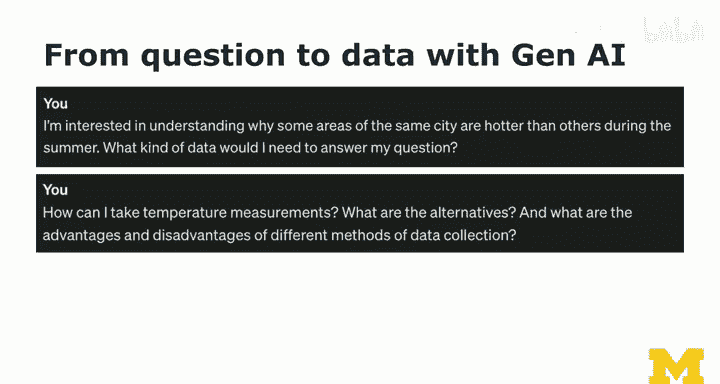
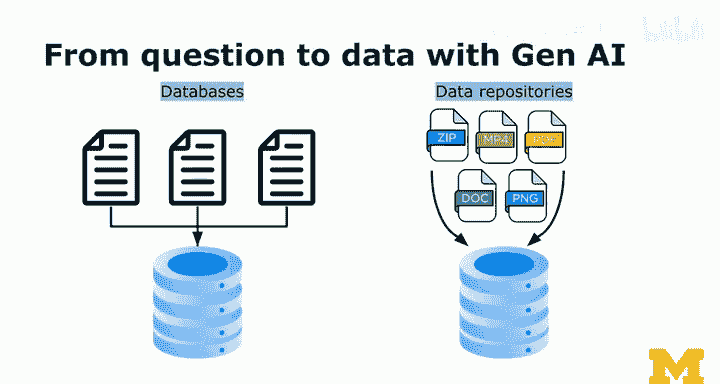

# 密歇根大学《AI驱动的数据分析：实用入门指南AI-Powered Data Analysis： A Practical Introduction》 - P3：2_数据采集与生成式AI.zh_en - GPT中英字幕课程资源 - BV1PdMUzUEbK

How do we get or acquire data and how could generative AI improve this process。

 We sometimes talk about data that can be captured like some wild animal。

 Sometimes we talk about it being collected like a basket of fruit。

 but also extracted like oil or even generated like electricity。

 We can even talk about acquiring data like some suspicious sum of money that landed on our lap。

What's important to remember here is the concept of recording and encoding。

 You're transforming things around you into digital data by recording the information in some way and encoding it in a computer processable format。

😡，Remembering the fact that data isn't just passively obtained in some pristine form should serve as a reminder that you need to think critically about where the data comes from and what it's supposed to represent。

Data doesn't spontaneously appear to us we humans are involved in the process that's undeniable。

 but the way we are involved and the extent to which we are involved is variable。

It can be as direct as counting items like the number of empty cups on your desk to using sophisticated tools that have automated processes of recording data like a heart rate monitor。

 or even a Geiger counter， which is an electronic instrument used for measuring ionizing radiation。

Even things as automated as a Geiger counter or heart rate monitor have embedded in them decisions that people made about what to measure。

Getting curious about what it is that's being recorded and what the potential limitations might be of the representation that you're capturing is something that's going to really improve your ability to generate valuable insights with data analysis you might have an idea of a question you want to ask and Gen AI can help you go from question to data。

😡，Maybe you're interested in why some areas of the same city are hotter than others during the summer。

You could use a text to text generative AI tool like chat GT or Claude to brainstorm your question using a prompt like。

I'm interested in understanding why some areas of the same city are hotter than others during the summer。

 What kind of data do I need to answer my question？

You take this as a starting point and then prompt further for specifics。

How can I take temperature measurements and you dig in critically to understand what your options are？

What are the alternatives and what are the advantages and disadvantages of different methods of data collection。

 depending on the tool that you use， it may be trained on data that can give you an answer on where to find existing data sets。

 or if it's integrated with a web browser， it can get you that information with a prompt like what are some publicly available sources of data that could help me answer my question。

😡。

You may want to play around with the terms data repositories and databases as well Both are terms for collections of data where a database tends to specify usually something more structured and specific like an inventory system used in a warehouse that uses a very particular consistent format while a data repository can contain a wide array of structured and unstructured collections of different types of data。

 for example， researchers often save things on websites like Zenoto where you can host images。

 spreadsheets， all kinds of modalities and formats。

Speaking of modalities and formats， let's break down those terms next。

