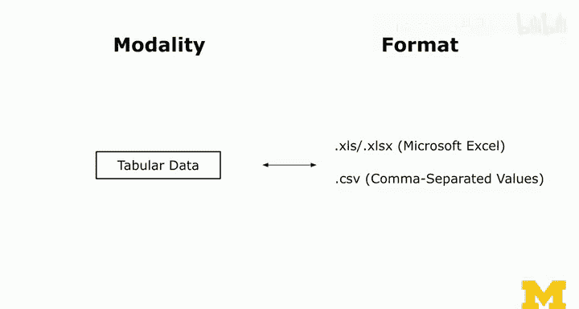

# 密歇根大学《AI驱动的数据分析：实用入门指南AI-Powered Data Analysis： A Practical Introduction》 - P4：3_数据内容与容器.zh_en - GPT中英字幕课程资源 - BV1PdMUzUEbK

Modality is about what the data represents， the content。

 while format is about how the data is stored and managed， the container。

 which can be done in different file types， that's the extensions you see at the end of the file name。

😡，Visual data includes formats like JPEG， PNG， and MP4， or AVI for videos。

Audio data is encoded in formats like MP3 or Wa。Text data can be stored in formats like plain text or Microsoft Word files or PDFs。

 These files can of course contain pictures and numbers。

 but they're usually considered unstructured text files In contrast to tabular data which can be represented in Excel files or CSv files they can contain structured data the specific thing about file types in this format is that they're tabular。

 meaning stuff is in a table。

Because most data analysis involves some kind of mathematical reasoning。

 no matter what kind of modality you're interested in。

 you'll most likely have to transform it to some numeric representation。In this short course。

 we'll focus on what you can do with data that's already coming to you in the form of spreadsheets containing numbers and text。

