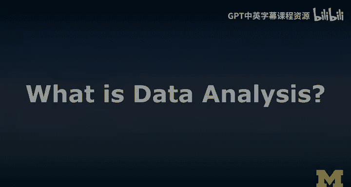

# 密歇根大学《AI驱动的数据分析：实用入门指南AI-Powered Data Analysis： A Practical Introduction》 - P5：4_数据分析定义解析.zh_en - GPT中英字幕课程资源 - BV1PdMUzUEbK

So now that you have an idea of what data is and why you might want to analyze it。

 let's dig into what data analysis actually is。Data analysis is investigation。

 You break things down into their components， you look at them from different angles and in different groups。

 and you look at patterns that allow you to tell a story。 So let's start with the basics。

 What are the building blocks of your data。Imagine a spreadsheet filled with weather data Each row in this spreadsheet represents a different observation。

 a specific instance or moment in which data is recorded。

The details in each observation like rainfall， temperature， atmospheric pressure， and location。

 these are what we call variables。By examining these observations and variables we begin to piece together a narrative for example。

 instead of looking at a single measurement of rainfall。

 we explore multiple data points across time to compare how rainfall varies in different locations。

This leads us to form analytical questions that guide our narrative。

 like which location receives more rainfall or how do temperature patterns vary by location？

These questions initiate comparative analysis where we explore differences and similarities to further our story。

Data analysis can also extend to inferential analysis where we attempt to predict or estimate an unknown based on known variables。

 for example， can we predict rainfall using data on temperature and atmospheric pressure？

In each of these steps， we creatively group and reorganize observations to reveal underlying patterns。

 transforming a broad inquiry into a precise data analysis question demands a keen understanding of how to manipulate data elements。

Genative AI can accelerate this process by acting as a dynamic sounding board。

 it helps you quickly explore various hypotheses and refine your analytical questions。For example。

 with your weather data， you might ask， given variables like rainfall， temperature and pressure。

 what patterns can we explore to understand temperature fluctuations？

These initial prompts are just a starting point。 you will learn to iterate your questions going back and forth with AI。

 refining them to better align with your analytical goals。For a seasoned analyst。

 this tool speeds up the process of identifying questions and data sets for beginners。

 it's like having an experience guide by your side suggesting which paths you might want to explore。

And now that you get the basics， imagine generative AI as your on demand data analytics consultant。

You are still in charge of the deep analysis and decision making。

 but AI makes sure that you're never starting from a blank page。

It'll be going from the dreaded。 What do you want to eat， Que2， Here's a menu。

 Does anything look good to you。With a basic understanding of what data analysis is。

 the next thing that we'll tackle is how to actually do it with an overview of the tools that you can use。

