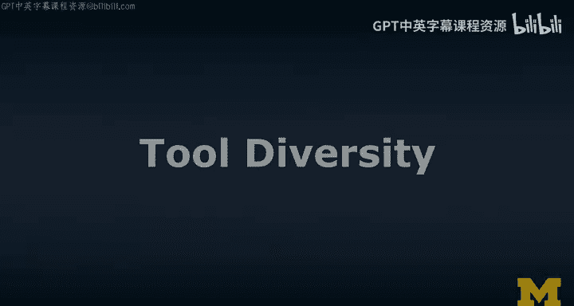
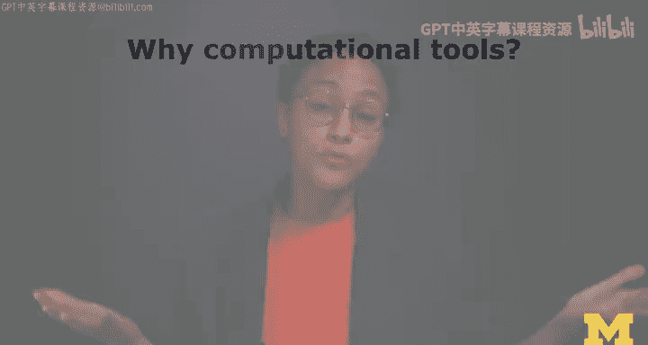
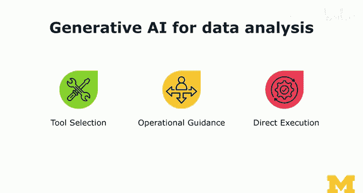
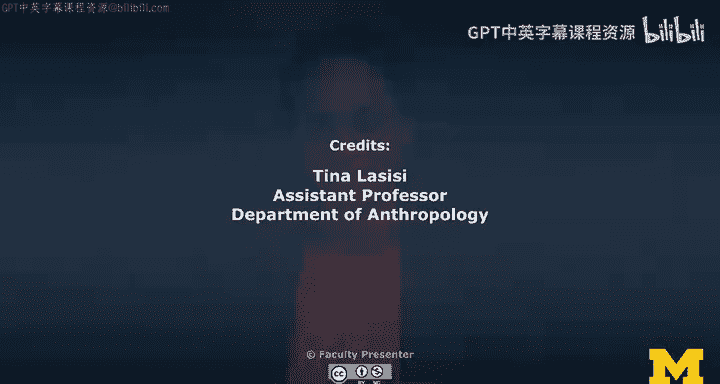

# 密歇根大学《AI驱动的数据分析：实用入门指南AI-Powered Data Analysis： A Practical Introduction》 - P6：5_数据工具的多样性.zh_en - GPT中英字幕课程资源 - BV1PdMUzUEbK

What tools do we need for data analysis？ Well， there was a time when people did it with pen and paper orquill and scroll。

 There are some people who can do certain types of analyses in their head。

 like your impressive friend who figured out that the value pack of shampoo and conditioner is actually more expensive than buying them separately。

 but there is a lot of reasons why you might want to use computational tools to do data analysis。

 One of them is data volume。 Theres simply too much data to handle or analytical complexity。

 The analyses required require too much complexity for noncomput methods。 or transparency。

 using computational tools can help you document your process。

 making your analyses clear and replicable。

There's also repeatability。Computational tools can allow you to replicate your own work and adapt it and scale it in bigger analyses。

To navigate the landscape of data analysis tools， we'll start with some of the basics。

Unless you can plug directly into the matrix， you're going to need to communicate with computers like the rest of us peasants with programming languages。

Programming languages are sophisticated systems for crafting instructions that computers can understand and execute。

At the core of these systems， like all digital computation is binary code。

 combinations of zeros and ones。These binaries represent both the data stored within computers and the instructions for processing that data。

Every operation a computer performs involves decoding these binary sequences On one end of the spectrum。

 there are low levell programming languages like assembly。

 which are just one step removed from direct binary code or the punch cards that early computation used。

😡，If you use these， you have to do a lot of really specific stuff and give instructions that you feel might be self evident or should be baked in。

 On the other end， there are high level languages like Python。

 they are further removed from that binary code and closer to how humans communicate。

This distinction between human readable and machine readable highlights a key aspect of computer programming。

 the level of abstraction。 libraries and packages act like shortcuts in programming。

 offering prewritten code blocks that save time and effort。

Then we have integrated development environments or IDEs Think of an IDE like a well equipped kitchen where all the tools that you need are within reach These tools are set up so that you can easily write your code。

 save it， document it， organize it and depending on which IDE use。

 they can even catch errors in your code， and some of them already have an AI copilot built right into them。

😡，Then we have software packages like SPSSS and SAS that offer high level specialized tools for statistical analysis。

 not much coding， just point and click what you want in the era of AI。

 it's actually really helpful to understand abstraction because that's what many AI tools actually offer。

 In other words， directly giving human language instruction of what we want to do。😡，Going forward。

 I want you to think about the following practical ways of leveraging text based generative AI for data analysis。

one。Tool selection。 You can use AI to identify the best software or programming language for your specific needs。

 For example， you can ask， Im trying to do X。 What would be a good language or tool for me to use。

AI search engines can help you get quick answers， helping you choose the right tools for your project requirements。

 Then there's operational guidance。 AI can guide you through the necessary steps to effectively use these tools。

😡，Ask questions like how do I input my data into our studio or how can I calculate a correlation in Python？

This approach is especially useful with popular tools because they're often better represented in the AI training data then there's direct execution with tools like chatGT。

 you can perform data analysis directly using their premium versions built in data analysis tool。😡。

These AI tools have a code interpreter built into them so they can integrate not just language。

 but also generate code。

For the rest of this course， we'll be thinking about operational guidance。

 and we'll be using Python as our programming language and Jupyter notebooks as our IDE。

