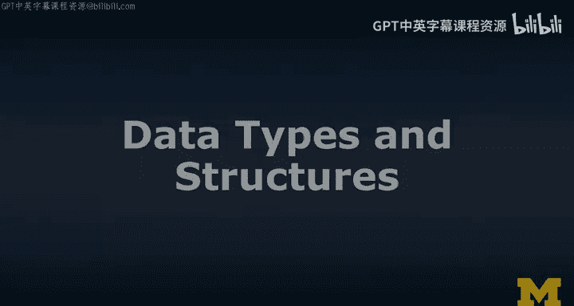
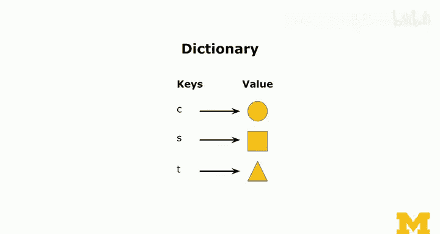

# 密歇根大学《AI驱动的数据分析：实用入门指南AI-Powered Data Analysis： A Practical Introduction》 - P7：6_数据类型与结构体系.zh_en - GPT中英字幕课程资源 - BV1PdMUzUEbK

So you've got your data， you've got your questions and your tools ready， what now？Well。

 the next step is to think about how you want to represent information in your data。

 which we'll cover in this video and how you want to prepare that data for analysis。

 which will leave for the next video。Let's begin with data types。

 Think of data types as the content in your data analysis process。

 You can think of data types as categories of data that come with specific rules about how they can be used and manipulated。

 For example， string data characters written out like names。 you can sort the mathematicalbeically。

 you can figure out how long they are， as in how many characters in a word。

 but then you also have numerical data， numbers， you know them， they include integers， whole numbers。

 and floating point numbers， decimals， they can be used for calculations。

 So valid operations might include averaging or summing these numbers。

 Then you have categorical data。😡，These include labels or names。

 So it's the difference between this and strings。 Well， it's how you use them。

 If you use them more than once， i。e。 to categorize things。

 We use categories to group and filter observations。Then we have binary data， AK， Boolean values。

 true or false。 These are used to track states or conditions and can be used in logical operations。

 if this， then that and or this is a non exhausthausive list。

 There are also file paths and variants of float like floatat 32 and F 64。 There's XML data。

 JO objects。 and a lot of other types that you might encounter。

 It all depends on the tools and the specific requirements of your analysis。 Essential。

 a data type can be any category of data that has specific attributes about how can be manipulated。

If data types are the content of your analysis， data structures are the containers designed to hold and organize this content。

 but it's important to remember that these containers themselves are types of data with their own specific attributes and rules。

 Some fundamental data structures that you're going to work with include arrays。

 They hold elements of the same type in a fixed size sequence， allowing for quick index based access。

 but limited flexibility。 Think of it as a table where the rows and columns mean specific things。

Listists， they're more dynamic than array， they can grow and shrink and can store elements of various types。

Then you have dictionaries， they function as key value pairs。

 they're ideal for fast retrieval based on unique identifiers they're especially useful for accessing data when you know the specific attribute that you need。

Think of it like looking up a friend's phone number based on their name。

 Why should you care about all of these things， Well， because inevitably。

 you will get an error that's because you gave an instruction that cannot be executed with the data type that you provided。

All of the data analysis you're going to do is a question of taking some kind of input。

 putting it through a series of transformations， getting an output and repeating it over and over again until you get what you want。

 Now， there are two final definitions that I want you to keep in mind， methods and objects。

If data types and structures are the objects， then methods are the operations or instructions for what you can do with them。

Understanding these concepts is going to be important for understanding how to use AI to help you with your data analysis。

 it will help you ask good questions and troubleshooting。

 and it will also help you understand troubleshooting instructions as you play around with different AI tools。

 try and use them as a friendly tutor to teach you about different data types and structures that might be appropriate for the kinds of analysis that you are interested in now that we have this basic terminology down in the next video we'll go into some more depth on all the ways that you can wrangle data。

😡。

