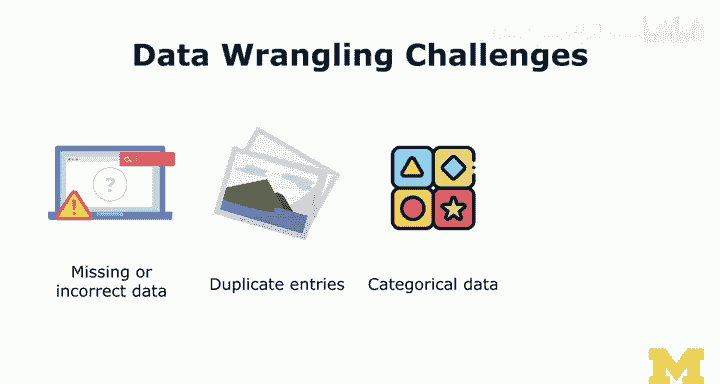

# 密歇根大学《AI驱动的数据分析：实用入门指南AI-Powered Data Analysis： A Practical Introduction》 - P8：7_数据整理技术.zh_en - GPT中英字幕课程资源 - BV1PdMUzUEbK

Think of data wrangling as。Giving your data a makeover。

Does that mean you can just give it a new haircut and call it a date。 No。

 it's not about making your data just look better。 It's got functional value。

 When you first get your data， it might be a mess， and wrangling is about getting that mess in order。

 When it comes to getting data in order， we face a couple of common hurdles。

 We often deal with missing or incorrect data。 We've got duplicate entries that can mess up your analysis。

 or maybe there's issues with categories in our data。

 like maybe you misspell a categorical name or write it three different ways。

 even though it's the same thing。 Sometimes we have to take the step of reshaping our data to suit our analysis。

😡。

You know what they're saying is garbage in， garbage out。

 so let's go through a little lesson to fix these common issues。

