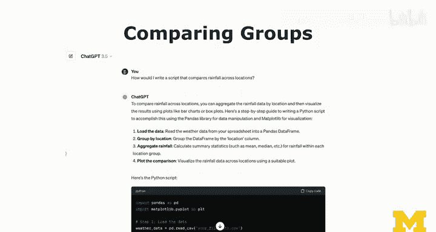
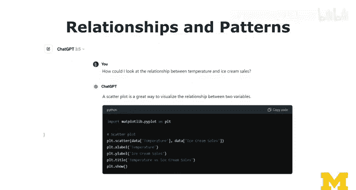
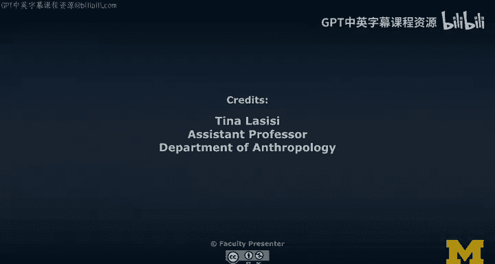

# 密歇根大学《AI驱动的数据分析：实用入门指南AI-Powered Data Analysis： A Practical Introduction》 - P9：8_数据分析实践.zh_en - GPT中英字幕课程资源 - BV1PdMUzUEbK

We've pondered data， collected it， even wangled it， and now finally the moment is here。Analysis。

The world is your oyster when it comes to data analysis。

 but to make sure you don't drown in your options， I want us to cover some of the basics。

Let's explore the bedrock of statistical analysis and I'll show you how JenAI can act as a copilot。

 guiding you through coding these analyses rather than just doing them for you。

Summary statistics give us quick insight into our data Let's say you have a data set of weekly temperatures instead of manually calculating the average。

 you can ask NAI，Hey， can you help me write a Python script to calculate the mean temperature in this data？

Then there's comparing groups comparisons and data can lead to important insights about differences and similarities between groups。

And identifying patterns or relationships can also reveal a lot about your data。

Imagine you're curious if higher temperatures influence ice cream sales with JenAI as your copilot。

 you might ask what's the best way to check for a correlation between temperature and ice cream sales using Python？

Here， JenAI would guide you to use correlation functions like this。

As your familiarity with basic statistics solidifies。

 venturing into advanced statistical modeling like regression analysis or predictive modeling becomes the next frontier。

Gen AI can teach you how you might say I want to predict next month's sales based on historical data。

 Can you walk me through setting up a linear regression model in Python？

Youve then got yourself a personalized tutorial。 I'm going to give you a few more examples of this before we move on to our next video on data visualization。

