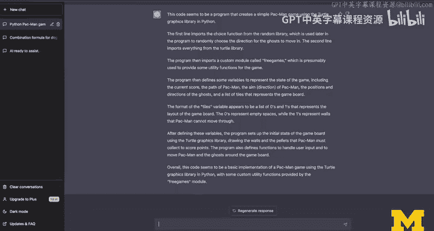

# 密歇根大学《ChatGPT 示教｜ChatGPT Teach-Out》中英字幕 - P10：9_选修：ChatGPT示例-编程实践(上).zh_en - GPT中英字幕课程资源 - BV1Rr421L7BX

Hi， everyone， Melissa here to bring you a programming example for chat GBT。

 So I'll begin by greeting chat GBT。 Hi chat GBT。What does this code do？Then I'll insert my code。

Chety Bt says this code seems to be a program that creates a simple packman game using the Turtle Graphics library in Python。

The first line imports the choice function from the random library。

 which is used later in the programme to randomly choose the direction for the ghost to move in。

The second line imports everything from the Trtle library。

The program then imports a custom module called Free Game。

 which is presumably used to provide some utility functions for the game。

The program then defineds some variables to represent the state of the game。

 including the current score， the path of packman， the aim direction of packman。

 the positions and directions of the ghosts and a list of tiles that represents the game board。

The format of the tiles variable appears to be a list of zeros and ones that represents the layout of the game board。

The zeroes represent empty spaces， while the ones represent walls that packmen cannot move through。

After defining these variables， the program sets up the initial state of the game board using the Turtle Graphics library。

 drawing the walls and the pellets that Pman must collect to score points。

The program also defines functions to handle user input and to move PAman and the ghosts around the game board。

Overall， this code seems to be a basic implementation of a PAman game using the Turtle Gics library in Python with some custom utility functions provided by the free games module。

😊，So。As we see here， Chet GPT provided a very nice summary of what the code does。

 and it also provides some insight about what specific lines do。

 And so this could be a very invaluable tool for beginners to programming。

