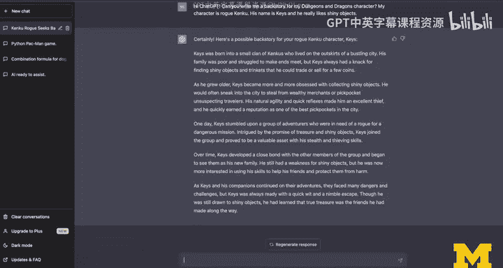

# 密歇根大学《ChatGPT 示教｜ChatGPT Teach-Out》中英字幕 - P12：11_选修：ChatGPT示例-龙与地下城角色背景.zh_en - GPT中英字幕课程资源 - BV1Rr421L7BX

Hi， everyone， Melissa here。 And today， I'm going to be giving you an example of how to use chat GPT for dungeons and dragons。

Specifically， how can we use chat GPT to develop really interesting and engaging character back storiesies。

😊，So I'll begin by greeting chatt GT。 Hi chat GPT。Can you write me？A backstory。

They're my dungeons and dragons character。My character is a rogue cancoo。

 and for those who don't know， a canoo is a crow like humanoid character。His name is Keys。

And he really likes shiny objects， as crows typically do。Chet GPT says， certainly。

 here's a possible backstory for your rogue cancoo character keys。

Kis was born into a small clan of Kencs who lived on the outskirts of a bustling city。

His family was poor and struggled to make ends meet。

 But Keys always had a knack for finding shiny objects in trinkets that he could trade or sell for a few coins。

As he grew older， Kis became more and more obsessed with collecting shiny objects。

 He would often sneak into the city to steal from wealthy merchants or pick pocket unsuspecting travellers。

His natural agility and quick reflexes made him an excellent thief。

 and he quickly earned a reputation as one of the best pick pockets in the city。😊，One day。

 Keys stumbled upon a group of adventurers who were in need of a rogue for a dangerous mission。

Intrigued by the promise of treasure in shiny objects。

 heughes joined the group and proved to be a valuable asset with his stealth and thieving skills。😊。

Over time， Keys developed a close bond with the other members of the group and began to see them as his new family。

He still had a weakness for shiny objects， but he was now more interested in using his skills to help his friends and protect them from harm。

As Keys and his companions continued on their adventures， they faced many dangers and challenges。

 But Keys was always ready with a quick wit and a nimble escape。

Though he was still drawn to shiny objects， he had learned that true treasure was the friends he had made along the way。

So， as we can see。Just from the small prompt I provided Chet GT with。

It fleshed out a pretty engaging and interesting backs storyory for keys。

