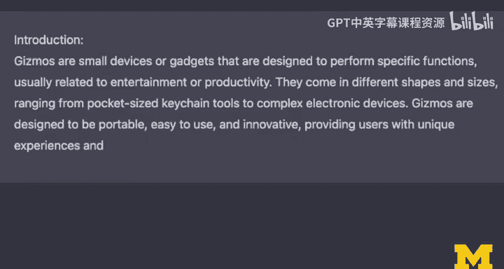

# 密歇根大学《ChatGPT 示教｜ChatGPT Teach-Out》中英字幕 - P15：14_ChatGPT的公平使用.zh_en - GPT中英字幕课程资源 - BV1Rr421L7BX

So another big question is whether Cha EBT is an equitable tool。A lot of people believe that it's。

It's definitely equitable because anybody can type in a search query or like a prompt and it will kind of provide a response like a well- written response no matter what your background or no matter what your writing skill and maybe that could be like a support tool but there's actually been a lot of research or the past few years that writing good search prompts or search queries is a skill and it's very very related to your writing or communication ability and so you can imagine a situation where someone。

Asks ChatGBT to write an essay prompt and they put in something very generic or not easily understood。

 and then the chatttBT would suggest something that isn't like a very detailed response whereas somebody else kind of knows exactly what they want to hear or knows exactly the type of instructions they're looking for and they can give a very more detailed query into chatttBT。

 so this kind of relates back to a lot of research on the equity and technology that oftentimes tools even though they're helpful like having the internet having a computer。

 it's definitely helpful to accessing more information。

 but it's often considered like more of an amplification of your existing skills your existing resources and so I can see chattGBT being just another example of this happening。

