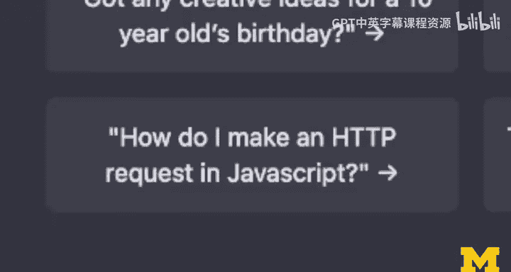

# 密歇根大学《ChatGPT 示教｜ChatGPT Teach-Out》中英字幕 - P16：15_道德与非道德应用场景.zh_en - GPT中英字幕课程资源 - BV1Rr421L7BX

So there are situations where chat ET can be considered ethical or unethical。

 and there is still a lot of work to be done to understand when these situations are。Questionable。

 I would say that for my experience， I would say that chat GBT could be considered unethical if the person is expecting a personally written message or if they're using the writing as a measure of the。

Writers's ability so， for example， for like a student assignment or foreign college essay。

 people are reading these this content to identify is this person able to form coherent thoughts are they able to structure a message are they able to kind of communicate at in a professional manner so this can also be for job applications and so you can imagine if someone just types in the the prompt into chatyBt and copy and paste that and put that in that the person who's reading those responses wouldn't really understand whether or not the person who has sent it has those communication abilities one of the other potentially unethical areas is if ChatyBt is being used to write personal messages so let's say if you writing a。

A personal email or a personal message to a friend or family member。

 you wouldn't really want those messages to be written by an AI。

And so you can imagine it being problematic or hurtful if you find out later on that that person didn't even come up with the stuff that they had sent in the message。

 so maybe in the future you might imagine that they are certain acceptable places to use chat GBT I could imagine like things that are a bit repetitive that nobody really cares if somebody had written that particular piece of writing like let's say summarizing a very long discussion for work or。

Easy search queries like how to instructions if you go on chat EBT。

 they have some suggestions like how do you do this。

 can you tell me more about quantum physics and kind of using it as like some sort of learning tool I think those are fine。

 but of course like you know that all answers have some sort of they take some sort of information from somewhere so it could be biased and you always have to take that into account So another area that it might be unethical or problematic to use chat EBT is if people are sending messages that are written by chat EBT without really reviewing what it says you can imagine that。

After a period of time， if you kind of gotten in used to the quality of whatever the tool has created that you would just put in the prompt table it。

 create like a whole report and send it without even reading it yourself and that can probably lead to a lot of miscommunication errors in the future and so maybe if we do see a situation or a future where we use ChattBT regularly that you would have to require the person to read over and kind of understand what they're sending。

 even if they didn't write all of it。To kind of have them go through the process of signing off before they send it and so I can see like a situation or many situations now where you might start off with what chatGBT has written。

 and then you might edit it to make it more accurate or more sounding like you had written it yourself to like your personal touches but always making sure that you understand what you are sending and kind of agreeing with what you've kind of co-written with chat GBT。

