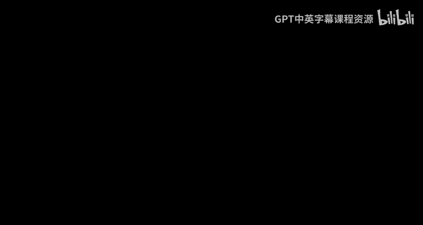

# 密歇根大学《ChatGPT 示教｜ChatGPT Teach-Out》中英字幕 - P19：18_输出内容所有权与货币化.zh_en - GPT中英字幕课程资源 - BV1Rr421L7BX

Yeah， so who owns the chat GT output is an interesting and somewhat open question。 I mean。

 from a copyright perspective。Right now in US copyright law。

Anything that's not created by a person can't get copyright protection。

 so it's not clear that there's a copyright ownership of what chat GT produces。

 of course the chat GT software， the copyright is held by open AI and that's true for any of the other AI software programs that are out there。

 the ones that create art or music or any number of other things， those people who created their。

Code actually get to hold the copyright in the code。 But the output， it's different。

 It just is different because the copyright office won't recognize it as a copyrightable work if the work is authored by a nonhuman。

 One of the challenges I think that we face in， in plumbing this particular set of depths is that how will we know what portions of a work were created by the AI and what portions were created by a person。

 that's very difficult to know right now， if if I put paint on my the pause of a cat。

 and I let that cat scratch away at at a canvas。If it's the cat that did the work， well。

 then there'll be no copyright in that。But。If I don't say that it was the cat that did that。

 and I pretend that I， that I painted it， I'm not sure how the US Copyright Office would。

 would know whether or not that was a copyrightable work。 So this， this is a challenge for us。

In terms of monetizing what's created through chat Gpt。

 I'm not aware that there is any prohibition on using the materials that chat GptT has created。

 Actually， it would be worth looking at the terms of service because they may prohibit it。

 Open AI will absolutely find a way to monetize this。 They have investors。

 Microsoft has invested in them already at to the tune of billions of dollars。

 So there is no question they will find a market for monetizing this to generate revenue。

 whether I will be able to monetize the output。 it's hard to say in playing with these technologies。

 And I've played with several technologies。 They create things that are unique and interesting things you might want to know。

 like， for instance。I asked Chat Ept the other day to write an additional chapter to Tolkikins the Hobbit。

 the chapter that takes place after the last chapter after B Boow has come home and between the time that he's returned home and the time that Gaandollf comes back to visit him years later。

 I wanted to know what happened in the ensuing years。

 And it created a wonderful narrative in the style of Tolki， because I said。

 do this in the style of Tolkien。 And so that was interesting。

 What are the ethical issues with respect to monetizing the output of Chat Gpt， I think in general。

 we need to cite our sources。 We need to acknowledge our sources。

 And so there's the risk that somebody isn't doing that。

 That is that they're taking stuff that's produced by Chat Gpt。

 Preing that they were the author of that work。 and then putting it out there。Now。

 it's not necessarily unlawful to do that。 We'll have to see how the law plays out in this area。

 I imagine there's going to be a whole lot of development and potentially panic around these issues。

 but there certainly are these kinds of integrity issues and authenticity of the work created。

 we always worry about that。 in some ways going to chat Ept is a lot like going to somebody else。

 it can produce information in the same way that other humans can produce that information。

 And in a way that looks an awful lot like what humans might say or in the case of the art AI。

 what humans might produce on their own。 And so the idea of giving people credit or or fame or opportunity or access as a result of what they've produced that actually was produced by AI。

 I think that raises some concerns for us as a society。

 and it's something that we ought to be thinking about。 But Im。

I'm not sure the sky is falling in the same way that there are ghost writers and ghost painters and ideas spring forth from the individuals we talk to and we don't necessarily even remember where we got that great idea what's interesting about Cha GPT is it really doesn't come up with ideas on its own。

 but maybe neither do we。